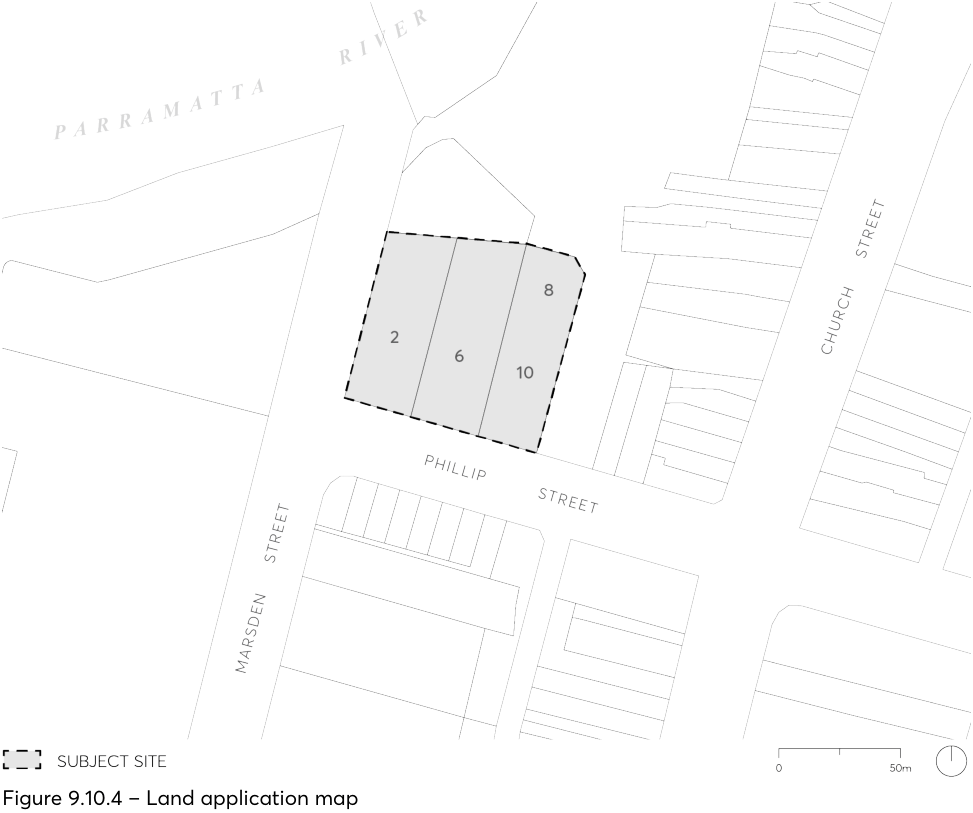

#### 9.10.4 2-10 PHILLIP STREET

This Section applies to land at 2-10 Phillip Street, Parramatta (the ‘subject site’) as shown in Figure 9.10.4.

> [Picture on page 222: a picture, saved as a picture (images/part-09-parramatta-city-centre-page-222-5.gif, 150 dpi).]

Figure 9.10.4 – Land application map

This Section is to be read in conjunction with other sections of Parramatta DCP 2023 as well as the relevant provisions in Parramatta LEP 2023.  If there is any inconsistency between this Section and other parts of the DCP, this Section prevails.

This Section establishes objectives and controls to be interpreted during preparation and assessment of development applications and supports the objectives of the LEP.

This Section should also consider the Principles for Site Specific Development Control Guidelines 2016, prepared by TKD Architects.

2-10 PHILLIP STREET
