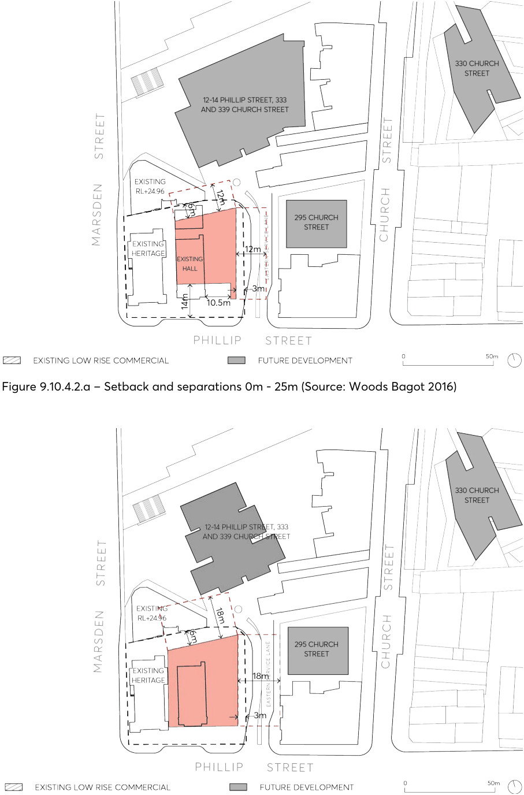
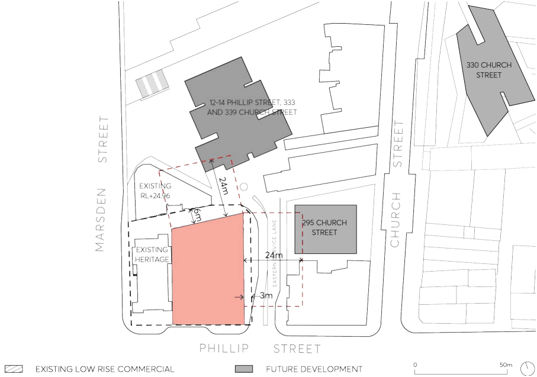
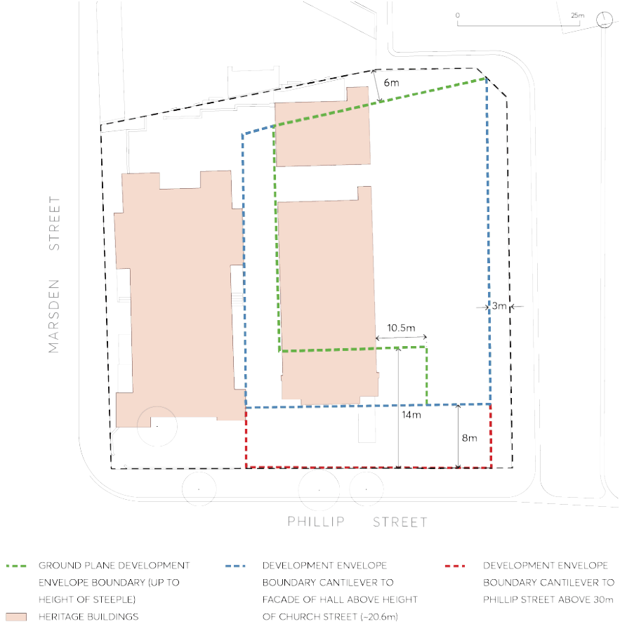
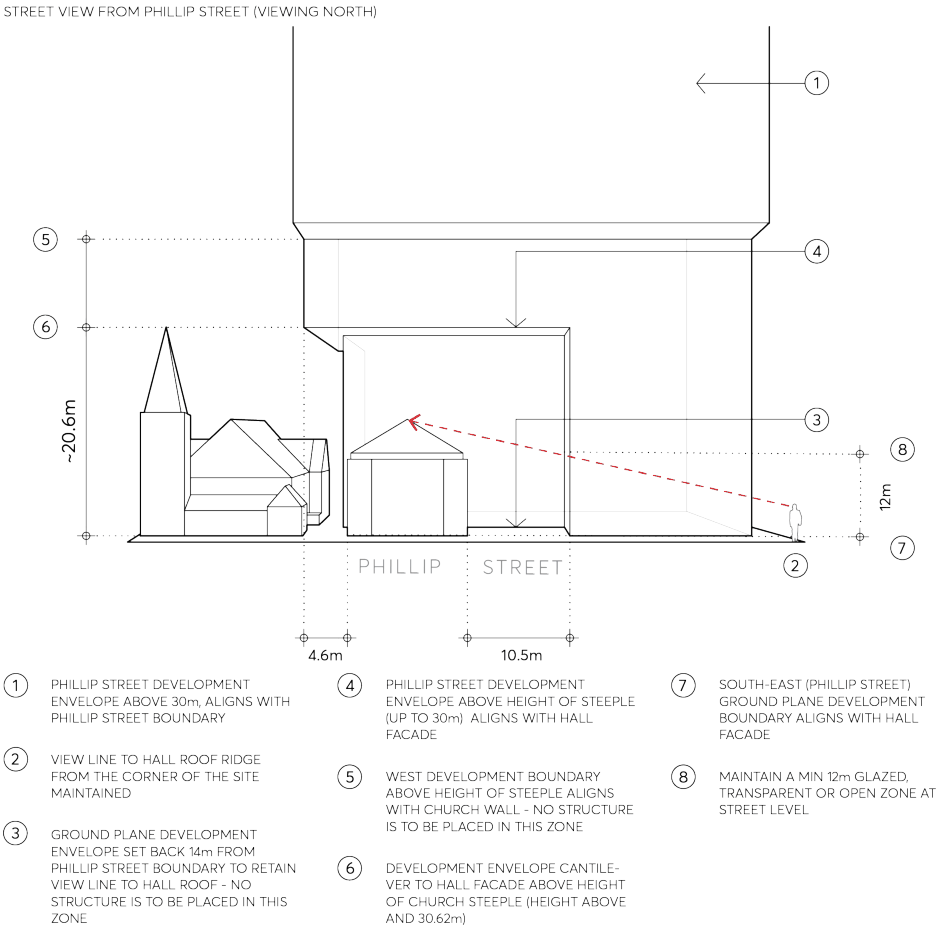
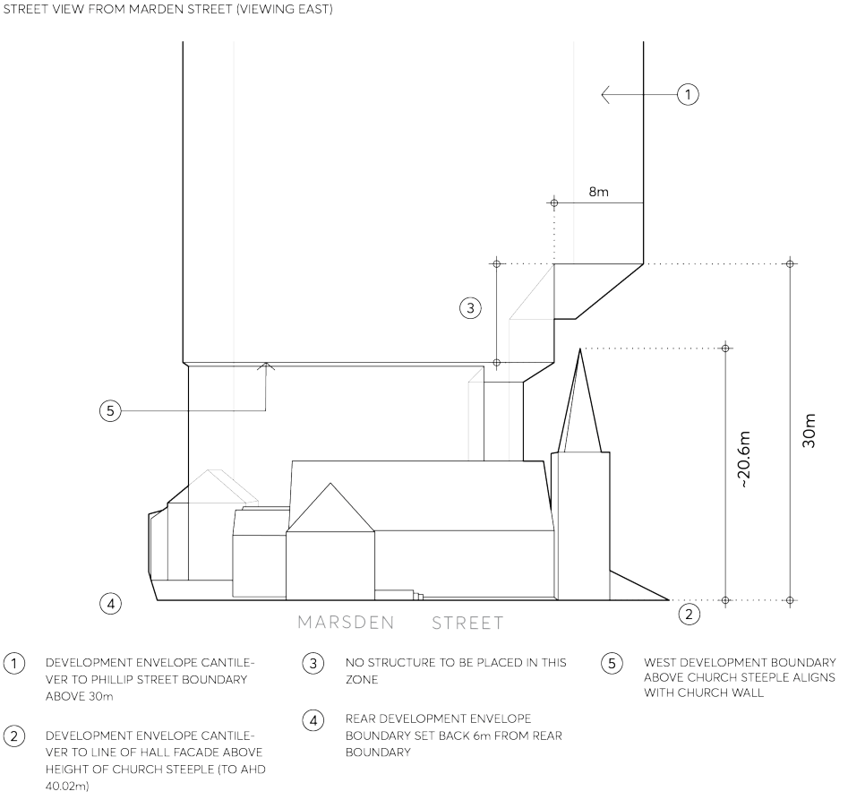
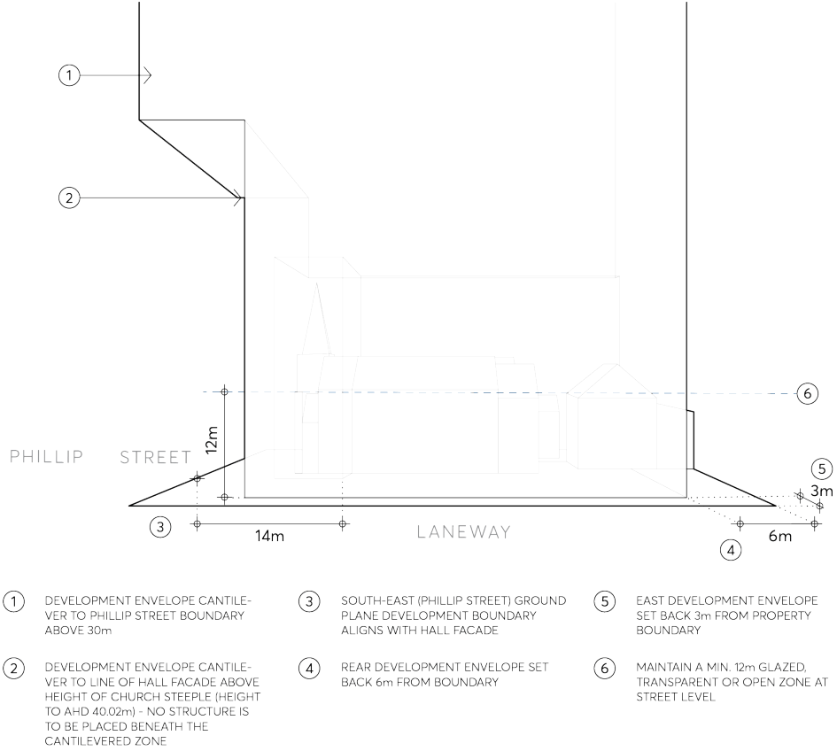
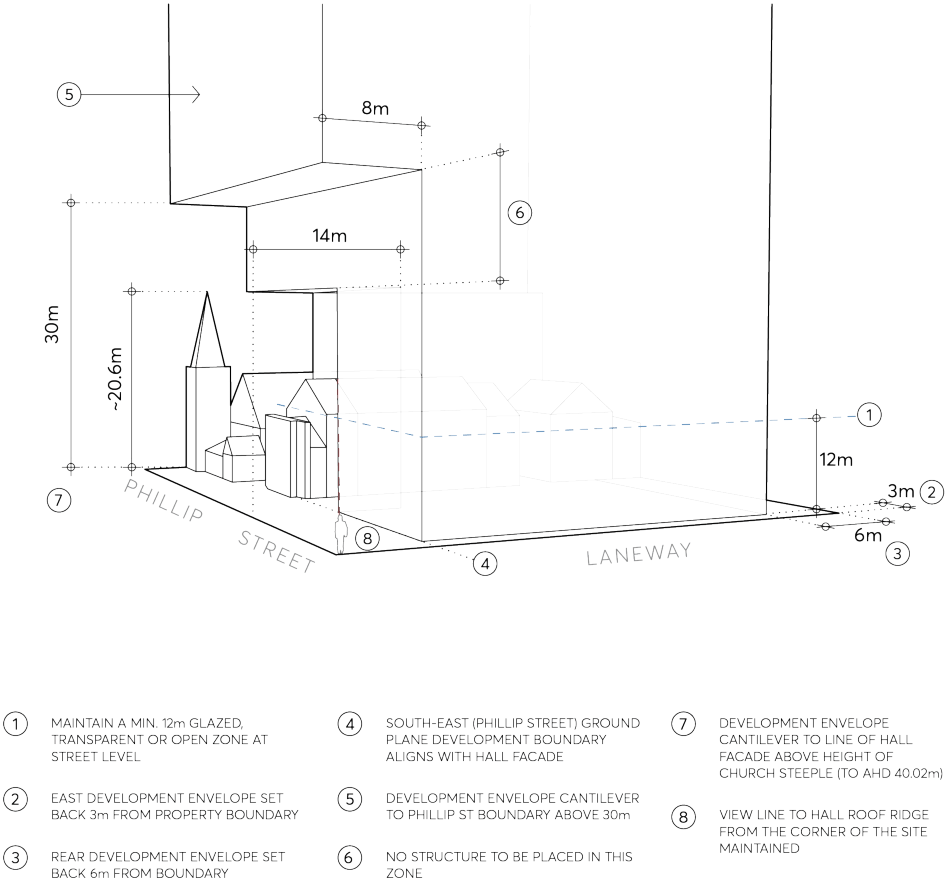
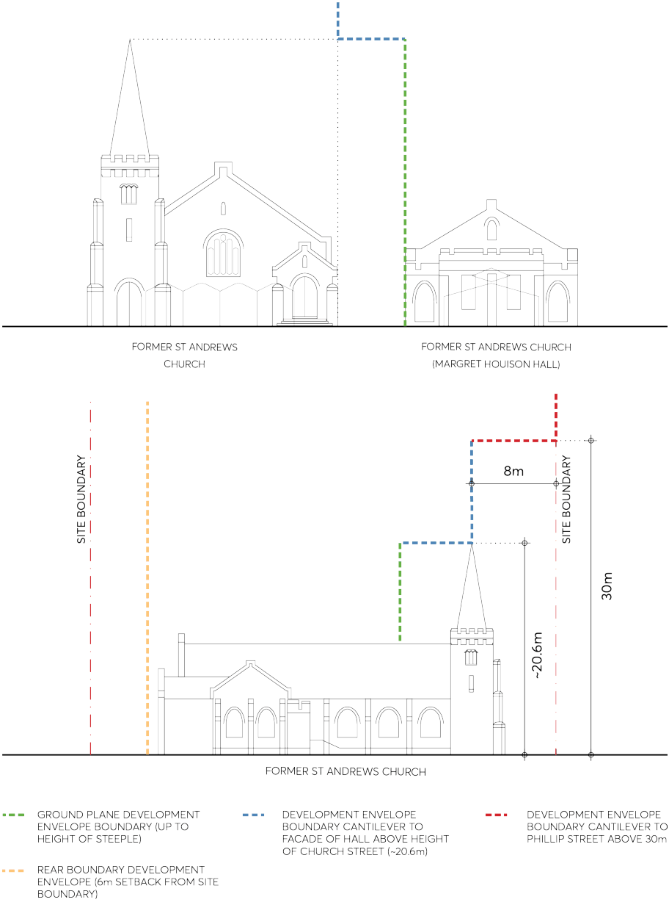
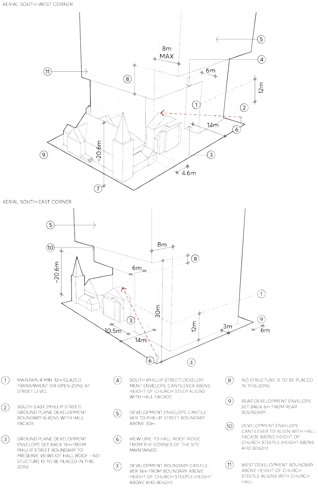
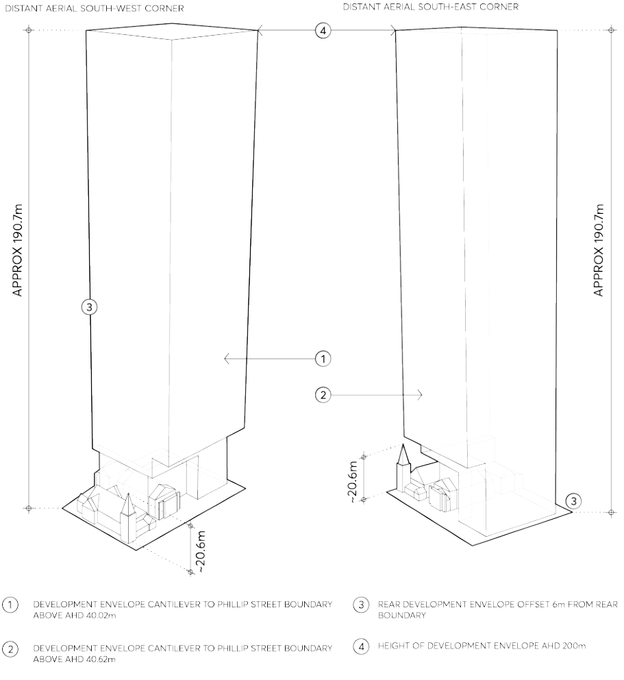

#### 9.10.4.1 DESIRED FUTURE CHARACTER

Future development at 2-10 Phillip Street is designed to respond to the surrounding future built form context and existing heritage significance and contributes to creating a gateway to the Parramatta City Centre when crossing the Parramatta River to reinforce the City Centre’s prominence and role. New development enhances the existing heritage buildings on the site, the former St Andrew’s Church and hall, with appropriate building envelopes, conservation of heritage fabric and adaptive reuse and in accordance with this Section and the Principles for Site Specific Development Control Guidelines, 2016, prepared by TKD Architects.

Site Objectives

O.01 To facilitate redevelopment of the site as a high-quality mixed use development. O.02 To conserve and enhance the existing heritage item (former St Andrew’s Church and Hall group) located on the site and interpret Parramatta’s indigenous and cultural heritage in the design of buildings, public spaces and public art.

O.03 Encourage future uses that are compatible with the Parramatta City Centre and heritage significance of the existing buildings.

O.04 Protect and enhance views to the site’s heritage buildings from the public domain. O.05 To ensure development does not encroach on the visual or built integrity of the Church.

Controls – Heritage

C.01 Heritage fabric

a) Conserve the heritage significance of the site by retaining identified heritage buildings and settings.

b) Ensure future development of the site enhances the appreciation of the heritage qualities of the site, its values and significance.

c) Ensure the conservation of the identified significant building elements, fabric, spaces, internal relationships and context.

d) Maintain the integral relationship between the significant buildings and their context.

e) Accommodate the activities, services and fittings, which are essential to the new use without damaging significant spaces, elements, or fabric.

C.02 Interpretation

a) Interpret Parramatta’s indigenous and cultural heritage in the design of buildings, public spaces, and public art.

b) Develop an interpretation program that derives from the special qualities and associations of the site for the people of Parramatta and the region.

C.03 Archaeology

2-10 PHILLIP STREET

a) Conserve and where appropriate, adaptively re-use archaeological resources in public interpretation to enrich public spaces.

C.04 Future uses & adaption of building components

a) Future uses should be compatible with the nature and significance of the building components and should enable the building to remain a vital and important component of the Parramatta City Centre.

b) The adaptation of all building components is acceptable, with compatible new uses selected that utilise the original character or permit a creative and responsible re-use of the fundamental architectural, functional and spatial characteristics.

c) Alterations to the primary external facades to suit new uses may be permitted to meet approved access or similar requirements, provided these are subservient to the primary architectural features and composition of the existing facades and the structure and the quality of the architectural design, materials and detailing of the alterations respects the quality and architectural design of the existing façade.

d) Adaptation of the buildings’ interiors should ensure that the original fabric or significant architectural and spatial features are retained and interpreted as far as possible.

C.05 Possible core location

a) The core location shall be optimised to ensure suitable conservation of heritage fabric.

b) In finalising core options, new development should also consider the additional heritage and core analysis provided in the Principles for Site Specific Development Control Guidelines, 2016, prepared by TKD Architects.

c) Any intervention in the Hall should aim to minimise heritage impacts by careful detailing of the core with extensive use of glass and discreet structural interventions to maximise the visibility of the original fabric and spatial volume. The rear section of the Hall has been extensively altered in the past, with construction of kitchens and basement toilets, so new modifications should be located in this part of the Hall to minimise disruption of more intact fabric. Any movement of the core to the East would reduce adverse impacts on the Hall.

d) Externally, as the core and ground level building envelope are set back 14 metres from the Phillip Street boundary, the Church and Hall roof must be able to be ‘read’ from the eastern service lane and Marsden Street corners (see Figure 9.10.4.7).

C.06 Vehicular access

a) Vehicular access may be from the eastern service lane in the north-east corner of the site.

C.07 Views

a) Protect and enhance the views of the site’s heritage buildings and their street presentation (see Figures 9.10.4.4 to 9.10.4.7 in Control C.09 Development Envelope Guidelines).

b) The view of the Hall roof should be retained, and the setback from the street boundary should be approximately 14 metres up to a height of approximately 30 metres (see Figure 9.10.4.7).

2-10 PHILLIP STREET

C.08 Development in the vicinity of the heritage items

a) New development should generally not encroach on the visual and built integrity of the church (see the development envelope controls in Control C.09). The internal site boundary with the Church Hall should determine the side perimeter curtilage, to constrain adjacent development above the ground plane and maintain the spatial relationships between the site’s heritage buildings.

b) The church and hall should both be able to be ‘read’ from the surrounding public domain. Double or triple height glazing should be provided to lower levels to allow greater exposure of the hall buildings from different areas of the public domain.

c) Development should provide a transition in building height from a heritage place to the tower structure through the use of podiums, awnings, voids or similar design features, and not create an overbearing appearance.

d) Any cantilever element to the tower should form a respectful relationship with the former St Andrews Church through consideration of separation, massing, and materiality (See Figures 9.10.4.4 to 9.10.4.10 in Control C.09 Development Envelope Controls). The prominence of the Church spire should not be compromised by a tower cantilever. There should be no tower cantilever over the Church.

e) The extent of any tower cantilever should be constrained and regulated by nominated critical view lines that must be protected, including the view of the Hall roof from the corner of Phillip Street and the eastern service lane, and the clear silhouette of the Church steeple viewed from Marsden Street. The tower cantilever toward Phillip Street should not extend past the line of the facade of the Hall up to a height of 30 meters. The tower cantilever above this height could extend to the Phillip Street boundary. See Figures 9.10.4.4 to

9.10.4.10 in Control C.09 Development Envelope Guidelines.

f) The amenity of the surrounding buildings, lanes and public spaces should be protected with appropriate setbacks from the property boundaries. The set back from the rear boundary should be 6 metres, and 3 metres from the eastern service lane boundary. See Figures

9.10.4.2 to 9.10.4.10 in Control C.09 Development Envelope Guidelines.

C.09 Development Envelope Controls

a) Future development setbacks and separations should be generally consistent with the building separation controls shown in Figure 9.10.4.2.a, 9.10.4.2.b and 9.10.4.2.c.

2-10 PHILLIP STREET

> [Picture on page 226: a picture, saved as a picture (images/part-09-parramatta-city-centre-page-226-2.gif, 150 dpi).]

Figure 9.10.4.2.a – Setback and separations 0m - 25m (Source: Woods Bagot 2016)

Figure 9.10.4.2.b – Setback and separations 12-25m (Source: Woods Bagot 2016)

2-10 PHILLIP STREET

> [Picture on page 227: a picture, saved as a picture (images/part-09-parramatta-city-centre-page-227-2.gif, 150 dpi).]

Figure 9.10.4.2.c – Setback and separations over 25m (Source: Woods Bagot 2016)

b) The built form should be generally consistent with the building envelopes shown in Figure

9.10.4.3 to Figure 9.10.4.10.

2-10 PHILLIP STREET

> [Picture on page 228: a picture, saved as a picture (images/part-09-parramatta-city-centre-page-228-2.gif, 150 dpi).]

Figure 9.10.4.3 – Existing ground floor plans with building guidelines (Source: TKD Architects)

2-10 PHILLIP STREET

> [Picture on page 229: a picture, saved as a picture (images/part-09-parramatta-city-centre-page-229-2.gif, 150 dpi).]

Figure 9.10.4.4 – Maximum building envelope – Ground plane from Phillip Street NTS (Source: TKD Architects)

2-10 PHILLIP STREET

> [Picture on page 230: a picture, saved as a picture (images/part-09-parramatta-city-centre-page-230-2.gif, 150 dpi).]

Figure 9.10.4.5 – Maximum building envelope – Ground plane from Marsden Street NTS (Source: TKD Architects)

2-10 PHILLIP STREET

> [Picture on page 231: a picture, saved as a picture (images/part-09-parramatta-city-centre-page-231-2.gif, 150 dpi).]

Figure 9.10.4.6 – Maximum building envelope – Ground plane view from laneway (viewing west) (Source: TKD Architects)

2-10 PHILLIP STREET

> [Picture on page 232: a picture, saved as a picture (images/part-09-parramatta-city-centre-page-232-2.gif, 150 dpi).]

Figure 9.10.4.7 – Maximum building envelope – Ground plane from corner Phillip Street and laneway (viewing north west) NTS (Source: TKD Architects)

2-10 PHILLIP STREET

> [Picture on page 233: a picture, saved as a picture (images/part-09-parramatta-city-centre-page-233-2.gif, 150 dpi).]

Figure 9.10.4.8 – Existing elevations with new building guidelines (Source: TKD Architects with base drawing from Paul Davies)

2-10 PHILLIP STREET

> [Picture on page 234: a picture, saved as a picture (images/part-09-parramatta-city-centre-page-234-2.gif, 150 dpi).]

Figure 9.10.4.9 – Maximum building envelope – Ground plane, south west and south east corner elevations NTS (Source: TKD Architects)

2-10 PHILLIP STREET

> [Picture on page 235: a picture, saved as a picture (images/part-09-parramatta-city-centre-page-235-2.gif, 150 dpi).]

Figure 9.10.4.10 – Maximum building envelope south west and south east corner elevations (Source: TKD Architects)

184-188 GEORGE STREET
