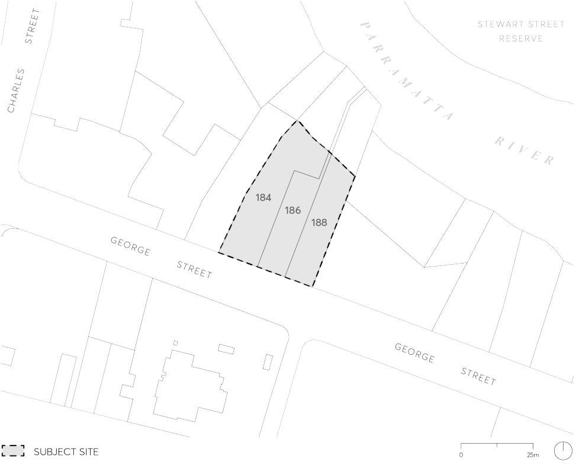

#### 9.10.5 184-188 GEORGE STREET

This Section applies to land at 184-188 George Street, Parramatta. The site comprises three allotments of land between George Street and the Parramatta River foreshore reserve as shown in Figure 9.10.5.

> [Picture on page 236: a picture, saved as a picture (images/part-09-parramatta-city-centre-page-236-5.gif, 150 dpi).]

Figure 9.10.5 – Land application map

This Section is to be read in conjunction with other sections of this DCP as well as Parramatta LEP 2023. If there is any inconsistency between this Section and other sections of the DCP, this Section prevails.
