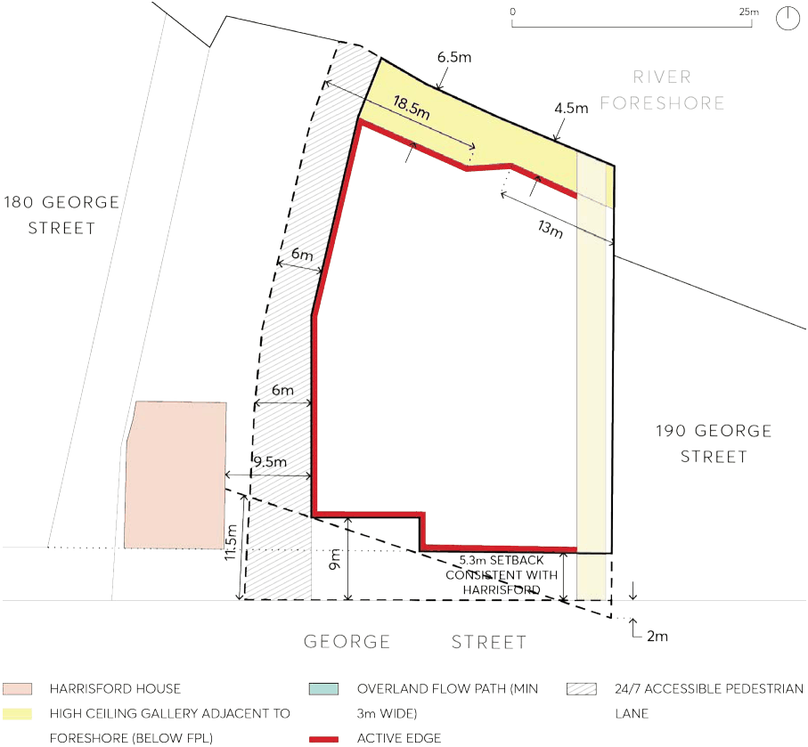
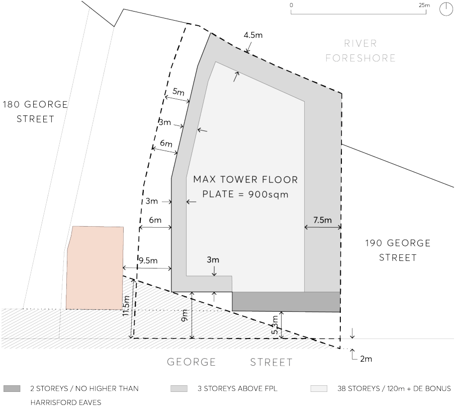

#### 9.10.5.1 DESIRED FUTURE CHARACTER

Redevelopment of the site provides an appropriate relationship to the state significant heritage item known as ‘Harrisford’ to the west of the site. The future built form maximises the curtilage to ‘Harrisford’ and ensures that ‘Harrisford’ remains prominent in the George Street streetscape. Both podium and tower setbacks to ‘Harrisford’ are maximised to achieve this outcome as well as suitable setbacks to George Street. A through site link adjacent the site’s western boundary, provides a midblock connection between George Street and Parramatta River and creates an additional public interface to ‘Harrisford’.

184-188 GEORGE STREET

Future development provides an appropriate interface to the public domain along both George Street and Parramatta River. High quality articulated facades are provided on all elevations which give public domain interfaces to the street, the River foreshore, the through site link and any future building from the north-eastern and eastern approach into Parramatta City Centre from Gasworks Bridge. Future redevelopment provides an appropriate connection and transition to any future public promenade along the Parramatta River foreshore and enhances connection to the Parramatta Ferry Terminal. Overshadowing impacts of any future development on the site on public open spaces includes the Robin Thomas Reserve and James Ruse Reserve are minimised. An appropriate design response is provided to address the flood affectation of the land. Existing stormwater drainage through the site is appropriately relocated.

Site Objectives

O.01 To create a mixed use building with setbacks and articulation that are compatible with maintaining a strong streetscape presence for the adjoining heritage item ‘Harrisford’.

O.02 To maximise the opportunities to expand the curtilage of ‘Harrisford’. O.03 To ensure the scale and proportions of the future building elements on the site are compatible with ‘Harrisford’.

O.04 To provide a high quality built form as viewed from all elevations and recognising the potential prominence of the building from the public domain and the north–eastern gateway into the Parramatta City Centre.

O.05 To provide public domain elements including a pedestrian through site link, forecourt to the George Street frontage, and connection to a future public promenade along the Parramatta River foreshore.

O.06 To provide active ground floor uses to increase pedestrian activity and promote casual surveillance along George Street, Parramatta River foreshore and the through site link.

O.07 To minimise overshadowing impacts on public open spaces including Robin Thomas Reserve and James Ruse Reserve.

O.08 To appropriately address the level of flood affectation on the site and to manage stormwater flows between George Street and the foreshore reserve.

Controls

Public Domain C.01 A new pedestrian through site link (link) is to be provided adjacent to the western side boundary of the site linking George Street and the Parramatta River foreshore. The link is to have a minimum width of 6 metres at its interface with Harrisford House and gradually reduce to a minimum of 5 metres as per Figure 9.10.6.2. Any increase in the width of the ground level setback could be considered as part of any future architectural design excellence competition and subsequent development application.

184-188 GEORGE STREET

C.02 The pedestrian link is to provide public access 24 hours per day, 7 days per week and may be the subject of land dedication to Council or an easement.

C.03 The pedestrian through site link is to be the subject of a Public Domain Plan and Alignment Plan and consistent with Parramatta Public Domain Guidelines (City Centres Lanes) and with the objectives of the Parramatta Laneways Policy. Finished treatment of the laneway should provide a high quality finish and incorporate pedestrian level lighting.

C.04 Future development should comply with the River Foreshore controls. C.05 The finished levels of any future building and though site link are to provide an appropriate connection to the finished levels of ‘Harrisford’ and any future public promenade built along the Parramatta River foreshore edge. Careful consideration should also be given to flood planning requirements. The intent is to provide access that is as seamless as possible between all activated spaces and public domain areas.

C.06 The setback area/public forecourt to George Street is to be appropriately treated and activated.

C.07 Continuous active frontages are to include retail and commercial uses along the George Street frontage, the through site link and the interface with the Parramatta River foreshore reserve.

Heritage C.08 Future development should maximise podium and tower setbacks to ‘Harrisford’. Minimum setbacks are detailed in Figures 9.10.5.2 to 9.10.5.3 below. However any opportunity to increase both the podium and tower setbacks as they relate to ‘Harrisford’ could be considered as part of any future architectural design excellence competition and subsequent development application.

C.09 Building setbacks to George Street should maximise the prominence of ‘Harrisford’ in the George Street streetscape. Minimum setbacks are shown in Figures 9.10.5.2 to 9.10.5.3 below.

C.10 Requirements of the NSW Office of Environment and Heritage are to be addressed with respect to both Aboriginal and Archaeological heritage significance of the site.

C.11 Façade treatment and exterior finishes palette is to be approved by Council to ensure a suitable relationship to ‘Harrisford’.

Building Form

Apartment Design

C.12 Future built form shall comply with the requirements of State Environmental Planning Policy No 65 – Design Quality of Residential Apartment Development 2002 (SEPP 65) and the Apartment Design Guide prepared by the NSW Department of Planning.

Building setbacks C.13 Future built form should be consistent with the minimum building setbacks shown in Figures

9.10.5.2 and 9.10.5.3. Opportunity to increase the width of the through site link and the podium and tower setbacks as they relate to ‘Harrisford’ could be considered as part of any future architectural design excellence competition and subsequent development application.

184-188 GEORGE STREET

> [Picture on page 239: a picture, saved as a picture (images/part-09-parramatta-city-centre-page-239-2.gif, 150 dpi).]

Figure 9.10.5.2 – Setbacks for ground floor

184-188 GEORGE STREET

> [Picture on page 240: a picture, saved as a picture (images/part-09-parramatta-city-centre-page-240-2.gif, 150 dpi).]

Figure 9.10.5.3 – Setbacks for tower and podium

Scale of Podium C.14 The podium height to George Street is to be two (2) to three (3) storeys in height. Should a third storey be proposed, exterior finishes and architectural treatments are to be applied to the George Street façade of the podium to give the appearance of two storeys to match the proportions of the Harrisford façade.

C.15 The podium height to the foreshore boundary is to be a maximum of three (3) to four (4) storeys in height. Development should achieve an appropriate pedestrian scale adjacent to any future public domain promenade.

Floor Plate C.16 The tower component is to have a maximum floor plate of 900m² and is to include external walls and balconies.

Wind Mitigation C.17 Future development should comply with Building Form and Wind Mitigation in PDCP 2023 and also have regard to the potential wind impact on any through site link.

Overshadowing Impacts

184-188 GEORGE STREET

C.18 Development should seek to minimise the overshadowing impact of future development on public open spaces including Robin Thomas Reserve and James Ruse Reserve.

Flooding and Stormwater Management C.19 Future development of the site is to meet the flooding controls contained within Parramatta LEP 2023, this DCP and the Lower Parramatta River Floodplain Risk Management Plan (and other relevant legislation and/or guidelines). Also refer to any future flood planning controls relating to the City Centre arising from the City Centre Planning Framework.

C.20 Future redevelopment of the site may be required to relocate the existing Council owned stormwater drainage line, which traverses the site, to Council’s satisfaction. Should the stormwater drainage line be required to be located, a new easement for drainage and overland flow path adjacent to the eastern side boundary is to be provided to meet this requirement. The relocated stormwater drainage line system will need to be designed to have a 1 in 20 year ARI design capacity. The overland flow path is to be designed to enable the 1 in 100 year overland flows to be safely conveyed.

C.21 Car parking on the site associated with future redevelopment is to address Council’s flooding concerns.

C.22 The lower ground level must relate to the river foreshore and not present blank walls inaccessible undercroft areas as a result of the flood condition.

Vehicular Access C.23 A combined vehicle entry/exit crossing is to be located in the south-east corner of the site with direct access to George Street. The finished levels and the location of the driveway are to be compatible with the engineering design requirements for an overland flow path and easement for drainage adjacent to the eastern side boundary.

2-6 HASSALL STREET, PARRAMATTA
