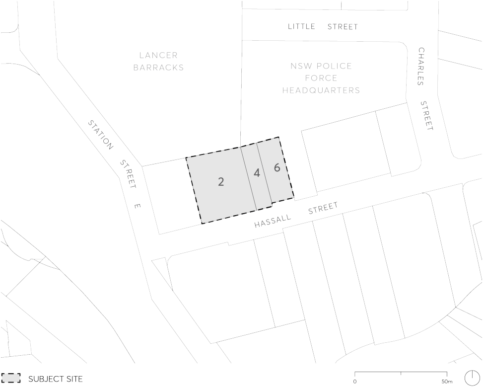

#### 9.10.6 2-6 HASSALL STREET, PARRAMATTA

This Section applies to 2-6 Hassall Street, Parramatta which comprises three allotments with a single frontage to Hassall Street as shown in Figure 9.10.6.

> [Picture on page 242: a picture, saved as a picture (images/part-09-parramatta-city-centre-page-242-5.gif, 150 dpi).]

Figure 9.10.6 – Land application map

This Section is to be read in conjunction with other Sections of Parramatta DCP 2023 and the relevant provisions in Parramatta LEP 2023. If there is any inconsistency between this Section and other parts of the DCP, this Section prevails.

This Section establishes objectives and controls to be interpreted during preparation and assessment of development applications and supports the objectives of the relevant provisions in Parramatta LEP 2023.
