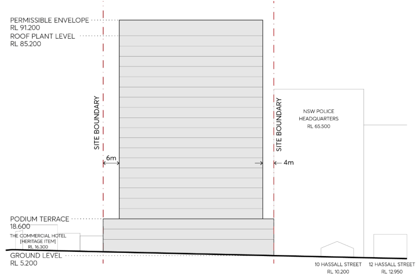
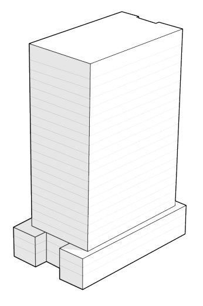
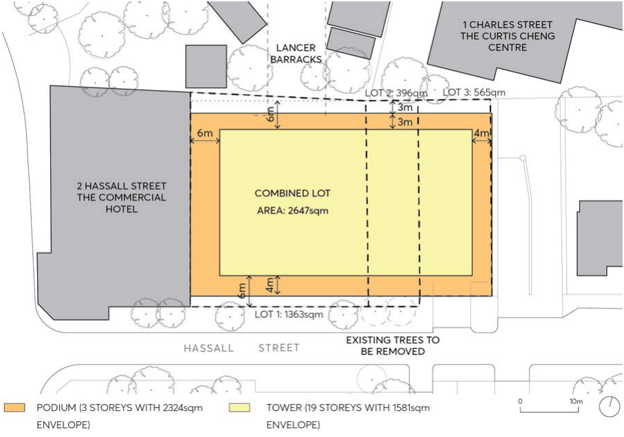
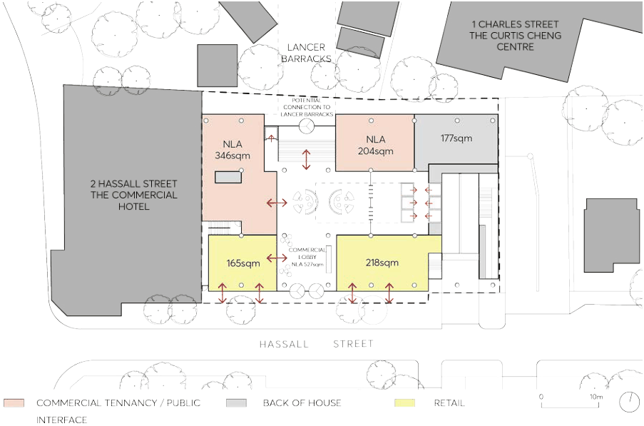

#### 9.10.6.2 BUILDING FORM

The development provisions on building form in this section are intended to encourage high quality design for new buildings, balancing the character of Parramatta with innovation and creativity. The resulting built form and character of new development should contribute to an attractive public domain in central Parramatta and produce a desirable setting for its intended uses.

Objectives

O.01 To establish high quality architectural and urban design for buildings. O.02 Provide a building envelope that is capable of achieving design excellence and a high performing building on a central City Centre site.

O.03 Design buildings with a high level of environmental performance to encourage comfort and full occupation.

2-6 HASSALL STREET, PARRAMATTA

O.04 To provide appropriate articulation of building form that is responsive to street address, microclimate and pedestrian-orientated environment.

O.05 Development should be responsive to the unique scale and character of the heritage buildings around the precinct.

O.06 Development should main a consistent street wall alignment on the northern edge of Hassall Street.

O.07 Maintain adequate inter-tower separation from the NSW Police Headquarters building to the north-east.

Controls

C.01 Street Wall and Building Height

a) Figure 9.10.6.2 and Figure 9.10.6.3 illustrate the maximum permitted podium and tower heights for the development, including:

• A maximum street wall height of 3 storeys, to align with the parapet of the Commercial Hotel to the east.

• Above the podium, a 19 storey tower

> [Picture on page 244: a picture, saved as a picture (images/part-09-parramatta-city-centre-page-244-17.gif, 150 dpi).]

Figure 9.10.6.2 – Hassall Street (southern) elevation illustrating the maximum building envelope

2-6 HASSALL STREET, PARRAMATTA

> [Picture on page 245: a picture, saved as a picture (images/part-09-parramatta-city-centre-page-245-2.gif, 150 dpi).]

Figure 9.10.6.3 – Maximum Building Envelope (Isometric view)

C.02 Building Setbacks and Envelope

a) Future development setbacks should be consistent with the building setback controls shown in Figure 9.10.6.4.

b) Provide a 3 metre podium setback from Lancer Barracks to the north, and a 2 metre podium setback to the southern boundary (Hassall Street) to match the predominant street boundary alignment to the east and aligning with the ground level façade.

c) Provide zero setbacks to the east and west boundary for the podium.

d) Above the podium, the minimum tower setbacks are to be:

• 3 metres from the edge of the podium to the north (6 metres to the northern boundary)

• 3 metres from the east boundary (and podium edge)

• 6 metres to Hassall Street (4 metres from the edge of the podium to the south)

• 6 metres from the west boundary (and podium edge)

2-6 HASSALL STREET, PARRAMATTA

> [Picture on page 246: a picture, saved as a picture (images/part-09-parramatta-city-centre-page-246-2.gif, 150 dpi).]

Figure 9.10.6.4 – Building setback control

C.03 Street Activation and Through Site Link

a) A high level of permeability through and around the site is to be achieved.

b) Ground level uses should activate the street frontage to Hassall Street.

c) A through site link should be created providing a connection between Hassall Street and the Lancer Barracks as shown in Figure 9.10.6.5 that is able to be accessed by the public (during daylight hours).

2-6 HASSALL STREET, PARRAMATTA

> [Picture on page 247: a picture, saved as a picture (images/part-09-parramatta-city-centre-page-247-2.gif, 150 dpi).]

Figure 9.10.6.5 – Through Site Link (indicative sketch)

C.04 Vehicle Access and Parking

a) Vehicular access may be from the eastern portion of the Hassall Street frontage.

b) Development on the site is not permitted to exceed the car parking rate outlined below:

Commercial: If the FSR > 3.5:1, M = (G x A) / (50 x T), where:

M = maximum number of parking spaces;

G = GFA of all office/business premises in the building (m²);

A = Site Area (m²); and

T = Total GFA of all buildings on the site (m²).

C.05 Roof design

a) The roof design may consider a staggered profile and a varying skyline in order to better articulate and modulate the built form.

C.06 Landscaping

a) The setback on the northern boundary is to be used as a deep soil zone for new planting and tree roots protection zone for the existing tree on the adjacent site.

b) The 2 large palm trees on Hassall Street are relocated to the deep soil zone at the northern boundary.

12A PARKES STREET
