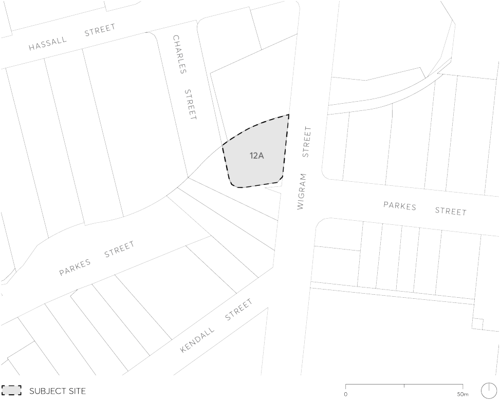

#### 9.10.7 12A PARKES STREET

This Section applies to 12A Parkes Street, Harris Park (also known as 122 Wigram Street, Parramatta), as labelled in Figure 9.10.7.

> [Picture on page 248: a picture, saved as a picture (images/part-09-parramatta-city-centre-page-248-5.gif, 150 dpi).]

Figure 9.10.7 – Land application map

This Section is to be read in conjunction with other Sections of Parramatta DCP 2023 as well as the relevant provisions in Parramatta LEP 2023.  If there is any inconsistency between this Section and other Sections of this DCP, this Section prevails.

This Section establishes objectives and controls to be interpreted during preparation and assessment of development applications and supports the objectives of the relevant provisions in Parramatta LEP 2023.
