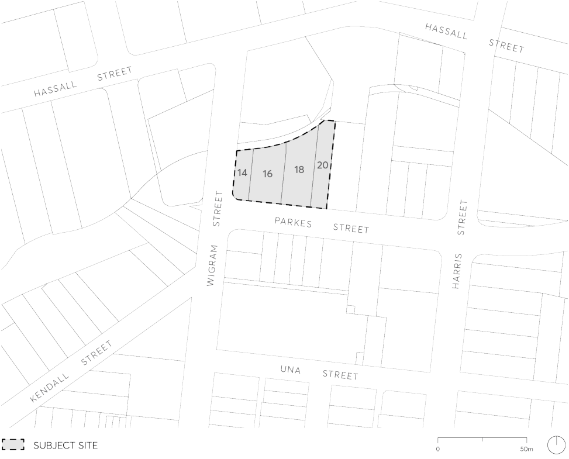

#### 9.10.8 14-20 PARKES STREET, HARRIS PARK

This Section applies to land at 14-20 Parkes Street, Harris Park, as shown in Figure 9.10.8.

> [Picture on page 252: a picture, saved as a picture (images/part-09-parramatta-city-centre-page-252-4.gif, 150 dpi).]

Figure 9.10.8 – Land application map

This Section is to be read in conjunction with other Sections of Parramatta DCP 2023 and relevant provisions in Parramatta LEP 2023. If there is any inconsistency between this Section and other Sections of the DCP, this Section prevails.

This Section establishes objectives and controls to be interpreted during preparation and assessment of development applications and supports the objectives of the LEP.
