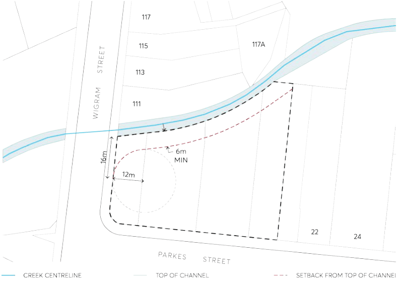

#### 9.10.8.1 DESIRED FUTURE CHARACTER

Future development at 14-20 Parkes Street, Harris Park is designed to respond to the flood conditions of the site.

14-20 PARKES STREET, HARRIS PARK

Site Objectives

O.01 To ensure the design of the building addresses the local flood conditions and does not impede local overland flow paths.

O.02 To minimise the risk to life by ensuring appropriate safe areas within the building to shelter during a flood, and safe access from the building during a medical or fire emergency.

O.03 To allow uses and development on the site that are appropriate to the flood hazard. O.04 To facilitate redevelopment of the site as a high-quality mixed use development. O.05 To ensure the building interfaces positively with the public areas and contributes to an attractive public domain and desirable setting for its intended uses.

Controls

Building Footprint and Uses C.01 To maintain local flood conveyance eastwards from Parkes St, Wigram Street and into the Clay Cliff Creek stormwater floodway, development on the site must have a building footprint that is setback a minimum of 6 metres from the top of the southern bank of the Clay Cliff Creek stormwater channel, and a greater amount for the north west corner of the building adjoining Wigram Street (channel wall) in accordance with Figure 9.10.8.2.

> [Picture on page 253: a picture, saved as a picture (images/part-09-parramatta-city-centre-page-253-18.gif, 150 dpi).]

Figure 9.10.8.2 – Required floodway setbacks

C.02 Any cantilever building element (excluding any structural support columns or similar) must have a minimum 4 metre clearance above the ground surface level of the overland flow path throughout the site to enable a landscaped open space to be created. A minimum 4.5 metre setback between the channel bank and the building must be maintained above this clearance height.

C.03 The landscaped open space must:

14-20 PARKES STREET, HARRIS PARK

a) be designed for low intensity and low risk pedestrian activities, recognising this is a site of ‘high hazard’ flash flooding;

b) create a positive and safe experience for pedestrians;

c) promote activity, connectivity and variety in the public domain;

d) be designed having regard to aspect, height and proportions;

e) be designed in conjunction with street levels to facilitate step-less access; and

f) be provided with ‘deep soil’ and planted with appropriate tree and shrub species that are satisfactory to Council for this context.

C.04 Development Application submission requirements must include architectural design details for the landscaped open space and its interface with the building that:

a) demonstrate consideration of the above requirements in C.02 and C.03;

b) have regard to Parramatta Public Domain Guidelines;

c) have regard to the City of Parramatta’s Council’s Best Practice Urban Design in Flood Prone Areas;

d) have regard to the immediate flooding environment, and

e) are to the satisfaction of the Design Excellence Jury.

C.05 Permanent and temporary commercial or retail floor space or uses are not permitted below the Flood Planning Level, which is either the Council-adopted 1% AEP flood water surface level plus 0.5m freeboard, or the overland flow flood level as agreed by Council, whichever is the greater.

C.06 The habitable floors of all residential uses within the building must be above the Probable Maximum Flood (PMF) is adopted by Council for this site.

C.07 ‘Sensitive Uses and Facilities’ and ‘Critical Uses and Facilities,’ as defined in Table 5.1.1.1 in Section 5.1 – Water Management are not permitted within the building.

Building and Basement Design

C.08 To minimise the chance of a fire during a flood situation, the building must have a fire management system which meets the Australian Building Code Board (ABCB).

C.09 External fire doors must be located above the Flood Planning Level. C.10 To prevent flood waters from entering the basement car park, a driveway crest at or above the Flood Planning Level including associated bund walls must be provided. Above this, at or near the crest of the driveway, automatic flood barriers must be installed that exclude floodwaters up to the Probable Maximum Flood (PMF). Other measures such as flood doors must also be provided at all openings to the basement to exclude flood waters up to the PMF.

C.11 Wherever possible, critical services infrastructure that could be damaged by flooding such as electrical, lifts, sewer and water are to be placed above the PMF level, or, where that cannot reasonably be achieved, effectively flood proofed.

14-20 PARKES STREET, HARRIS PARK

C.12 Development Application submission requirements must:

a) demonstrate that the building and basement will be protected from floodwaters up to the PMF;

b) include evidence demonstrating why all or some of the critical infrastructure services cannot be located above the PMF and the floodproofing measures to be taken instead.

Areas of Refuge and Evacuation Routes

C.13 All building occupants (residents, workers and visitors) must have access to a safe area of refuge or ‘shelter in place’) above the PMF where they can remain until the flood event has passed and any subsequent disruption after the flood has been rendered safe and serviceable. Residents may choose to remain in their own apartments as a safe area of refuge. A communal safe area(s) of refuge for residents, workers and visitors must also be provided and suitably equipped.

C.14 A communal safe area of refuge must have: emergency electricity supply, clean water, food, personal washing facilities, medical equipment including a first aid kit, a battery-powered radio and relevant communications equipment.

C.15 All safe areas of refuge (residents own apartment or a communal area) must have:

a) fail safe access from anywhere in the building including the basement (lift access is not allowed) that is protected from floodwaters up to the PMF by suitable flood doors, flood gates and the like; and

b) fail safe access to an exit/entry point located above the 1% AEP flood level plus 0.5m freeboard that enables people to exit the building during a fire and/or flood, and allows emergency service personnel to enter a building to attend to a medical emergency.

C.16 Development Application submission requirements must include a Flood Emergency Response Plan (FERP) consistent with the FERP for the City Centre. The FERP must outline:

a) both warning and evacuation measures for occupants in the building including the most appropriate ‘safe areas’ and ‘safe evacuation routes’;

b) measures to prevent evacuation from the site by private vehicle;

c) the most appropriate emergency response for flood and fire events that occur together;

d) a building flood emergency response plan, similar to a building fire evacuation drill, and measures to ensure this is tested at least annually; and

e) consultation undertaken with relevant state and local agencies in the preparation of the FERP.

C.17 The Building Management System and Plan for the development must include all necessary measures to maintain, test and operate the flood protection devices including flood gates, doors and barriers, flood sensors, flood refuges and FERP.

55 AIRD STREET
