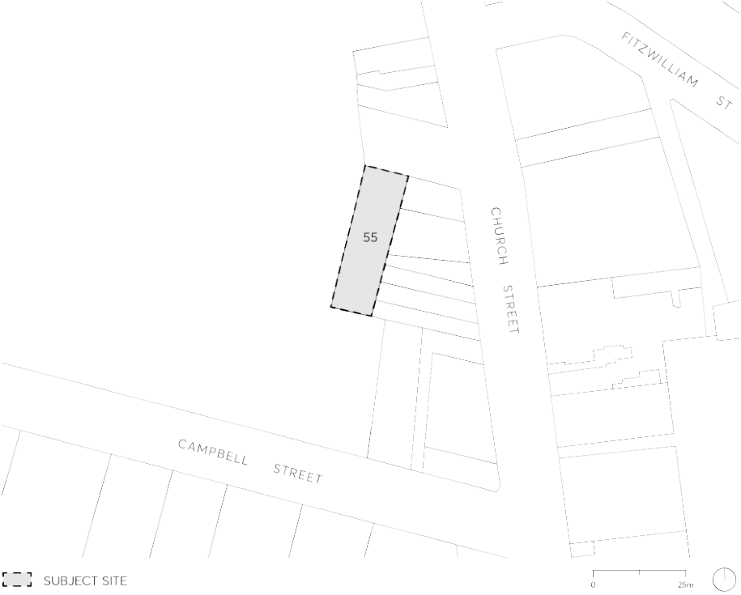

#### 9.10.9 55 AIRD STREET

This Section applies to land at 55 Aird Street, Parramatta (described as Lot 4 in DP310151) as shown in Figure 9.10.9.

> [Picture on page 256: a picture, saved as a picture (images/part-09-parramatta-city-centre-page-256-5.gif, 150 dpi).]

Figure 9.10.9 – Land application map

This Section is to be read in conjunction with other Sections of Parramatta DCP 2023 and the relevant provisions in Parramatta LEP 2023. If there is any inconsistency between this Section and other Sections of Parramatta DCP 2023, this Section prevails.

This Section establishes objectives and controls to be interpreted during preparation and assessment of development applications and supports the objectives of the relevant provisions in Parramatta LEP 2023.

Guiding Principles

P.01 Facilitate redevelopment of the site as a high-quality mixed use development to support the role of the Parramatta City Centre.

Contribute to the public domain at ground level through an activated edge to Aird Street.

Design the street wall to create streets that are legible, comfortable, safe, functional and attractive.

55 AIRD STREET

Design the street wall to respond to existing built context.

Set back buildings above the street walls to allow daylight penetration, mitigate wind impacts, and enable views to the sky in streets and public places.

Design the tower to be elegantly proportioned and maximise its slenderness of form.

Protect amenity, daylight penetration, views to the sky and privacy between adjoining developments and minimise the negative impacts of buildings on the amenity of the public domain.

Design and select the materials of buildings and the public domain to contribute to a high quality, durable, and sustainable urban environment.
