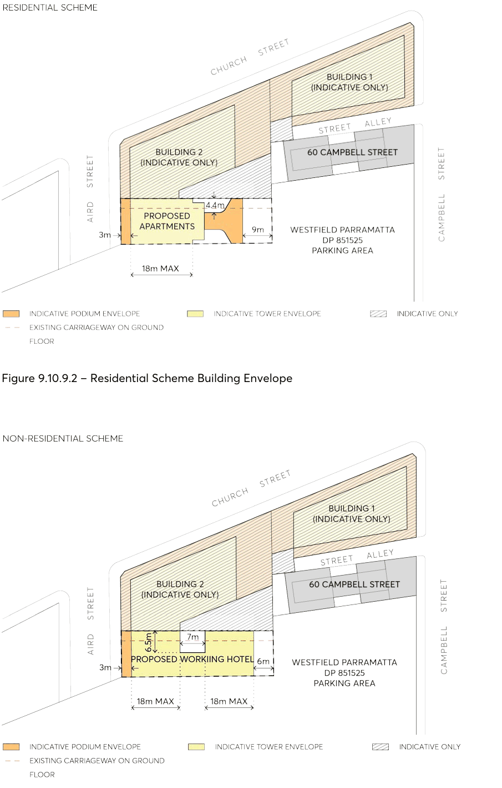

#### 9.10.9.1 BUILDING ENVELOPES

Objectives

O.01 Reinforce the spatial definition of the streets. O.02 Design the street walls with an appropriate human scale and sense of enclosure for the streets. O.03 Protect daylight access at street level and permit views of sky from the streets by providing setbacks above street frontage height that promote separation between buildings.

O.04 Ensure that building form achieves comfortable public domain conditions for pedestrians, with adequate daylight, appropriate scale, and mitigation of wind effects of the tower building.

O.05 Ensure that the ground level interface provides shelter for pedestrians in the form of an awning. O.06 Ensure that built form achieves contextual fit with adjacent buildings on Aird and Church Streets.

Controls

C.01 Building envelopes must be consistent with the minimum setbacks specified in Figure 9.10.9.2 if a Residential Development or Figure 9.10.9.3 if a Non-Residential Development.

C.02 The street wall must be built to the street boundary along its full frontage on Aird Street. C.03 Above the street wall the recessed tower element must be set back a minimum of 3 metres from Aird St.

C.04 Setbacks must be measured perpendicular to the boundary to the outer faces of the buildings. C.05 The height of the podium at Aird must relate to the existing adjacent building to the west and south.

C.06 Any blank walls are to be designed or treated to provide a high-quality finish of visual interest.

55 AIRD STREET

> [Picture on page 258: a picture, saved as a picture (images/part-09-parramatta-city-centre-page-258-2.gif, 150 dpi).]

Figure 9.10.9.2 – Residential Scheme Building Envelope

Figure 9.10.9.3 – Non-Residential Scheme Building Envelope

55 AIRD STREET

Note – The site is burdened with a Right of Way along its eastern boundary which benefits sites at 129, 131, 135, 137 and 141 Church Street, Parramatta. Nothing within this Section seeks to amend the legal responsibilities of this easement.
