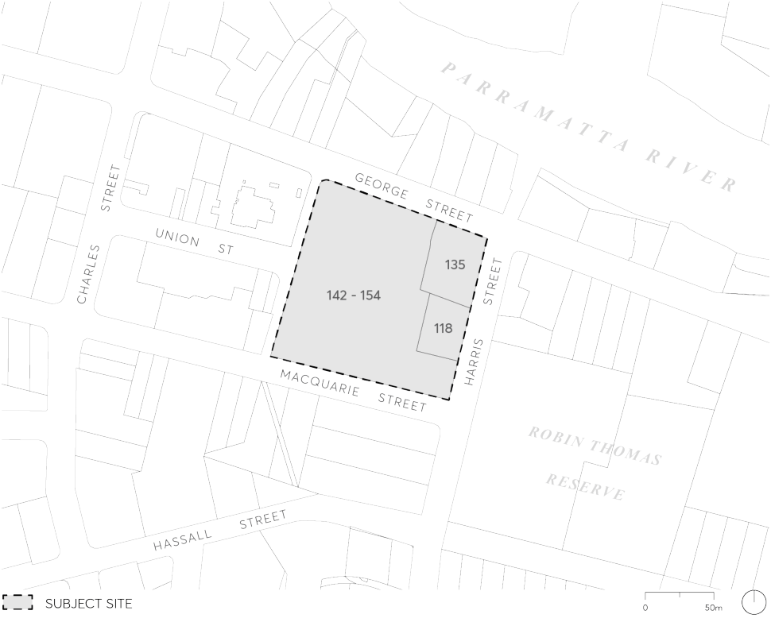
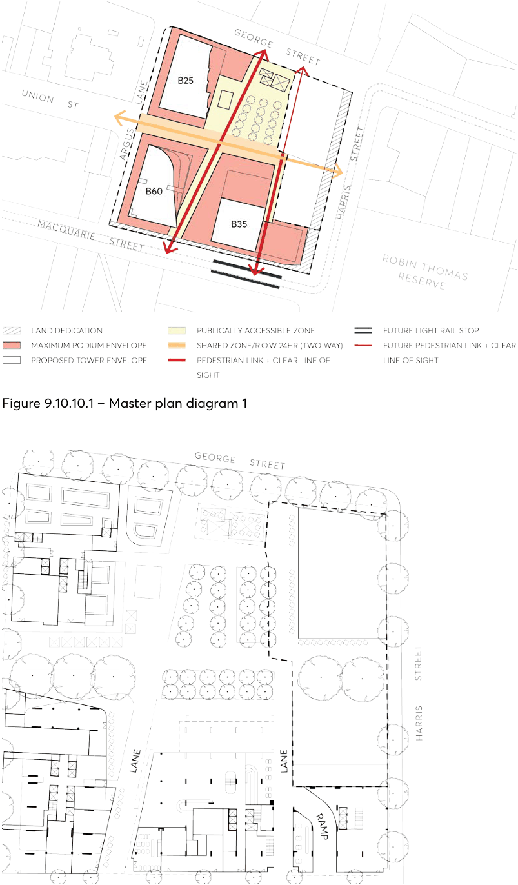
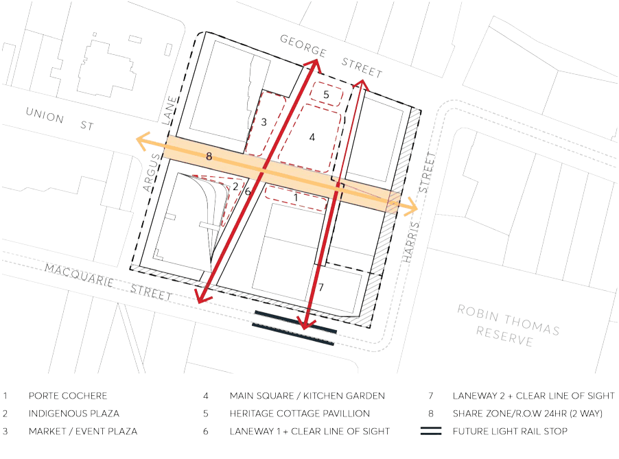
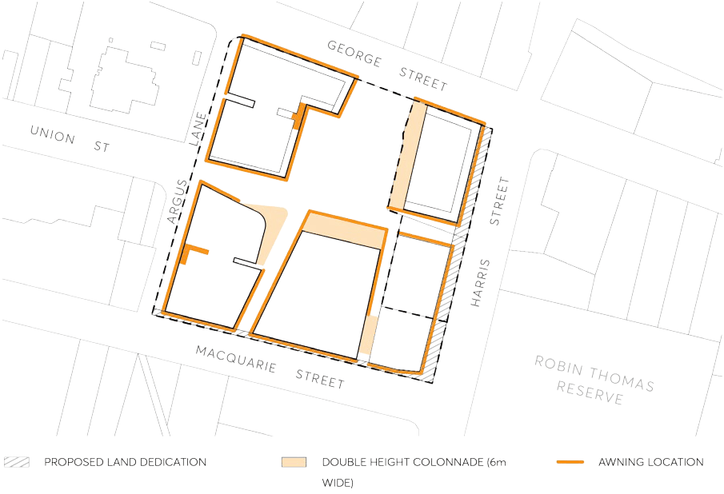
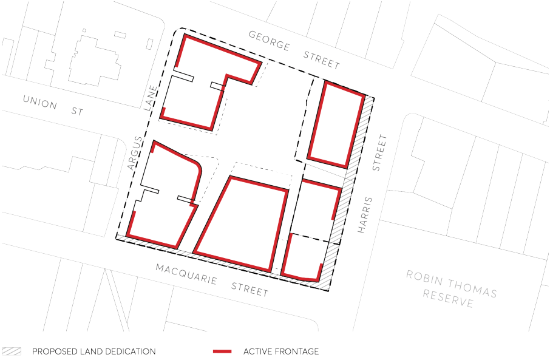

#### 9.10.10 142-154 MACQUARIE STREET, 118 HARRIS STREET AND 135 GEORGE STREET

This Section of the DCP applies to the street block bound by George Street, Harris Street, Macquarie Street and Argus Lane, the subject site, as shown in Figure 9.10.10.

> [Picture on page 261: a picture, saved as a picture (images/part-09-parramatta-city-centre-page-261-5.gif, 150 dpi).]

Figure 9.10.10 – Land application map

This Section must be read in conjunction with other Sections of this DCP and the Parramatta LEP 2023. The aspects of this Section that relate to the former Cumberland Media site have been prepared in accordance with the winning design from Council’s Design Excellence process (LA/353/2015), as per Division 3 Design excellence of Parramatta LEP 2023.

This Section of the DCP provides principles, objectives and controls relating to: public domain; building form; access, parking and servicing; and sustainability, microclimate and water.

Where there is any inconsistency between this section and other Sections of PDCP 2023, this Section prevails.

142-154 MACQUARIE STREET, 118 HARRIS STREET AND 135 GEORGE STREET

Design Principles

The following design principles support the objectives and development controls for the site.

Relationship to Parramatta City Centre:

P.01 To revitalise the eastern edge of the Parramatta City Centre and create a new destination for the City.

Architectural Design:

P.02 To create a high quality, high-density mixed-use development in Parramatta City Centre.

P.03 To respond to the existing streetscape pattern and scale.

P.04 To mitigate wind impacts through design of towers and podiums.

P.05 To provide an accessible open space with separate plaza spaces activated by a variety of retail, cultural, community, entertainment, and commercial uses.

Landscape and Public Domain:

P.06 To support the amenity of the adjacent parklands and open space.

P.07 To improve the landscape character and quality of the public domain which adjoins the site.

P.08 To provide a high quality communal open space.

P.09 To minimise overshadowing impacts on the open space and heritage items.

Pedestrian Connectivity:

P.10 To improve connectivity in a north-south and east-west direction across the site and link a series of smaller public open spaces of different shapes and character.

P.11 To provide active street frontages to George Street and Macquarie Street.

P.12 To minimise traffic conflicts between pedestrians and vehicles on the site.

P.13 To integrate pedestrian linkages with the future Light Rail station.

History and Culture:

P.14 To respond to the history, heritage and archaeological values of the area and incorporate Aboriginal and environmental heritage into the future development through the built elements, streetscape, landscape design and interpretation on the site. The proposed master plan concept for the site is shown on Figures 9.10.10.1 and 9.10.10.2.

142-154 MACQUARIE STREET, 118 HARRIS STREET AND 135 GEORGE STREET

> [Picture on page 263: a picture, saved as a picture (images/part-09-parramatta-city-centre-page-263-2.gif, 150 dpi).]

Figure 9.10.10.1 – Master plan diagram 1

Figure 9.10.10.2 – Master plan diagram 2

Plazas and Walkways

142-154 MACQUARIE STREET, 118 HARRIS STREET AND 135 GEORGE STREET

P.15 The publicly accessible plaza includes publicly accessible walkways and shared spaces within and around the site including streets, lanes and plazas which provide 24/7 access (to be delivered by a planning agreement).

Objectives

O.01 Enhance the public domain through improvements to the streets and lanes within and adjoining the site and the creation of publicly accessible plazas.

O.02 Respond to the existing and planned streets cape pattern and scale. O.03 Provide active street frontages to George Street and Macquarie Street. O.04 Provide a new publicly accessible open space which is activated by a variety of retail, cultural, community, entertainment, and commercial uses.

O.05 Provide heritage interpretation within the publicly accessible open space. O.06 Improve connectivity in a north-south and east-west direction across the site and link a series of smaller public open spaces of different shapes and character.

O.07 Ensure a high level of pedestrian amenity, safety, and security through the inclusion of weather protection and lighting.

O.08 Address the new public place to the riverfront. O.09 Ensure the Heritage Cottage Pavilion is activated. O.10 Ensure that the plazas and walkways respond to the history, heritage, and archaeological values of the area.

Controls

C.01 New pedestrian walkways and plazas shall be provided in accordance with Figure 9.10.10.3.

142-154 MACQUARIE STREET, 118 HARRIS STREET AND 135 GEORGE STREET

> [Picture on page 265: a picture, saved as a picture (images/part-09-parramatta-city-centre-page-265-2.gif, 150 dpi).]

Figure 9.10.10.3 – Open Space – Plazas, walkways and shareways

C.02 New pedestrian walkways, plazas and shareway are composed of the following areas:

a) Plaza area – minimum 2,500sqm (comprising Plazas 1 to 4)

b) Shareway – minimum 1,000sqm

c) Laneways – minimum 850sqm

The total area of the entire public open space to be provided is 4,400m².

C.03 Plaza 3 (Market/Events), 4 (Main Square/Kitchen Garden), 5 (Heritage Cottages Pavilion) are to receive a minimum of 2 hours of solar access between the hours of 10am and 3pm on June 21st to a minimum of 50% of the area.

C.04 The plazas and laneways are designed to celebrate the heritage and archaeological values of the site’s history and location through high-quality public domain design and on-site interpretation, with consideration given to the themes in Figure 6.10.10.3 (above) as well as the descriptions provided in the control table below. Alternate themes that link to the history and values of the site may also be considered (subject to Council’s approval).

| Public Domain Plaza | Use / Description |
|---|---|
| Plaza 3 – Market / Events | • Flexible event space in the plaza space adjoining the markets • Market Stalls and seating – grand market containing an eatery within the ground floor of Building 25 (B25). Flexible stalls and seats spill out into the open space and towards the Laneway 1. |

142-154 MACQUARIE STREET, 118 HARRIS STREET AND 135 GEORGE STREET

| Public Domain Plaza | Use / Description |
|---|---|
| Plaza 4 – Main Square / Kitchen Garden | • Kitchen Garden - Contained within Heritage Lots 49 & 50. To provide edible gardens containing passive recreation space and supplies of produce to the kitchen garden restaurant (restaurant contained within B25 and serving the Convict Cottages). |
| Plaza 5 – Heritage Cottages Pavilion | • An open pavilion structure interpreting the convict cottages on Lots 48 & 49; acting as an educational tool. It also provides sheltered seating for the customers of the Kitchen Garden Restaurant. |

C.05 A two storey under-croft is to be provided along Laneway 2 in the south east building to allow for a clean line of site as indicated in Figure 9.10.10.3.

C.06 A shareway as indicated in Figures 9.10.10.3 and 9.10.10.10 is to be provided, forming an active spine across the site. The minimum width of the shareway is 12 metres.

C.07 Continuous street frontage awnings are to be provided along building frontages and along active frontages to provide shade and shelter in accordance with Figure 9.10.10.5.

> [Picture on page 266: a picture, saved as a picture (images/part-09-parramatta-city-centre-page-266-9.gif, 150 dpi).]

Figure 9.10.10.4 – Awning location for former Cumberland Media and Albion Hotel sites

142-154 MACQUARIE STREET, 118 HARRIS STREET AND 135 GEORGE STREET

> [Picture on page 267: a picture, saved as a picture (images/part-09-parramatta-city-centre-page-267-2.gif, 150 dpi).]

Figure 9.10.10.5 – Control diagram: Location of active edges and/or pedestrian entries for former Cumberland Media and Albion Hotel sites

C.08 Frontage, activation and entries:

a) The site is to provide active frontages on ground level along the public spaces as per Figure 9.10.10.5.

b) Access to residential and commercial uses above ground level is to be provided directly from plaza or ground level pedestrian walkway.
