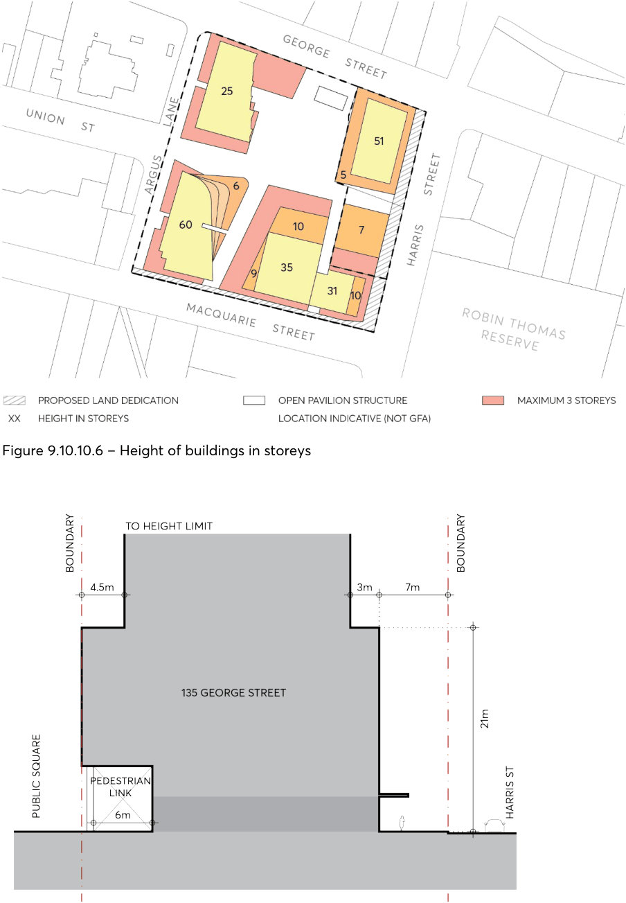
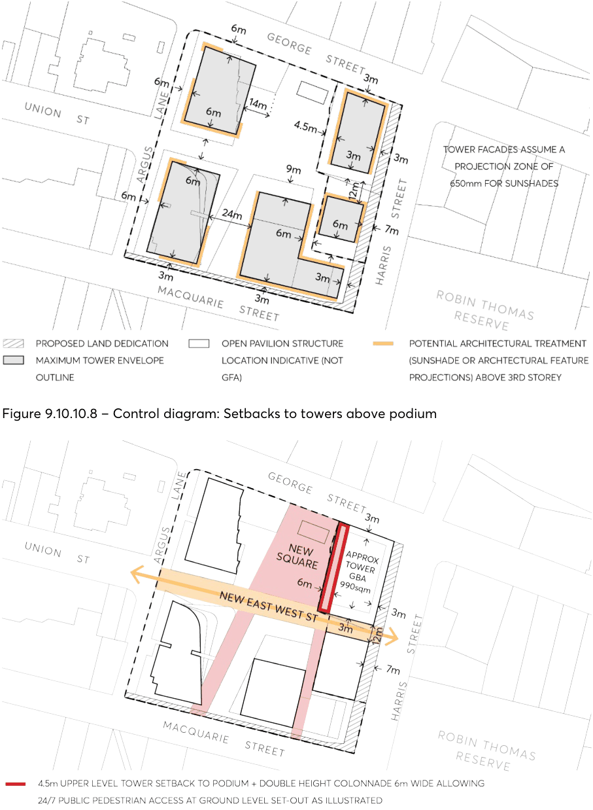
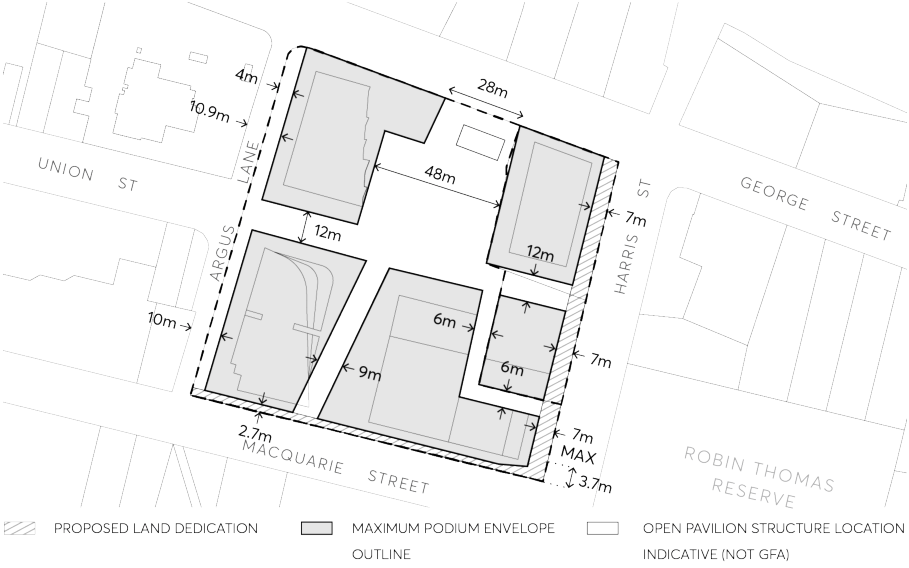

#### 9.10.10.2 BUILDING FORM

Objectives

O.01 Establish high quality architectural and urban design of the site. O.02 Create three distinct built forms (towers) with heights varying from 25 storeys to 35 storeys to 60 storeys which transition within the site towards the park and the river.

O.03 Protect the amenity of adjacent parklands and open space, including existing trees in these areas, nearby schools, heritage items and surrounding urban areas by minimising overshadowing impacts.

O.04 Mitigate wind impacts through design of towers and podiums.

Controls

C.01 Building envelopes:

a) The heights (in storeys) of the podium and tower elements are to be consistent with Figures

9.10.10.6 and 9.10.10.7.

142-154 MACQUARIE STREET, 118 HARRIS STREET AND 135 GEORGE STREET

> [Picture on page 269: a picture, saved as a picture (images/part-09-parramatta-city-centre-page-269-2.gif, 150 dpi).]

Figure 9.10.10.6 – Height of buildings in storeys

Figure 9.10.10.7 – Section showing double height colonnade and setbacks to tower at the corner of Harris and George Streets

b) The Heritage Cottages Pavilion is to have no internal and external walls (as it is an open pavilion structure and not part of the GFA of the development).

142-154 MACQUARIE STREET, 118 HARRIS STREET AND 135 GEORGE STREET

c) New building forms are to be consistent with dimensions of the street setbacks and above street setbacks as shown in Figures 9.10.10.8, 9.10.10.9 and 9.10.10.10.

> [Picture on page 270: a picture, saved as a picture (images/part-09-parramatta-city-centre-page-270-4.gif, 150 dpi).]

Figure 9.10.10.8 – Control diagram: Setbacks to towers above podium

Figure 9.10.10.9 – Height of buildings in storeys and setbacks to towers over podium on former Albion Hotel Site

142-154 MACQUARIE STREET, 118 HARRIS STREET AND 135 GEORGE STREET

d) Residential towers should not exceed the maximum building floor plate of 950m².

e) The size of a podium floor plate is to be proportional to the height of each tower in order to achieve the effect of a slim tower form. Taller tower forms will require a larger floor plate and lower tower forms will require a smaller floor plate (refer to Figure 9.10.10.8).

C.02 Building podiums are to be consistent with the setbacks shown in Figure 9.10.10.10 and be predominantly non-residential in character.

> [Picture on page 271: a picture, saved as a picture (images/part-09-parramatta-city-centre-page-271-8.gif, 150 dpi).]

Figure 9.10.10.10 – Setbacks and separations at street level
