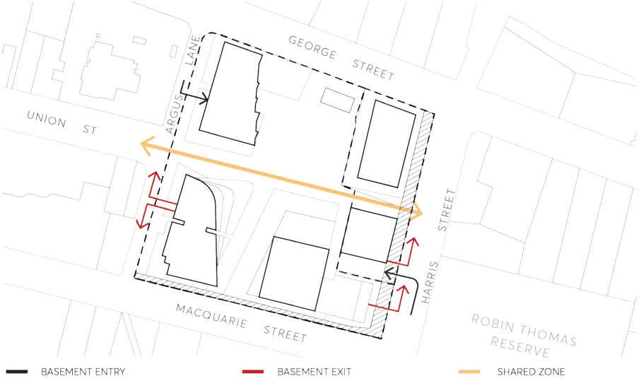
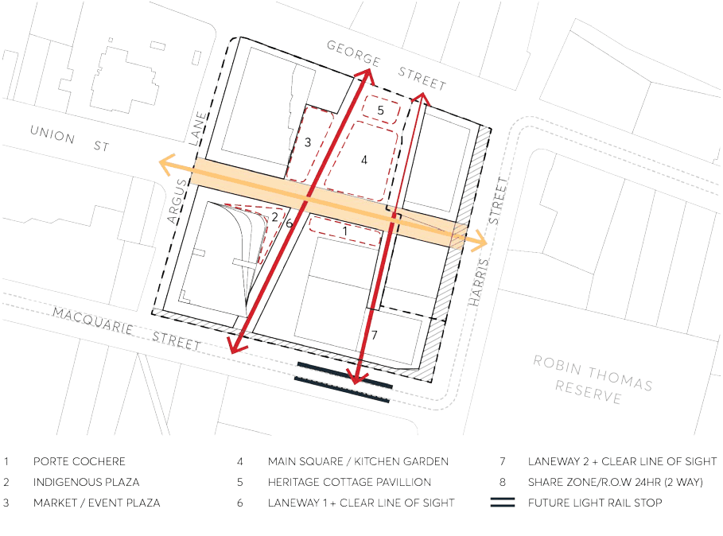
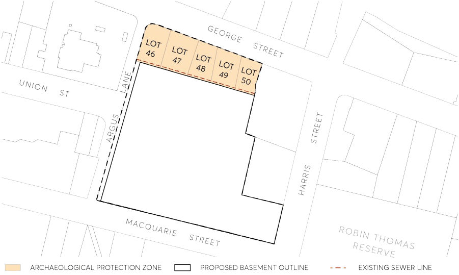
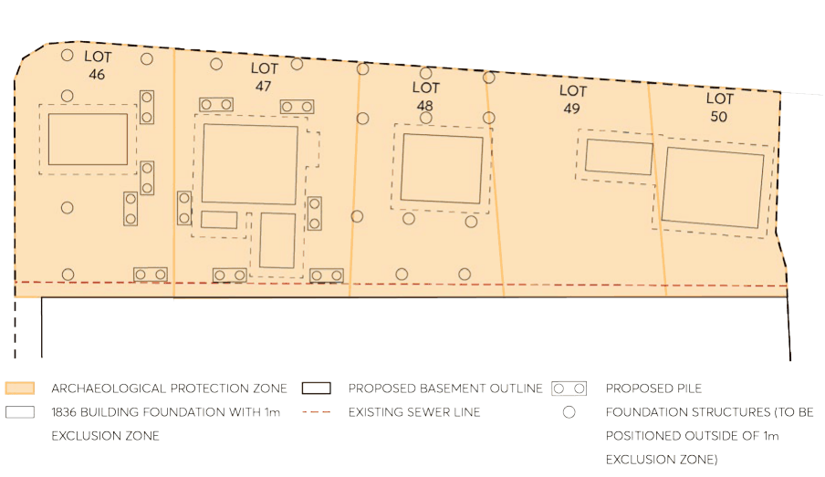

#### 9.10.10.3 ACCESS, PARKING AND SERVICING

Objectives

O.01 Connect the new network of spaces to Robin Thomas Reserve. O.02 Provide access for vehicles to the site balanced with pedestrian amenity, access, and safety. O.03 Improve traffic impacts by widening Argus Lane. O.04 Minimise the number of vehicular access and service points along the active frontages in particular along George Street and Macquarie Street.

O.05 Provide high quality design of the vehicular access areas with high quality materials. O.06 Ensure safety by minimising pedestrian and vehicular conflicts through lighting and signage. O.07 Reduce the visual impact of above ground car parking. O.08 Increase opportunities to use public transport, to cycle or walk to work.

142-154 MACQUARIE STREET, 118 HARRIS STREET AND 135 GEORGE STREET

O.09 Improved pedestrian connectivity through the site to the City Centre. O.10 Ensure that the design of the development, below ground structures and basement is sympathetic to the archaeological heritage on the site and provides in situ retention of State Significant Archelogy on lot 46, 47, 48 and 49.

Controls

C.01 Vehicular access and servicing:

a) Vehicular access and egress are to be provided in the locations shown on the Figure 9.10.10.11.

> [Picture on page 272: a picture, saved as a picture (images/part-09-parramatta-city-centre-page-272-10.gif, 150 dpi).]

Figure 9.10.10.11 – Vehicular Access and Servicing

b) Service vehicle access points and utilities are to be minimised along pedestrian routes and adjacent public open space.

c) A 12 metre wide two-way share way shall connect Argus lane and Harris Street for pedestrian and service vehicle access. The share way shall deny access to private vehicles except for emergency vehicles, vehicles associated with the hotel/serviced apartments (i.e. taxis and hotel deliveries) and loading/unloading during defined loading times. The development application shall address any temporary parking and loading/unloading arrangements to be implemented.

d) Entry to the share way via Harris Street shall not be permitted. The development application must outline the security measures that will be implemented to control access into the share way such as bollards.

e) Vehicular and service access widths are to be minimised and incorporated into the building design.

142-154 MACQUARIE STREET, 118 HARRIS STREET AND 135 GEORGE STREET

f) High quality design and materials are to be used for the security shutters into the car park and loading areas. Details of design and materials are to accompany the development application.

g) Any on grade or above ground car parking and service areas are to be sleeved with other uses such as commercial and residential and is not to be visible to the public domain.

h) Development application plans are to provide evidence of signage and urban design elements that reduce pedestrian and vehicle conflicts over the shared zones illustrated in Figure 9.10.1.10.

i) Provide facilities for cyclists such as parking, storage, and end of trip facilities for bicycles in accordance with the relevant sections of this DCP. Additional showers for office buildings and public bicycle racks located within the pedestrian walkways must also be provided to encourage the use of bicycles.

j) All loading and servicing provisions are to be made on site. The applicant is to prepare a Freight and Servicing Management Plan (FSMP) and a Loading Dock Management Plan (LDMP) in consultation with Transport for NSW which is to be endorsed by Transport for NSW prior to the issue of any construction certificate.

C.02 A Travel Plan consistent with Section 6.1.2 – Travel Plans of this DCP must accompany each Development Application stage with the last stage including a comprehensive Travel Plan for the entire development. In addition, the following is also required:

a) An annual survey to estimate the travel behaviour to and from the site and a review of the measures.

b) A copy of the Travel Plan must be available to Council on request.

Travel Plan: A Travel Plan is a package of measures designed to reduce car trips and encourage the use of sustainable transport. Where a Travel Plan is required as a condition of development, it must be submitted to Council prior to the release of the Occupation Certificate. If the future occupant(s) are known, then the Travel Plan must be prepared in co-operation with them. The condition of consent remains for the life of the development:

a) Development that contains 5,000m² of gross floor space or 50 or more employees must prepare a Travel Plan.

b) Travel Plan must include:

• Targets: This typically includes the reduction of single occupant car trips to the site for the journey to work and the reduction of business travel particularly single occupant car trips.

• Travel data: An initial estimate of the number of trips to the site by mode that is required.

• Measures: a list of specific tools or actions to achieve the target.

142-154 MACQUARIE STREET, 118 HARRIS STREET AND 135 GEORGE STREET

• An annual survey to estimate the travel behaviour to and from the site and are view of the measures.

A copy of the Travel Plan must be available to Council on request.

C.03 A community car share scheme is available for the future residents and is integrated into the development. Development application plans for the basement are to show car share car spaces.

C.04 Pedestrian movement controls:

a) Provide a series of pedestrian links allowing access from Macquarie Street to the main plaza and George Street and from Argus Lane to the Harris Street as shown on the Figure 9.10.10.12.

> [Picture on page 274: a picture, saved as a picture (images/part-09-parramatta-city-centre-page-274-12.gif, 150 dpi).]

Figure 9.10.10.12 – Pedestrian links and shared zones

b) The pedestrian links are to be in accordance with the street level setback widths outlined in Figure 9.10.10.12 and the minimum width be no less than 6m.

C.05 Basement and below ground structure controls:

a) The basement line is not to extend further north (into the protected archaeological zone) than the existing sewer line shown in Figure 9.10.10.14 and shall be designed such that it will not result in adverse heritage impacts on the archaeology in Lots 46, 47, 48 and 49. This is to be demonstrated on the Development Application plans.

142-154 MACQUARIE STREET, 118 HARRIS STREET AND 135 GEORGE STREET

> [Picture on page 275: a picture, saved as a picture (images/part-09-parramatta-city-centre-page-275-2.gif, 150 dpi).]

Figure 9.10.10.13 – Control diagram: Protected archaeological zone and lots

b) Ensure that the basement and below ground structures and services allow for the in-situ retention of State Significant Archaeology in lots 46, 47, 48 and 49 in Figure 9.10.10.13. Ramp access and building lift cores are to be located south of the basement line, outside of the protected archaeological zone. This is to be demonstrated on the development application plans.

c) The design of the piling and foundations for building B25 shall ensure the retention of the archaeology in Lots 46, 47, 48 and 49 in-situ. All piles and structures must fall outside of a one-metre exclusion zone as shown in Figure 9.10.10.14. This is to be demonstrated on the Development Application plans.

142-154 MACQUARIE STREET, 118 HARRIS STREET AND 135 GEORGE STREET

> [Picture on page 276: a picture, saved as a picture (images/part-09-parramatta-city-centre-page-276-2.gif, 150 dpi).]

Figure 9.10.10.14 – Control diagram: Piles and structures in relation to archaeological exclusion zone

d) An application pursuant to Section 140 of the Heritage Act 1977 is to be submitted with the development application that seeks consent for excavation or below ground works on the site.
