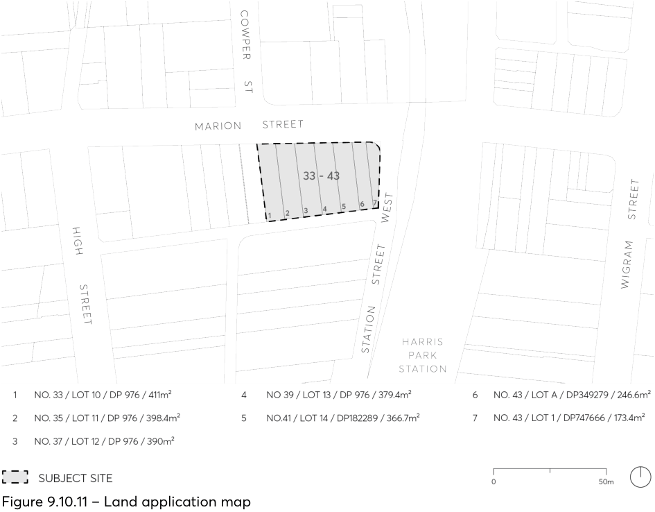

#### 9.10.11 33-34 MARION STREET

This Section applies to land at 33-43 Marion Street, Harris Park, as illustrated in Figure 9.10.11. The subject site comprises seven (7) allotments and totalling 2,367.5m². also shown in Figure 9.10.11.

> [Picture on page 280: a picture, saved as a picture (images/part-09-parramatta-city-centre-page-280-5.gif, 150 dpi).]

Figure 9.10.11 – Land application map

This Section must be read in conjunction with other sections of Parramatta DCP 2023 and the relevant provisions within Parramatta LEP 2023.  If there is any inconsistency between this section and other sections of this DCP, this Section prevails.

This Section establishes relevant development controls for the built form and urban design objectives for subject site including setbacks, pedestrian and heritage interface, vehicular access and movement, and landscaping.

Re-development of this site will be subject to a design excellence competition process under Division 3, Part 7 Design excellence in Parramatta LEP 2023. The scope of this brief will be informed by the urban design outcomes and principles identified by this DCP.
