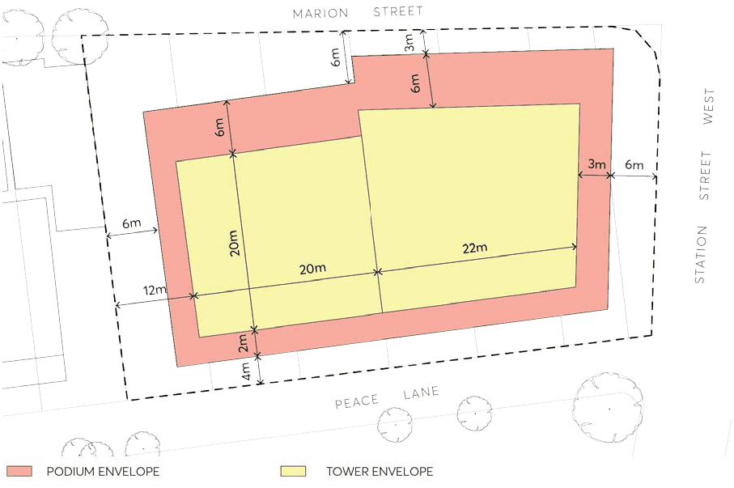

#### 9.10.11.1 BUILT FORM OBJECTIVES

The site has two main frontages, with 62 metres to Marion Street and 35 metres to Station Street West. The site has a secondary frontage to the south to Peace Lane of 60 metres, and a 40 metre boundary to a heritage item to the west at 31 Marion Street.

33-34 MARION STREET

The objectives have been developed to respond to the context of the site, and in doing so maximise the building interface with the two primary frontages, encourage permeability at the ground plane, and to manage the interface between existing and new development.

Objectives

O.01 To facilitate the provision of a mixed-use development on the site. O.02 To provide an improved, pedestrian-friendly environment. O.03 Activate ground floor space, particularly along Marion Street. O.04 Ensure a suitable interface with adjoining heritage items. O.05 Create a permeable ground plane through visual and physical connections and maximise permeability.

O.06 Ensure through-site links provide a high level of pedestrian amenity, safety, and security. O.07 To provide for access and vehicular movements away from the two key active frontages along Marion Street and Station Street West.

Built Form Controls

Alignment C.01 The site is to have a variable alignment to Marion St. Buildings located on the eastern portion shall be parallel to Marion Street. Buildings located on the western portion of the site are to be setback and align with the adjoining heritage item and be perpendicular to the subdivision pattern. Refer to Figure 9.0.11.2.

Podium Setbacks C.02 Minimum of 3 metres from northern boundary (eastern half of building) and a minimum of 6 metres (western half of building).

C.03 Minimum 6 metre setback to the east (Station Street West). C.04 Minimum 4 metre setback to the south (Peace Lane). C.05 Minimum 6 metre setback to the west (31 Marion Street). Basement Setbacks, Planting and Ingress/Egress C.06 Eastern and western setbacks to be deep soil zones – no basement underneath. C.07 Vehicle entry to be located on the south of the site via Peace Lane. C.08 Ingress and egress points must be contained within the envelope of the building. Tower Setbacks from Boundary C.09 Minimum 9 metres and variable to northern boundary (Marion Street). C.10 Minimum 9 metres to the eastern boundary (Station Street West). C.11 Minimum 6 metres to southern boundary (Peace Lane). C.12 Minimum 12 metres to western boundary (31 Marion Street)

33-34 MARION STREET

Built Form C.13 Maximum tower building length of 45 metres. C.14 Maximum tower building depth of 23 metres. C.15 Maximum podium footprint of 1,565m². C.16 Maximum tower footprint of 955m². Public Domain C.17 Tree planting is to be maximised across the site. C.18 If awnings are provided, they are to be consistent with Parramatta Public Domain Guidelines. C.19 Publicly accessible through-site link is to be provided along the western setback to 31 Marion Street.

C.20 The through-site link is to be legible, provide a clear path of travel, open to the sky, and well-lit at night.

C.21 3 metres of the northern and western setback are to be publicly accessible to allow for footpath widening.

C.22 Active frontages are to be provided on Marion Street and Station Street West.

> [Picture on page 282: a picture, saved as a picture (images/part-09-parramatta-city-centre-page-282-17.gif, 150 dpi).]

Figure 9.10.11.2 – Building alignment and setbacks

2 O’CONNELL STREET, PARRAMATTA
