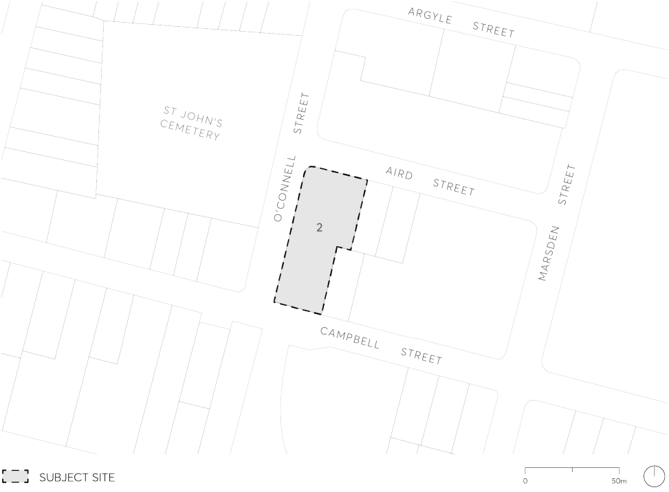

#### 9.10.12 2 O’CONNELL STREET, PARRAMATTA

This Section applies to land at 2 O’Connell Street, Parramatta, also known as 5 Aird Street (formally known as SP20716) as illustrated in Figure 9.10.12.

> [Picture on page 283: a picture, saved as a picture (images/part-09-parramatta-city-centre-page-283-5.gif, 150 dpi).]

Figure 9.10.12 – Land application map

This Section is to be read in conjunction with other sections of this DCP and the relevant provisions within Parramatta LEP 2023.  If there is any inconsistency between this Section and other sections of this DCP, this section prevails.

This Section establishes objectives and controls to be interpreted during preparation and assessment of development applications and supports the objectives of the relevant provisions within Parramatta LEP 2023.

Guiding Principles

P.01 Facilitate redevelopment of the site as a high-quality mixed-use development to support the role of the Parramatta City Centre.

P.02 Contribute to the public domain at ground level through activated edges to Aird Street, O’Connell Street, and Campbell Street.

2 O’CONNELL STREET, PARRAMATTA

P.03 Design the street walls to create streets that are legible, comfortable, safe, functional, and attractive.

P.04 Design the street walls to respond to existing built and heritage context.

P.05 Protect, frame, and enhance the axial view corridor from the entry gate to St John’s cemetery along Aird Street.

P.06 Set back buildings above the street walls and side and rear boundaries to allow daylight penetration, mitigate wind impacts and enable views to the sky in streets and public places.

P.07 Design the tower to be elegantly proportioned and maximise its slenderness of form.

P.08 Protect amenity, daylight penetration, views to the sky and privacy between adjoining developments, and minimise the negative impacts of buildings on the amenity of the public domain.

P.09 Design and select the materials of buildings and the public domain to contribute to a high quality, durable, and sustainable urban environment.

P.10 Satisfy the standards of SEPP 65 and the Apartment Design Guide (ADG).
