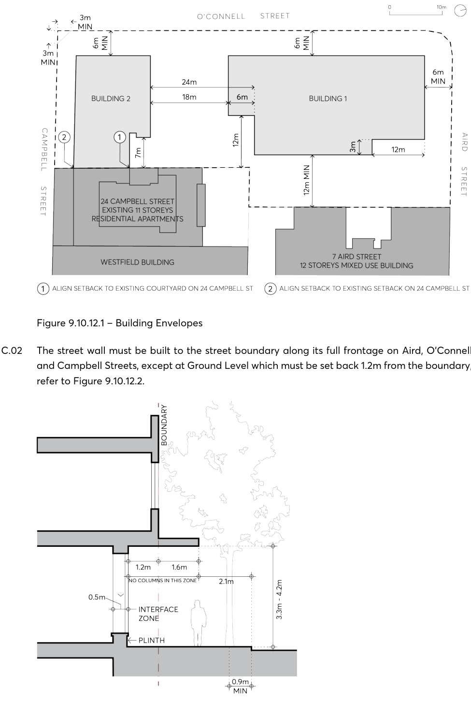

#### 9.10.12.1 BUILDING ENVELOPES

Objectives

O.01 Reinforce the spatial definition of the streets. O.02 Design the street walls with an appropriate human scale and sense of enclosure for the streets. O.03 Ensure that the axial view corridors from the entry to St John’s cemetery and along Aird Street are respected through the podium and recessed tower built form.

O.04 Protect daylight access at street level and permit views of sky from the streets by providing setbacks above street frontage height that promote separation between buildings.

O.05 Ensure that building form achieves comfortable public domain conditions for pedestrians, with adequate daylight, appropriate scale, and mitigation of wind effects of the tower building.

O.06 Ensure that the ground level interface provides shelter for pedestrians in the form of an awning as well as adequate space for street trees.

O.07 Ensure that built form achieves contextual fit with adjacent buildings on Aird and Campbell St. O.08 Ensure that built form enables a healthy environment for street trees.

Controls

C.01 Building envelopes must be consistent with Figure 9.10.12.1.

2 O’CONNELL STREET, PARRAMATTA

> [Picture on page 285: a picture, saved as a picture (images/part-09-parramatta-city-centre-page-285-2.gif, 150 dpi).]

Figure 9.10.12.1 – Building Envelopes

C.02 The street wall must be built to the street boundary along its full frontage on Aird, O’Connell and Campbell Streets, except at Ground Level which must be set back 1.2m from the boundary, refer to Figure 9.10.12.2.

2 O’CONNELL STREET, PARRAMATTA

Figure 9.10.12.2 – Street Section Aird St, O’Connell St and Campbell St

C.03 The street wall must incorporate a minimum splayed setback of 3 metres from the corner intersections for its full height.

C.04 Minor recesses in the street wall profile for modulation and articulation are permissible. C.05 Above the street wall:

a) Building 1 must be set back a minimum of 6 metres on O’Connell St and Aird St.

b) Building 2 must be set back a minimum of 6 metres on O’Connell St and line up with the existing adjacent building to the east on 24 Campbell St.

C.06 Setbacks must be measured perpendicular to the boundary to the outer faces of the buildings. C.07 The height of the street wall must be a minimum of 12.5 metres and a maximum of 21 metres from natural ground at footpath level. The height of the street wall at Aird and Campbell Streets must relate to the existing adjacent buildings.

C.08 Building 2 must be limited in height to 39 metres.
