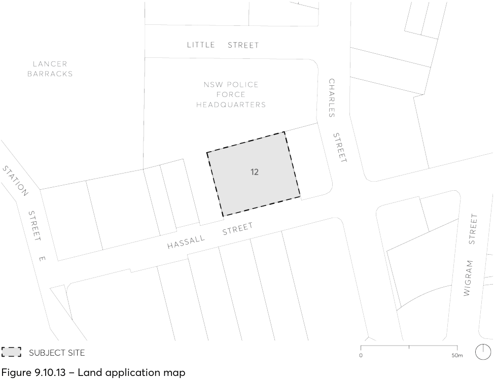

#### 9.10.13 12 HASSALL STREET

This Section applies to land at 12 Hassall Street, Parramatta (formally described as Lot 156 DP1240854) as shown in Figure 9.10.15.

> [Picture on page 290: a picture, saved as a picture (images/part-09-parramatta-city-centre-page-290-5.gif, 150 dpi).]

Figure 9.10.13 – Land application map

This Section is to be read in conjunction with other sections of this DCP and the relevant provisions within Parramatta LEP 2023.  If there is any inconsistency between this Section and other Sections of this DCP, this Section prevails.

This Section provides site-specific objectives and design controls to achieve development that is consistent with the desired future character.
