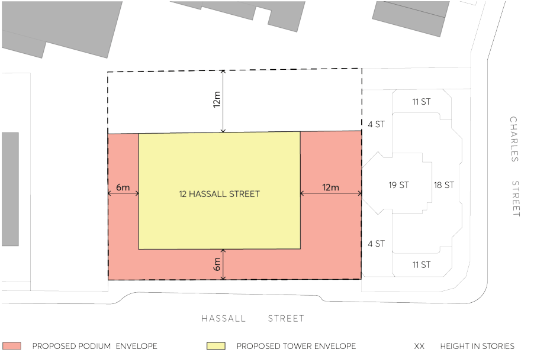
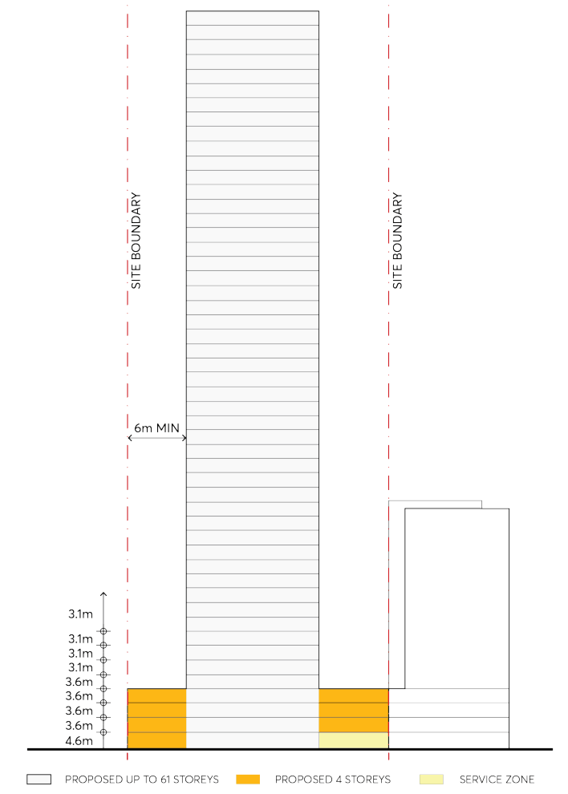

#### 9.10.13.2 BUILDING FORM

The provisions in this Section are intended to encourage a high-quality mixed use building form that will complement the City Centre and support the centre’s core employment role. A new building form should contribute to an active and improved public domain that will create a positive transition with existing development along the south-eastern edge of the Parramatta City Centre.

The building form is required to have a four storey podium at street level to define the street edge and narrow to a tower form above to maximise daylight and ensure the development and adjoining properties receive a high level of solar access.

Objectives

O.01 To provide an appropriate building scale that will provide appropriate setbacks to ensure a high level of amenity for future residents and adjoining sites.

12 HASSALL STREET

O.02 Create a street edge consistent with surrounding development and provide street definition. O.03 Ensure the building allows for appropriate setbacks to maintain high levels of solar access, maintain privacy and allow for view sharing.

O.04 Ensure that building form is appropriately articulated and modulated to minimise building bulk and scale.

Controls

Refer to Figures 9.10.13.2 to 9.10.13.4 which illustrate built form diagrams to support the setbacks outlined below.

Maximum Street Frontage Height

C.01 Maximum podium height of 4 storeys (15 metres), to match adjoining podium at 14 Hassall Street.

Maximum Tower Height

C.02 Maximum tower height of 61 storeys (192 metres). Street Frontage Setbacks C.03 The podium shall have a nil setback from Hassall Street. Basement Setback C.04 The basement carpark shall be setback from the northern boundary to provide opportunity for deep soil landscaping along the boundary.

Building Setbacks above Maximum Street Frontage Height C.05 The tower shall have a minimum setback of 6 metres from Hassall Street. C.06 Balconies are generally to be located within the building envelope, however may extend beyond the envelope to provide articulation to the building form.

C.07 Minor projections into the front building line setback for sun shading devices, entry awnings and building elements are permissible, but shall not extend further than 450mm.

Podium Side and Rear Setbacks C.08 The podium shall have a flexible setback of between nil to 6 metres from the western boundary. C.09 The podium shall have a minimum rear setback of 12 metres, variation to the rear setback to achieve a better urban design outcome may be considered.

C.10 The podium shall have no setback from the eastern boundary. Tower Side and Rear Setbacks C.11 The tower shall have a minimum setback for 6 metres from the western boundary. C.12 The tower shall be setback in accordance with the separation distance requirements of the Apartment Design Guide. The setbacks of the tower should ensure compliant solar access to the proposed units.

12 HASSALL STREET

> [Picture on page 293: a picture, saved as a picture (images/part-09-parramatta-city-centre-page-293-2.gif, 150 dpi).]

Figure 9.10.13.2 – Built form – setbacks and tower separations

12 HASSALL STREET

> [Picture on page 294: a picture, saved as a picture (images/part-09-parramatta-city-centre-page-294-2.gif, 150 dpi).]

Figure 9.10.13.3 – Built form Elevation and floor to floor heights
