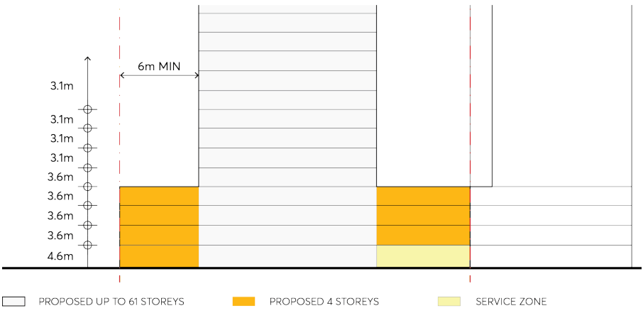

#### 9.10.13.4 PUBLIC DOMAIN AND LANDSCAPING

The development will improve the public domain with non-residential uses located at ground level. Improved pedestrian amenity will activate Hassall Street and create a place where people will interact to support the non-residential core of the City Centre. The ground level will be designed to enhance the environment along Hassall Street and provide pedestrian movement around the site and into the site to access non-residential uses at ground level.

Objectives

O.01 To encourage pedestrian movement at street level along the street frontage to provide increased natural surveillance.

O.02 Improve the natural environment to create a pleasant and desirable place to attract pedestrians and residents.

Controls

C.01 Publicly accessible spaces should incorporate public art, seating and other facilities to enhance the space.

C.02 The service zone shall be located adjacent to the eastern boundary to minimise conflict between vehicles and pedestrians, as shown in Figure 9.10.13.4 below.

C.03 Street tree planting shall be provided along Hassall Street in accordance with the Parramatta City Street Tree Planting Policy.

12 HASSALL STREET

> [Picture on page 296: a picture, saved as a picture (images/part-09-parramatta-city-centre-page-296-2.gif, 150 dpi).]

Figure 9.10.13.4 – Vertical view of the podium and service zone
