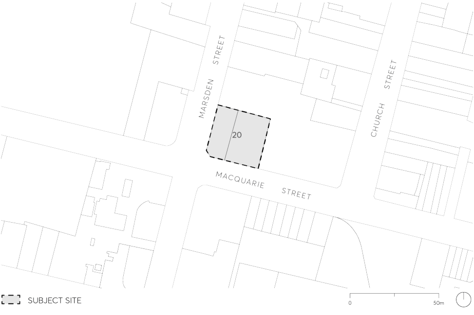

#### 9.10.14 20 MACQUARIE STREET

This Section applies to land at 20 Macquarie Street, Parramatta (formally described as Lot 1 DP 503651 and Lot 1 DP 501663) - the subject site - as illustrated in Figure 9.10.14.

> [Picture on page 297: a picture, saved as a picture (images/part-09-parramatta-city-centre-page-297-7.gif, 150 dpi).]

Figure 9.10.14 – Land application map

This Section is to be read in conjunction with other sections of this DCP and the relevant provisions within Parramatta LEP 2023.  If there is any inconsistency between this Section and other sections of this DCP, this section prevails.

This part establishes site specific principles, objectives and controls to be interpreted during preparation and assessment of development applications for the site.

The yield anticipated for the site via Clause 7.43 in Parramatta LEP 2023 comprises:

• Base FSR of 10:1.

• Maximum building height of 90 metres.

• Design Competition Bonus of 15% relating to Height and FSR to achieve 103.5m and FSR of 11.5:1. Note – This is subject to Clause 7.7 Sun access provisions in Parramatta LEP 2023).

20 MACQUARIE STREET

This Section sets relevant development controls for the form of the building, taking into account the anticipated yield in floor space. This bonus height and FSR will be achieved via Part 7, Division 3 Design excellence in Parramatta LEP 2023 at the Development Application stage.

Options for Development

The following Desired Future Character, Built Form, Design and Massing, Land Uses, Traffic and Transport Objectives can be presented for two development options, the options include:

• Option A – Retail and commercial uses on the lower floors and hotel and commercial uses above with underground parking below.

• Option B – Retail and commercial uses on the lower floors and residential uses above with underground parking below.

OPTION A – RETAIL, COMMERCIAL USES ON THE LOWER FLOORS AND HOTEL AND COMMERCIAL USES ABOVE WITH UNDERGROUND PARKING BELOW.
