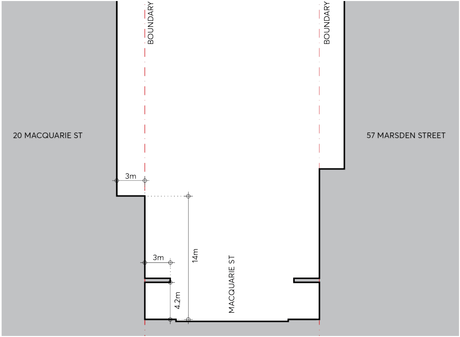
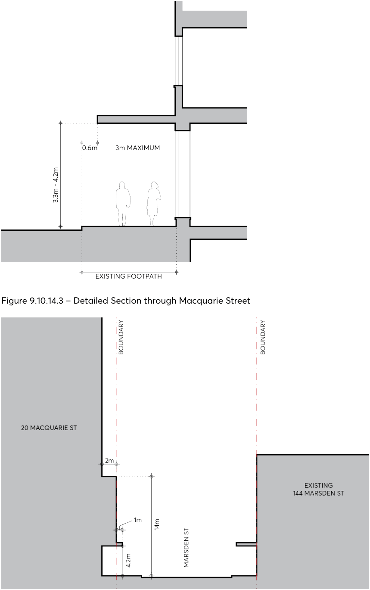
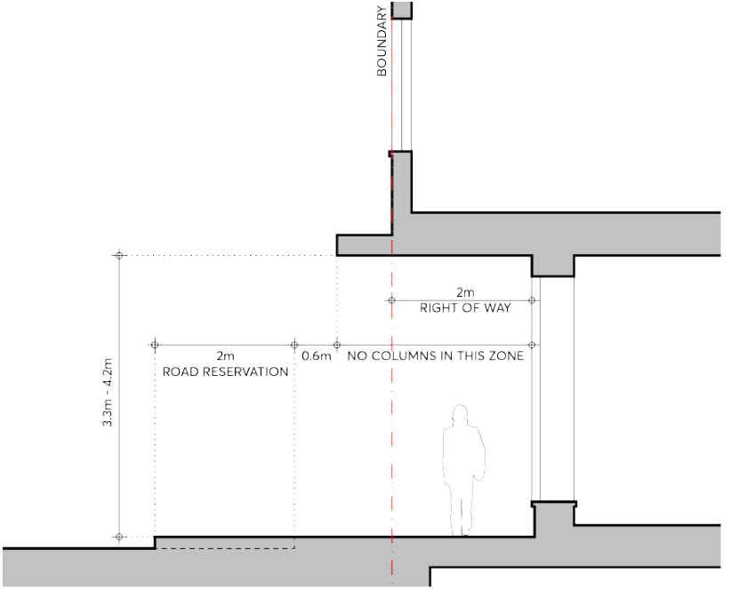

#### 9.10.14.2 BUILT FORM, DESIGN AND MASSING

Objectives

O.01 To ensure that the built form:

• Responds positively to the subject site’s location in relation to the Parramatta City Centre and the streetscape.

• Has a positive and cohesive relationship with surrounding land and uses.

• Has adequate separation to minimise visual bulk and to ensure adequate amenity within the site and to neighbouring development.

• Achieves usable and pleasant street and podium environment in terms of daylight and solar access, scale, and wind mitigation.

• Responds to the potential for future road widening on Marsden Street.

Controls

Street Frontage Heights C.01 Maximum street wall height of 14 metres (3 storeys) fronting Macquarie Street. Building Setbacks

20 MACQUARIE STREET

C.02 The minimum building setbacks are to be in accordance with the control table below:

|  | Minimum setback (m²) |
|---|---|
| PODIUM |  |
| All boundary (except Marsden Street) | 0m for the first 3 storeys or any building up to 14m in height |
| Western boundary (Marsden Street) |  |
| TOWER (UPPER LEVEL) COMMERCIAL |  |
| Western boundary (Marsden Street) | 2m |
| Eastern boundary | 9m or 6m if criteria are met – see table below ** |
| Northern boundary | 6m |
| Southern boundary (Macquarie Street) | 3m |

Western boundary (Marsden Street) podium setback C.03 The podium may overhang the 2 metres setback area, however, this will only be considered in the case that the proposed building satisfies the design excellence provisions within Part 7, Division 3 Design excellence in Parramatta LEP 2023 and complies with the 2 metres setback for a maximum of 4.2 metres above the finished level of the future footpath as per Figure 9.10.14.4

– Section 2 through Marsden Street and Figure 9.10.14.5 – Detailed Section through Marsden Street.

> [Picture on page 300: a picture, saved as a picture (images/part-09-parramatta-city-centre-page-300-11.gif, 150 dpi).]

Figure 9.10.14.2 – Section 1 through Macquarie Street

20 MACQUARIE STREET

> [Picture on page 301: a picture, saved as a picture (images/part-09-parramatta-city-centre-page-301-2.gif, 150 dpi).]

Figure 9.10.14.3 – Detailed Section through Macquarie Street

Figure 9.10.14.4 – Section 2 through Marsden Street

20 MACQUARIE STREET

> [Picture on page 302: a picture, saved as a picture (images/part-09-parramatta-city-centre-page-302-2.gif, 150 dpi).]

Figure 9.10.14.5 – Detailed Section through Marsden Street

Tower (upper level) Eastern Boundary – 6 metre Minimum Setback Criteria C.04 A lesser side setback on the eastern side boundary than 9 metres may be considered in the case that the proposed building satisfies the design excellence provisions within Part 7, Division 3 Design excellence of Parramatta LEP 2023 and the following specific criteria in the control table below:

| THEME | CONTROLS |
|---|---|
| Minimum side setback on the eastern boundary | The side setback is not less than 6 metres. |
| Minimum tower separation | The proposed tower is separated a distance of no less than 18m from any existing or proposed tower on the adjoining site to the east at 197 Church Street. |
| Public Domain Amenity | The proposed development ensures that the amenity of the public domain is retained and enhanced through adequate building separation such that: • Light can adequately penetrate between buildings. • Breezes can flow between buildings. • There are high quality and well-designed facades which can be seen and contribute to the visual amenity of the locality, the cityscape and beyond. |
| Design Quality | The proposed development achieves the highest level of design quality and design excellence such that it visually enhances the locality, the city scape and beyond. |

20 MACQUARIE STREET

| THEME | CONTROLS |
|---|---|
| Visual privacy | The proposed development achieves building separation to ensure reasonable levels of external and internal visual privacy. |
| Internal amenity | The proposed development achieves a high level of internal amenity and can provide adequate access to light and ventilation. |
| Heritage | The proposed development does not have an unreasonable impact on the heritage significance of the heritage listed shop adjoining at No. 197 Church Street, Parramatta. |

Tower floor plate C.05 The tower setbacks will accommodate a tower with a floorplate of approximately 750m². Building design C.06 The street wall /podium is to be a separate architectural element, that is distinct and different in character from the tower element.

C.07 High quality design and materials are to be used for the security shutters into the car park and loading areas.

C.08 Should residential land uses be included, a vegetated rooftop terrace is to be provided in the podium that is usable taking into account solar access and wind mitigation.

C.09 Overshadowing is to be minimised within the area of Parramatta Square outlined in the blue hatched area of Parramatta Square identified as “No additional overshadowing” within the Sun Access Protection Map in Parramatta LEP Plan 2023. The building shall be designed so that no single point of the area identified above is in shadow between 12.00pm and 2.00pm in mid-winter.
