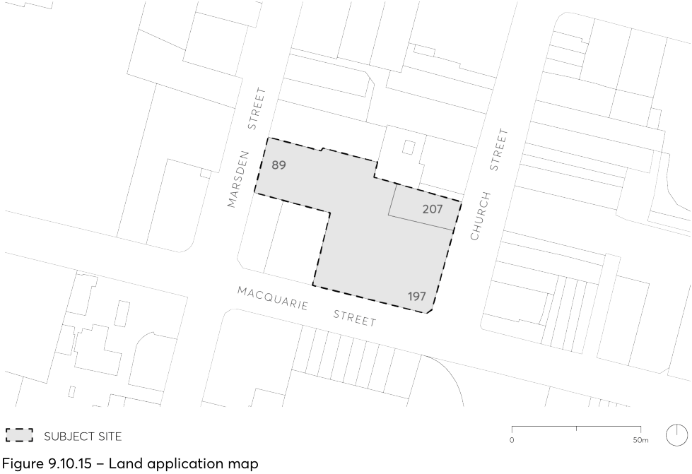

#### 9.10.15 197 AND 207 CHURCH STREET AND 89 MARSDEN STREET

This Section applies to land at 197 and 207 Church Street and 89 Marsden Street, Parramatta (197 Church Street) as illustrated in Figure 9.10.15. The subject land is formally described as Lot 1 DP 710335 and Lot 1 DP 233150.

> [Picture on page 308: a picture, saved as a picture (images/part-09-parramatta-city-centre-page-308-6.gif, 150 dpi).]

Figure 9.10.15 – Land application map

This Section is to be read in conjunction with other sections of this DCP as well as with the relevant provisions in Parramatta LEP 2023.  If there is any inconsistency between this Section and other Section of this DCP, this Section prevails.

This Section establishes objectives and controls to be interpreted for the preparation and assessment of any development application for the subject site and supports the objectives of Parramatta LEP 2023.
