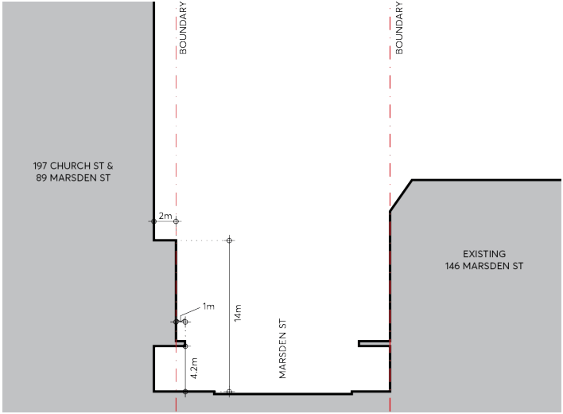
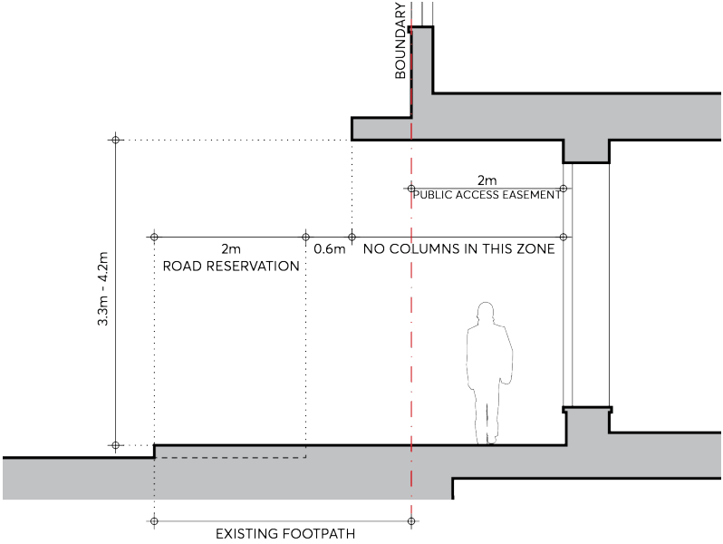

#### 9.10.15.2 BUILT FORM

The reference design is a guide to future development on the site and is based on a proposal that provides for two towers above a podium which will cover the entire site. The tower on the south and eastern part of the site comprises commercial floor space. The tower on the north-western part of the site (fronting Marsden Street) comprises hotel accommodation.

Retail floor space may be provided on the ground floor of the podium, as well as within a lower ground/basement level, which has been designed to accommodate a small format supermarket. Site servicing (loading, unloading, waste collection) may also occur on basement level 1. Car parking will be located within basement levels accessed from Macquarie Street.

197 AND 207 CHURCH STREET AND 89 MARSDEN STREET

Objectives

The following design objectives are to be considered in relation to development on the site: O.01 Towers are to be designed to ensure solar access to the key public space within Parramatta Square is maintained.

O.02 Activation of street frontages to Church Street, Macquarie Street and Marsden Street is to be provided.

O.03 Opportunities to connect with the development on 20-22 Macquarie Street at ground level to be considered.

O.04 The existing facade of the Murray Bros building along Church Street and Macquarie Street (including the awning) is to be retained. Access arrangements are to respect the heritage values of the facade.

O.05 Incorporate design features to eliminate wind downdrafts on Marsden and Macquarie Streets. O.06 Provide awnings along all street frontages, where these can be incorporated without compromising heritage features.

O.07 Provide opportunities to accommodate a major retail tenant within the ground floor or lower ground floor areas.

Controls

C.01 The setbacks along Marsden Street are to be consistent with those shown in Figures 9.10.15.2 and 9.10.15.3.

C.02 The parapet wall along Marsden Street is to align with the parapet height of the Marsden Street frontage of the adjoining development on 20 Macquarie Street. Refer Figures 9.10.15.2 and 9.10.15.3.

> [Picture on page 310: a picture, saved as a picture (images/part-09-parramatta-city-centre-page-310-24.gif, 150 dpi).]

Figure 9.10.15.2 – Marsden Street Frontage – Setbacks to Podium and Tower

197 AND 207 CHURCH STREET AND 89 MARSDEN STREET

C.03 A zero setback to Macquarie Street for the podium, with the tower element being setback a minimum of 6 metres to Macquarie Street.

C.04 A zero setback to Church Street for the podium, with the tower element being setback a minimum of 12 metres from Church Street.

C.05 The separation between towers used for non-residential uses on the site shall be a minimum of 12 metres.

C.06 Setbacks to adjoining property boundaries will generally be a minimum of 6 metres for non-residential uses.

C.07 If residential uses are proposed, setbacks to adjoining property boundaries will be a minimum of 9 metres, and inter-building separation of 18 metres between residential uses and compliant with the design criteria specified in Part 2F of the Apartment Design Guide. Note – The above controls are illustrated on the Site Reference Site Plan at Figure 9.10.15.4.

> [Picture on page 311: a picture, saved as a picture (images/part-09-parramatta-city-centre-page-311-14.gif, 150 dpi).]

Figure 9.10.15.3 – Detailed Section through Marsden Street
