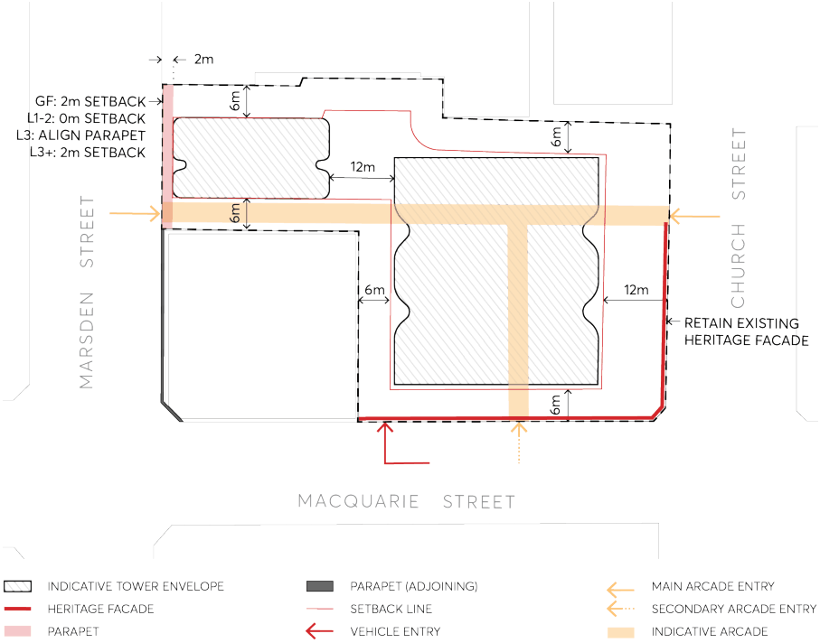

#### 9.10.15.3 PUBLIC DOMAIN

The fine grain pedestrian network is a key aspect of the public domain. The pedestrian amenity provisions in this section are intended to achieve a high quality of urban design, pedestrian comfort and safety in the City Centre.

197 AND 207 CHURCH STREET AND 89 MARSDEN STREET

Parramatta’s streets, lanes, arcades and through-site links should form an integrated and legible pedestrian network providing choice of routes at ground level for pedestrians. The design of individual developments will be required to contribute to and integrate with this network.

The site offers an opportunity to enhance the public domain by the provision of through-site pedestrian links to and from key destinations within the City Centre.

Objectives

The following design principles are to be considered in relation to public domain features within any future development:

O.01 Improve access within and through the City Centre by providing new through-site links. O.02 Contribute meaningfully to the legibility of the pedestrian network. O.03 Provide active frontages to through-site links. O.04 Design through-site links having regard to pedestrian amenity and safety. O.05 Design to separate vehicular entries from primary pedestrian thoroughfares.

Controls

C.01 A through-site pedestrian link from Church Street to Marsden Street is to be incorporated. C.02 A through-site pedestrian link from Macquarie Street to the Church Street/Marsden Street through-site link is to be provided.

C.03 Arcades must be located in a mid-block position or where connections can be made between other public spaces as agreed with Council.

C.04 Arcades must not compromise, or take precedence over, the activation of adjacent streets. C.05 Where possible, arcades must be aligned with existing arcades or laneways across blocks. C.06 Arcades must provide clear access and sight lines from one end to the other and be designed so as to:

a) Be well-proportioned with a minimum width of 4 metres and minimum ceiling height of 4.5 metres.

b) Have a 1:20 maximum gradient.

c) Connect one public space to another in a clear and obvious way.

d) Act as a supplementary connection rather than a primary one.

e) Conform to the relevant controls relating to active ground floor frontage contained elsewhere in this Section.

Note – The above controls are illustrated on the Site Reference Site Plan at Figure 9.10.15.4.

197 AND 207 CHURCH STREET AND 89 MARSDEN STREET

> [Picture on page 313: a picture, saved as a picture (images/part-09-parramatta-city-centre-page-313-2.gif, 150 dpi).]

Figure 9.10.15.4 – Site Reference Plan and Footprint
