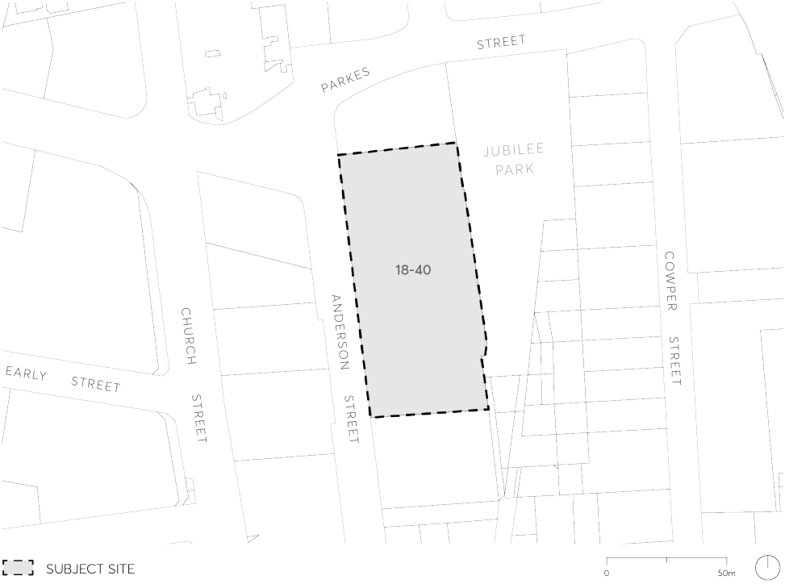

#### 9.10.16 18-40 ANDERSON STREET

This Section applies to 18-40 Anderson Street, Parramatta. The site comprises Lot 20 DP792518 which flanks the western side of Jubilee Park as shown in Figure 9.10.16.

> [Picture on page 320: a picture, saved as a picture (images/part-09-parramatta-city-centre-page-320-5.gif, 150 dpi).]

Figure 9.10.16 – Land application map

This Section must be read in conjunction with other sections of this DCP and the relevant provisions in Parramatta LEP 2023. If there is any inconsistency between this Section and other Sections of this DCP, this Section prevails.
