#### 9.10.16.1 DESIRED FUTURE CHARACTER

The site is redeveloped into a high-quality mixed-use development with potential for hotel, residential and ground floor retail uses. Future development responds to the site’s unique characteristics as a flood-prone site fronting Jubilee Park by providing appropriate stormwater and flooding management and minimising overshadowing to the park.

An improved public domain is a key component of future development. The site provides a pedestrian link along its eastern boundary with connection to Jubilee Park and a new public park for passive recreation, which will contribute to the walkability and amenity of the immediate locality.

18-40 ANDERSON STREET

Site Objectives

O.01 To create a high-quality urban environment that provides a mix of uses including hotel, commercial and high density residential.

O.02 To allow for viable hotel and residential floor plates while ensuring that built form responds to site constraints related to flooding, overshadowing and tree protection.

O.03 To improve the quality and function of the public domain through provision of new pedestrian links and new park for passive recreation.

O.04 To minimise overshadowing to Jubilee Park. O.05 To protect the mature fig trees in the northern portion of the site. O.06 To encourage activation of the street and public domain. O.07 To enable adequate flood conveyance and management while providing for the embellishment of portions of the Clay Cliff Creek corridor.

O.08 In the case that two vehicle crossings over the footpath to access basements and service areas are unavoidable, to create a place for pedestrian respite when negotiating the two vehicle crossings, that also accommodates street trees within the respite space, without impeding the view of oncoming traffic.

Site Controls

Public Domain and Landscaping

C.01 Provide a 3 metre-wide public pedestrian access path along the eastern boundary of the site as identified in Figure 9.10.16.2. The path should include a pedestrian bridge over Clay Cliff Creek connecting to Jubilee Park in the location identified in Figure 9.10.16.3.

C.02 Provide a public park in the south of the site as identified in Figure 9.10.16.2. The park should be designed to cater for passive recreation and to minimise flood flow obstructions. The park should also provide a continuous tree canopy between Jubilee Park and Anderson Street.

18-40 ANDERSON STREET

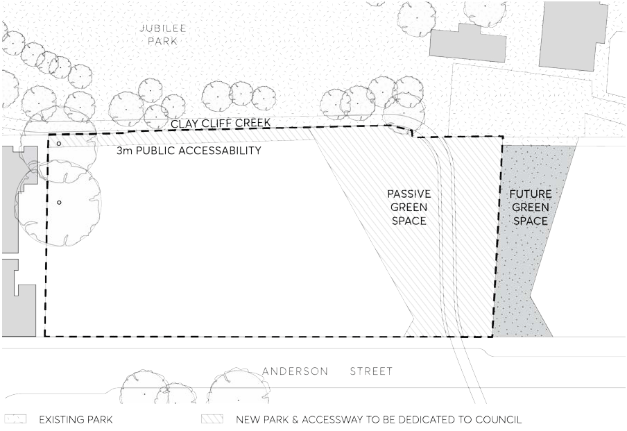

> [Picture on page 322: a picture, saved as a picture (images/part-09-parramatta-city-centre-page-322-2.gif, 150 dpi).]

Figure 9.10.16.2 – Public domain plan

C.03 Public pathways that are named with street signage, lighting and street address are to be provided along the Jubilee Park interface and the park to the south. Development should be designed to address, and provide an accessible and public interface to, the pedestrian access path and southern park identified in C.01 and C.02.

C.04 Landscaping is to reflect the level of solar access through the site. Shade tolerant species and permeable hard surfaces are to be used in heavily shaded areas.

C.05 Provide an active frontage along Anderson Street. Active frontage is defined as one or a combination of the following at street level:

a) Retail premises or business premises with entry from the street.

b) Active office uses, such as reception, if visible from the street.

c) Glazed lobby entries.

Areas for vehicular access are excluded from this requirement.

C.06 Minimise the extent of vehicular access presenting to the street.  Access is to be limited to a porte-cochere and a single two way entry point off Anderson Street for both hotel and residential uses. The vehicular entry should be discrete and recessive.  Façade materials should be applied to the interior of vehicular entries.

C.07 Design of the raised pedestrian lane and pedestrian connection as per Figure 9.10.16.3 must meet the following requirements:

18-40 ANDERSON STREET

a) Be raised above the 1% flood level, as per Council’s Flood Engineers advice, using retaining walls design to withstand flood effects. Special consideration and horticultural advice should be applied when designing and constructing the footway within the Tree Protection Zone (TPZ) of the adjacent Ficus trees.

b) Align with building ground floor and provide for and ensure 24/7 safe public accessible access within the building during an emergency flood period.

c) Meet existing ground level using footway graded no steeper than 1:20 (V:H), steps and ramps should be avoided. The raised footway must provide access to existing ground level beyond the 1% flood extent, to allow emergency evacuation if required.

d) Design and material selection of the raised footway and associated hardware ie railings, be commensurate to a 24/7 publicly accessible space, to be of high quality and standard of finish, and that the building design compliment.

e) Lighting should be provided from the building and avoid light spill into the adjacent park spaces.

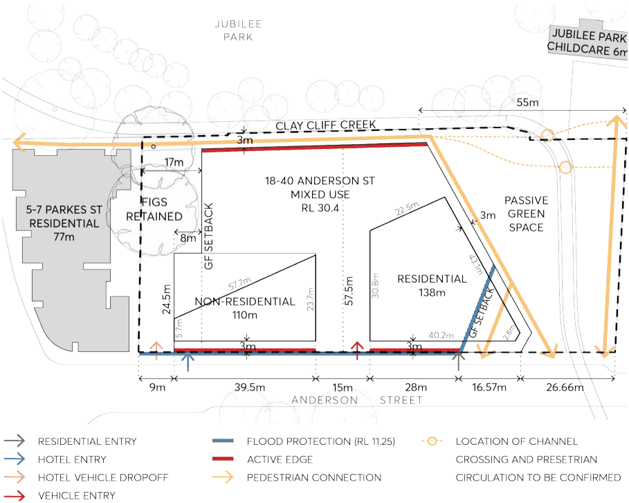

> [Picture on page 323: a picture, saved as a picture (images/part-09-parramatta-city-centre-page-323-16.gif, 150 dpi).]

Figure 9.10.16.3 – Land use plan

C.08 Use of space within the setbacks associated with the Fig trees must ensure the long-term viability and sustainability of the fig trees. An Arboricultural Impact Assessment and Tree Protection Plan must be provided prior to any design, prior to construction and post

18-40 ANDERSON STREET

construction. The report must also include recommendations to reuse and transplant existing vegetation such as the palms.

C.09 If two vehicle crossings over the footpath to access basements and service areas are unavoidable, they must be separated and there should be sufficient space between the vehicle crossings so that:

a) The space between the vehicle crossings must be a minimum 4 metres to allow for the installation of CoP Street tree planting in StrataVault with Mass Planting detail, subject to Council advice.

b) This detail and surface finish of the tree pit may be modified to use a tree grate, subject to Council advice.

c) The vehicle crossing must be installed as per Council Heavy Vehicle detail DS9 or DS45, subject to Council advice.

d) The placement of the vehicle crossing should not impose on the overall dimensions and performance of the street tree(s) planter bed, subject to Council advice.

Building Envelope

C.10 Building heights must be consistent with the building envelopes in Figure 9.10.16.4 to Figure 9.10.16.9. Note – additional height for the northern tower may be available through LEP provisions.

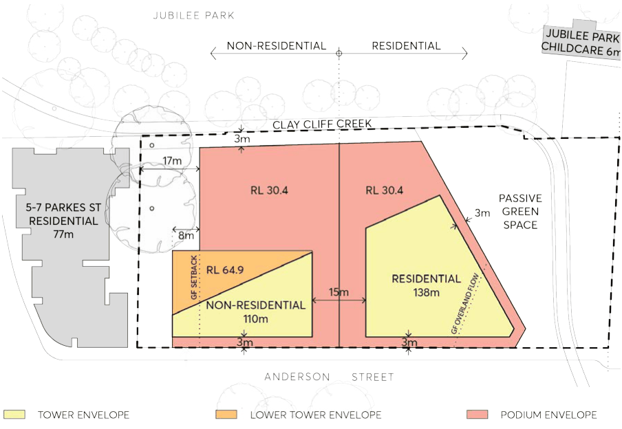

> [Picture on page 324: a picture, saved as a picture (images/part-09-parramatta-city-centre-page-324-20.gif, 150 dpi).]

Figure 9.10.16.4 – Building envelope plan

18-40 ANDERSON STREET

C.11 Building setbacks must be consistent with Figure 9.10.16.5 to Figure 9.10.19.10. Setbacks must be measured perpendicular to the boundary to the outer faces of the building including balconies, sunscreens, and the like.

C.12 Provide a podium to a maximum height of RL 30.4 and 0m setback along Anderson Street and the new southern park (subject to C.16), with a minimum 3 metre setback above the podium.

C.13 Provide a minimum 9 metres setback from the northern boundary for the northern tower and the western portion of the northern podium form as shown in Figure 9.10.16.5.

C.14 Provide a minimum 17 metres setback from the northern boundary for that part of the podium adjacent to the mature fig trees, as shown in Figure 9.10.16.4.

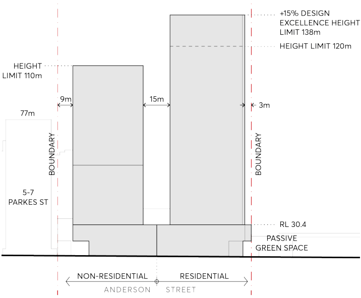

> [Picture on page 325: a picture, saved as a picture (images/part-09-parramatta-city-centre-page-325-11.gif, 150 dpi).]

Figure 9.10.16.5 – Building envelope Anderson Street elevation

C.15 Provide a minimum 15 metres of building separation between the commercial and residential tower forms within the site so that tower buildings appear ‘in the round’ as shown in Figure 9.10.16.5. The 15 metres setback is based on the northern hotel tower not having primary sources of light and ventilation to habitable uses located on the southern façade. Should habitable uses accessing light and ventilation be proposed on both sides of this setback, a minimum inter building separation of 18 metres must be provided.

18-40 ANDERSON STREET

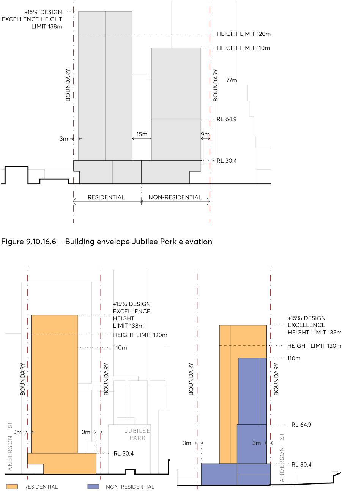

> [Picture on page 326: a picture, saved as a picture (images/part-09-parramatta-city-centre-page-326-2.gif, 150 dpi).]

Figure 9.10.16.6 – Building envelope Jubilee Park elevation

Figure 9.10.16.7 – Building envelope south Figure 9.10.16.8 – Building envelope north elevation

elevation

18-40 ANDERSON STREET

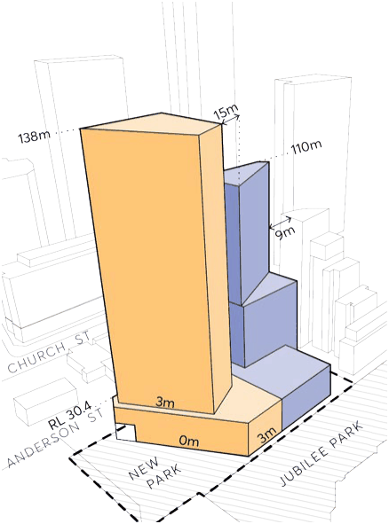

> [Picture on page 327: a picture, saved as a picture (images/part-09-parramatta-city-centre-page-327-2.gif, 150 dpi).]

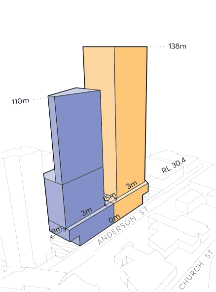

> [Picture on page 327: a picture, saved as a picture (images/part-09-parramatta-city-centre-page-327-3.gif, 150 dpi).]

Figure 9.10.16.9 – Envelope perspective from Figure 9.10.19.10 – Envelope perspective from south-east

north-west

C.16 Development in the area identified as ‘1’ on Figure 9.10.16.11 must not cause any additional overshadowing, on 21 June in any year, to Jubilee Park (shown hatched grey) between 12:00 and 14:00.

18-40 ANDERSON STREET

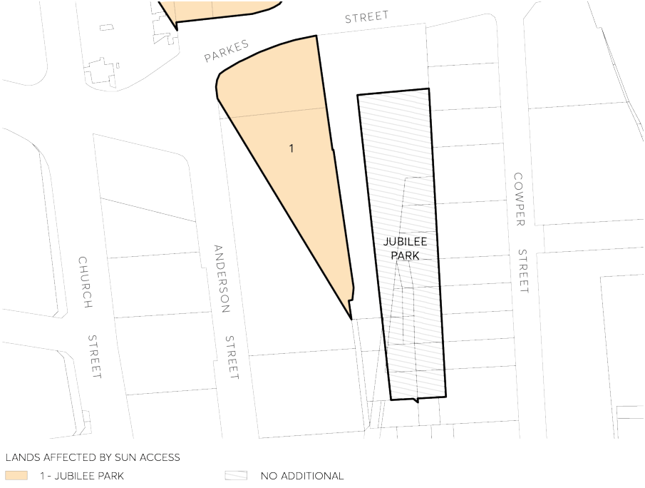

> [Picture on page 328: a picture, saved as a picture (images/part-09-parramatta-city-centre-page-328-2.gif, 150 dpi).]

Figure 9.10.17.11 – Jubilee Park Sun Access Protection Map

Flooding and Stormwater Management

C.17 Implement measures to convey floodwaters in the Clay Cliff Creek Corridor through the property such that development causes minimal adverse flooding impacts on adjoining properties during the 1% AEP event compared to existing conditions.

C.18 Provide landscaping embellishments to the surroundings of Clay Cliff Creek on the eastern and southern sides of the development site and-within the park in the southern end of the site in order to enhance the character of the creek environment. The landscaping should result in no adverse impacts on adjoining properties during the 1% AEP event compared to existing conditions.

C.19 In order to achieve minimal adverse flooding impacts on adjoining properties in Anderson Street during the 1% AEP event compared to existing conditions, development must have a ground floor that is set back from the southwest corner of the site generally in accordance with Figure 9.10.16.4 to Figure 9.10.16.10. Any cantilever element above the setback (excluding any structural support columns or similar) must have a minimum 4 metre clearance above the ground surface level of the overland flow path.

Parking and Access

C.20 A porte-cochere driveway entry may be provided if it is well integrated into the site layout and includes appropriate landscaping to improve the driveway’s interface to the public domain.

18-40 ANDERSON STREET

C.21 All areas for vehicle passenger set down/pick up, car parking, loading, deliveries and servicing shall be located within the boundaries of the site.

C.22 All vehicles, including service vehicles, shall enter and exit the site in a forward direction. C.23 In addition to the porte-cochere, a single two-way entry point off Anderson Street is permitted to serve both hotel and residential uses.

Architectural Resolution

C.24 The northwest corner of the northern tower must be designed to recognise its prominent location at the viewpoint terminus for eastbound traffic along Great Western Highway. Emphasis should be placed on views to sky and visibility beyond as much as the building presentation. This aspect must be incorporated in any roof level signage if provided.

C.25 The setback area at ground level required under Control C.11 must be expressed architecturally as an “urban room” with a positive interface to the adjoining public domain.

C.26 A defined street wall with the towers set clearly back must be provided along all public interfaces to the east, south and west as per detailed sections shown in Figure 9.10.16.12, Figure

9.10.16.13 and Figure 9.10.16.14. This street wall must:

a) Be built to the street alignment at all levels along its full frontage except where identified for a porte cochere and flood conveyance.

b) Be modulated in vertical increments that relate to a traditional subdivision pattern.

c) Be of predominantly masonry character with limited amounts of glass and no lightweight panel construction.

d) Be articulated with depth, relief, and shadow on the street façade. A minimum relief of 150mm between the masonry finish and glazing face must be achieved.

18-40 ANDERSON STREET

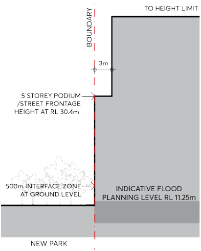

> [Picture on page 330: a picture, saved as a picture (images/part-09-parramatta-city-centre-page-330-2.gif, 150 dpi).]

Figure 9.10.16.13 – New Park (South) Street

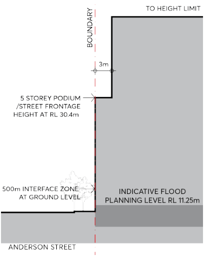

> [Picture on page 330: a picture, saved as a picture (images/part-09-parramatta-city-centre-page-330-4.gif, 150 dpi).]

Figure 9.10.16.12 – Anderson Street (East)

Wall

Street Wall

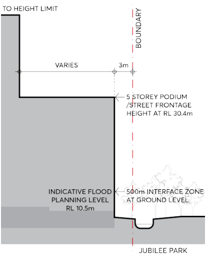

> [Picture on page 330: a picture, saved as a picture (images/part-09-parramatta-city-centre-page-330-8.gif, 150 dpi).]

Figure 9.10.16.14 – Jubilee Park (West) Street Wall Indicative Flood Planning Level is 10.74m AHD

e) Utilise legible architectural elements and spatial types (doors, windows, loggias, reveals, pilasters, sills, plinths, frame and infill, etc.) not necessarily expressed in a literal traditional manner.

18-40 ANDERSON STREET

f) Include a ground floor facade design which intensifies the walking experience with particular richness in detail.

C.27 Under crofts or other interruptions of the street wall which expose the underside of the tower and amplify its presence on the street are not permitted.

C.28 The active ground floor frontage must be considered in detail, and the following must be incorporated in its design:

a) A nominal 500mm interface zone at the frontage must be set aside to create interest and variety in the streetscape. This zone is for design elements such as setbacks for entries, opening of windows, seating ledges, benches and general articulation.

b) The facade must have a high-level of expressed detail and tactile material quality.

c) The articulation of the facade must include a well resolved meeting with the ground that also takes account of any slope. A horizontal plinth, integrated in the design, must be incorporated at the base of glazing to the footpath.

d) Building entries should be clearly legible.

e) Fire escapes and service doors must be seamlessly incorporated into the facade with quality materials.

f) All required services must be incorporated in the design of the ground floor frontage at DA stage.

89-91 GEORGE STREET
