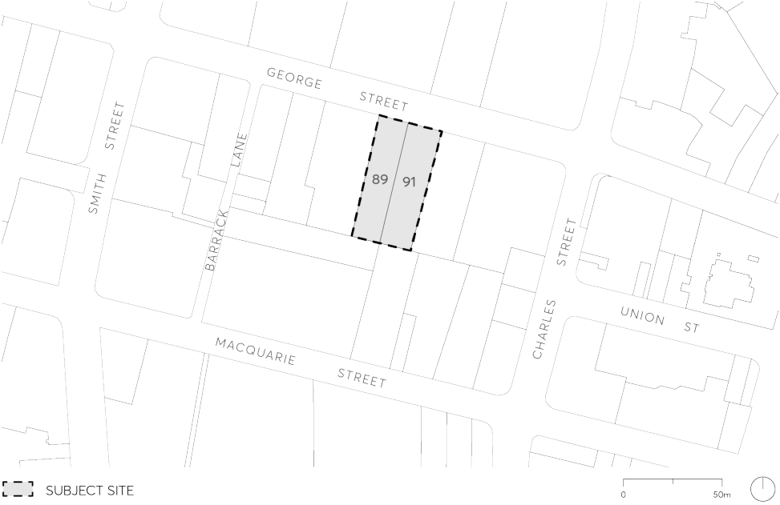

#### 9.10.17 89-91 GEORGE STREET

This Section applies to 89 to 91 George Street, Parramatta comprising two parcels of land fronting George Street, legally known as Lot 1 DP 505486 and Strata Plan 71180, as shown in Figure 9.10.17.

> [Picture on page 332: a picture, saved as a picture (images/part-09-parramatta-city-centre-page-332-5.gif, 150 dpi).]

Figure 9.10.17 – Land application map

This Section is to be read in conjunction with other sections of this DCP and the relevant provisions in Parramatta LEP 2023. If there is any inconsistency between this Section and other Sections of the DCP, this Section prevails.
