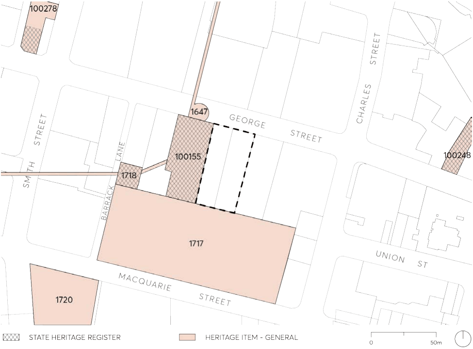
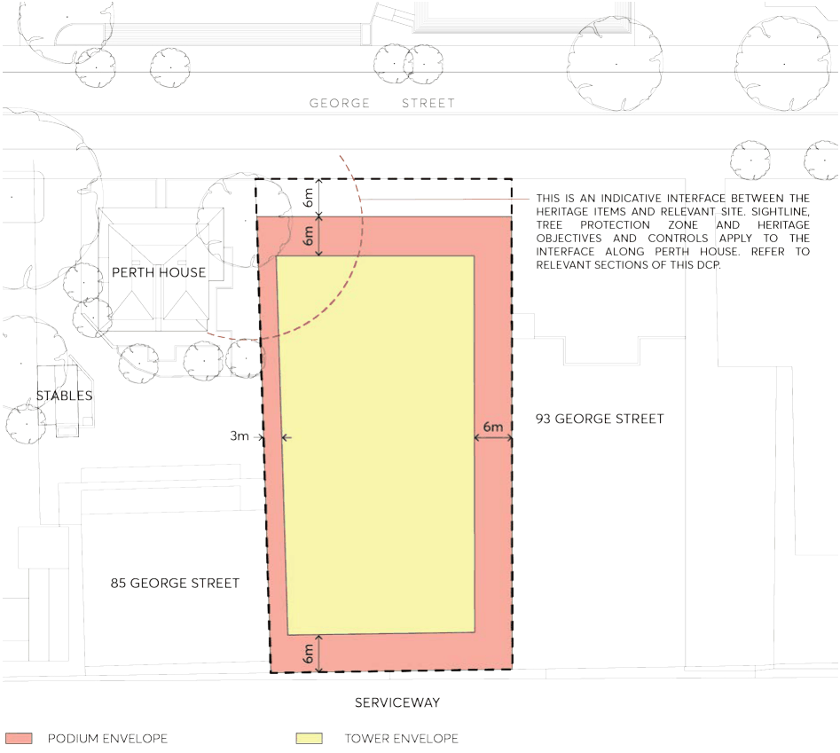

#### 9.10.17.2 HERITAGE

The subject site is does not comprise a listed heritage item on the Parramatta LEP 2023 or the State Heritage Register (SHR); however as identified in Figure 9.10.17.2, it is located in the vicinity of a number of state and locally listed heritage items, including:

• Perth House, stables, carriageway (SHR no. 00155) - 85 George Street, Parramatta

• Moreton Bay Fig (heritage tree) (SHR no. 00155) – 85 George Street, Parramatta

• Convict Barracks Wall and Potential Archaeological Site (Item no. I717) – 80-100 Macquarie Street, Parramatta

• Convict Drain (Item no. I647) – George Street

• Arthur Phillip High School (Item no. I1720) at 175 Macquarie Street, Parramatta.

• Olive Tree (unidentified item subject to future investigation due to potential to be original planting)

– 85 George Street, Parramatta.

Parramatta LEP 2023 sets out the controls for development within the vicinity of heritage items.

89-91 GEORGE STREET

> [Picture on page 334: a picture, saved as a picture (images/part-09-parramatta-city-centre-page-334-2.gif, 150 dpi).]

Figure 9.10.17.2 – State and local heritage items in the vicinity of the subject site

Objectives

O.02 Embrace the distinctive local context by recognising the contextual relationship with the surrounding heritage listed items through a scale and form that is contextually appropriate and for Perth House to be visually prominent when viewed against the podium of new development.

O.03 Conserve the heritage significance of 85 George and 80-100 Macquarie Street by respecting the heritage buildings and settings.

O.04 Ensure future development of the site limits its impact on the setting of nearby heritage items and allows Perth House to be visually prominent against the podium of new development.

O.05 To create a commercial building with setbacks and articulation that are compatible with maintaining a strong streetscape presence for the adjoining heritage item “Perth House”.

Controls

C.01 The development should respond to and protect the significance of Perth House and identified trees, considerate of the heritage interface as shown in Figure 9.10.17.3 in the following ways:

a) Podium setbacks to the north (George Street) and west (Perth House – 85 George Street) should comply with the following design principles:

89-91 GEORGE STREET

i views from George Street to the eastern façade of Perth House should be maximised and enhanced by articulation and selection of materials and finishes; and

ii setbacks should maintain and enable continued maturity of the Olive Tree associated with Perth House.

b) The tower form should have a minimum 3 metre separation from the property boundary adjoining Perth House.

c) The western façade of the podium is to be designed to respect the scale and maintain legibility of the eastern façade of Perth House through articulation and appropriate selection of materials and finishes.

d) Subject to design excellence and environmental impact studies, the western façade of development should have vertical walls, with protrusions and recesses minimised to create a subdued and composed podium that allows Perth House to be visually prominent.

e) Landscaping should generally be based on historic landscaping layouts and schemes, and should be used to enhance Perth house presentation.

f) Ground floor areas of the future building should provide a direct outlook to the Perth House curtilage, with visual clutter adjacent to Perth House minimised.

g) New buildings must incorporate interpretation of heritage significance of the place.

Note – Proponents are referred to best-practice guidelines including Design in Context guidelines for infill development in the historic environment, prepared by the NSW Heritage Office (now Heritage Branch, Office of Environment and Heritage) and RAIA (now Australian Institute of Architects).

C.02 Any proposal that includes the use of any part of the grounds of Perth House adjoining the site is to minimise impacts on heritage significance having regard to the principles of the Conservation Management Plan for Perth House.

C.03 Provide opportunities for views of Perth House from George Street (east) with the provision of a heritage view corridor along the frontage of the subject site to maintain the appreciation of the state heritage item and significant trees from the George Street.

C.04 The fig and olive trees listed as being of heritage significance on 85 George Street as well as existing trees that contribute to the setting of Perth House, must be retained and protected.

C.05 Materials, finishes and colours for the new development must be carefully selected to ensure that they will not be visually intrusive in the setting of Perth House.

C.06 Signage must be located so that it does not obscure Perth House or adversely affect its setting.

89-91 GEORGE STREET

> [Picture on page 336: a picture, saved as a picture (images/part-09-parramatta-city-centre-page-336-2.gif, 150 dpi).]

Figure 9.10.17.3 – Heritage Interface (Source: Fender Katsalidis Architects)
