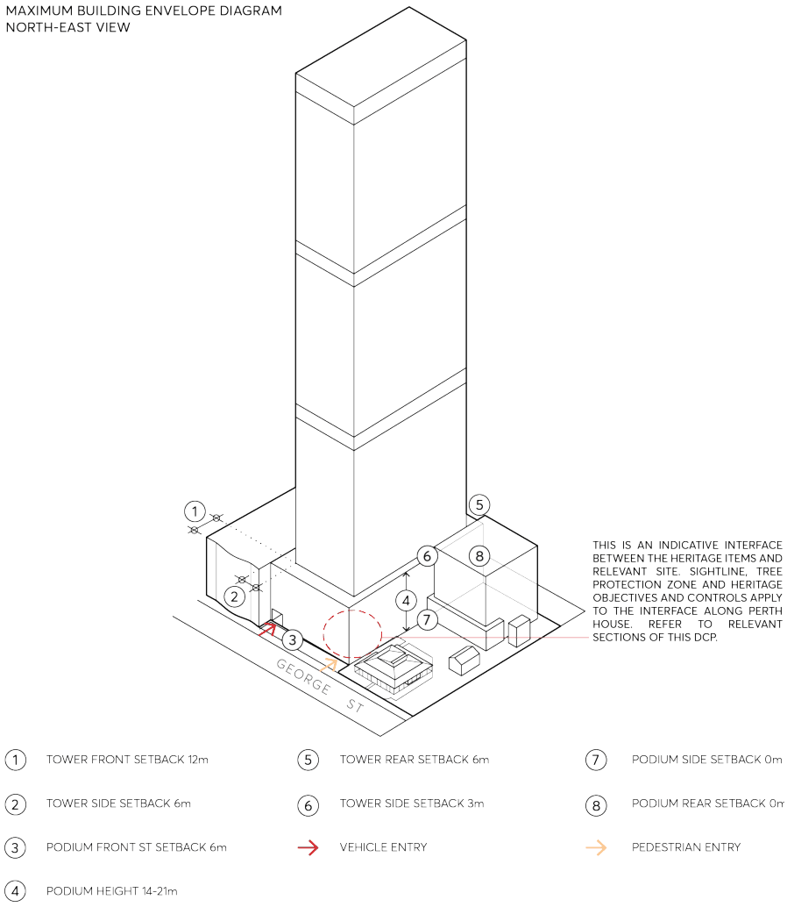
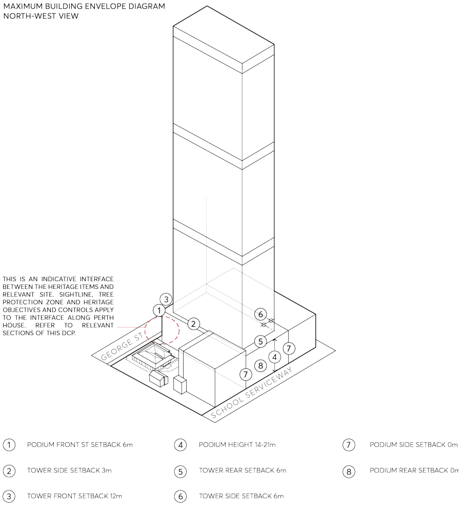
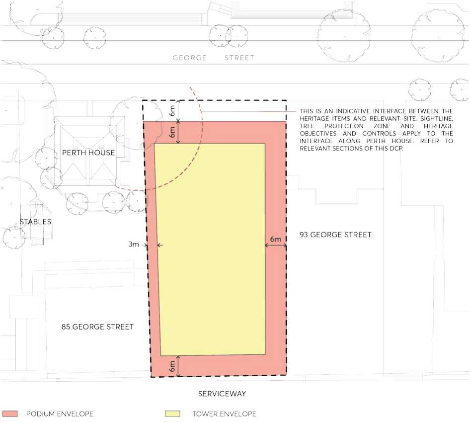

#### 9.10.17.3 BUILT FORM

This section seeks to establish built form controls for the site to deliver a development which exhibits architectural design excellence and will positively contribute to the emerging and future character of the Parramatta City Centre. The urban form will enable commercial uses to support a thriving economic City Centre and promoting modern and flexible workplaces.

Objectives

O.01 Facilitate the redevelopment of the site to achieve a high-quality urban form which respects the heritage significance of adjoining sites and exhibits design excellence.

O.02 Establish the building envelope requirements for 87-91 George Street, Parramatta and facilitate designers as part of a future design excellence competition.

89-91 GEORGE STREET

O.03 The built form is to provide for flexible and efficient commercial floorplates suitable for achieving A grade office space without compromising the heritage objectives of the DCP controls.

O.04 Provide for a range of retail uses for the activation of the ground floor plane along George Street suitable for day and night-time activities.

O.05 Respond to the potential for future road widening and footpath construction within the George Street frontage.

Controls

C.01 Development should be in accordance with the identified Maximum Building Envelope Diagram as shown in Figures 9.10.17.4 and 9.10.17.5. The following setback requirements are applicable with consideration of the relevant design excellence and heritage objectives: Podium Setbacks to be observed are:

• Zero Net Carbon in operation.

• 6 metres to the North (front) George Street Podium Setback

• 0 metres West (side) Podium Setback

• 0 metres East (side) Podium Setback

• 0 metres South (rear) Podium Setback

• Podium setbacks at the north-west corner will be subject to additional design controls relating to the interface with the adjacent heritage item and are to address the heritage objectives and controls within the DCP. Tower Setbacks to be observed are:

• 12 metres to the North (front) George Street Tower Setback

• 3 metres West (side) Tower Setback

• 6 metres East (side) Tower Setback

• 6 metres South (rear) Tower Setback

C.02 The podium height is to be between 14 metres to 21 metres above the ground level. C.03 The podium setbacks to the north (George Street) and west (Perth House – 85 George Street) should comply with the following design principles as shown in 9.10.17.6:

a) Views from George Street to the eastern façade of Perth House should be maximised and enhanced by articulation and selection of materials and finishes.

b) Setbacks should maintain and enable continued maturity of the heritage protected Olive Tree associated with Perth House.

C.04 The new development is to provide suitable levels of solar access to 85 George Street. C.05 Roof design is to make a positive contribution to the quality of the City Centre skyline. C.06 Opportunities for outdoor areas and terraces should be considered in order to enhance the amenity for future building occupants.

89-91 GEORGE STREET

C.07 Future development should also have regard to the potential wind impact on George Street and publicly accessible areas on the site and adjoining properties.

> [Picture on page 338: a picture, saved as a picture (images/part-09-parramatta-city-centre-page-338-4.gif, 150 dpi).]

Figure 9.10.17.4 – Maximum Building Envelope Diagram, view from North East (Source: Fender Katsalidis Architects)

89-91 GEORGE STREET

> [Picture on page 339: a picture, saved as a picture (images/part-09-parramatta-city-centre-page-339-2.gif, 150 dpi).]

Figure 9.10.17.5 – Maximum Building Envelope Diagram, view from North West (Source: Fender Katsalidis Architects)

89-91 GEORGE STREET

> [Picture on page 340: a picture, saved as a picture (images/part-09-parramatta-city-centre-page-340-2.gif, 150 dpi).]

Figure 9.10.17.6 – Building Setback Control Diagram (Source: Fender Katsalidis Architects)
