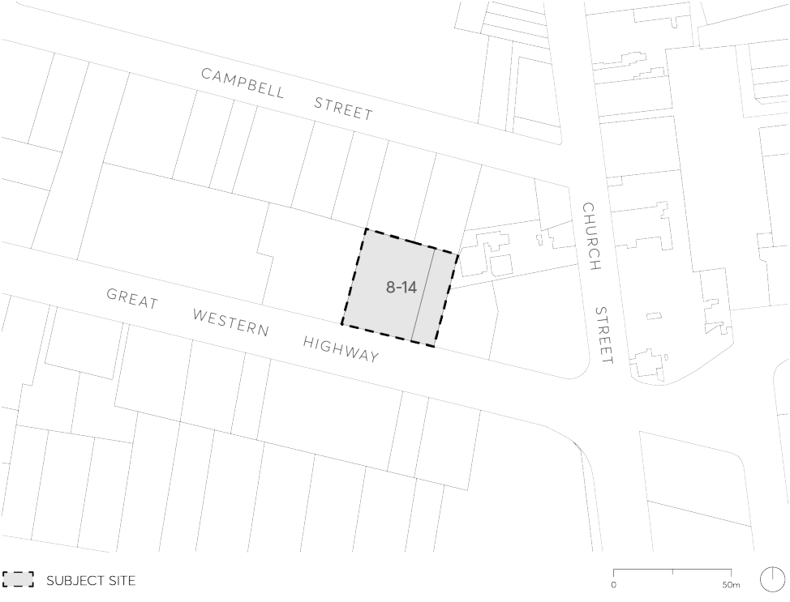

#### 9.10.18 8-14 GREAT WESTERN HIGHWAY

This Section applies to land at 8-14 Great Western Highway, Parramatta and described as known as Lot 10 DP 1097949 and SP 8700, as illustrated in Figure 9.10.18.

> [Picture on page 342: a picture, saved as a picture (images/part-09-parramatta-city-centre-page-342-5.gif, 150 dpi).]

Figure 9.10.18 – Land application map

This Section must be read in conjunction with other sections of this DCP and the relevant provisions in Parramatta LEP 2023. If there is any inconsistency between this section and other sections of the DCP, this section prevails.

This Section establishes objectives and controls to be applied to the preparation and assessment of a development application for the site. It establishes development controls for the built form and urban design objectives for the subject site including building form and massing, setbacks, building separation, heritage interface, landscaping, and potential road widening and vehicular access requirements.

It should be noted that re-development of the site will be subject to a design excellence competition process under Part 7, Division 3 Design excellence in Parramatta LEP 2023. The scope of this brief will be informed by the urban design outcomes and principles of this Section.

8-14 GREAT WESTERN HIGHWAY
