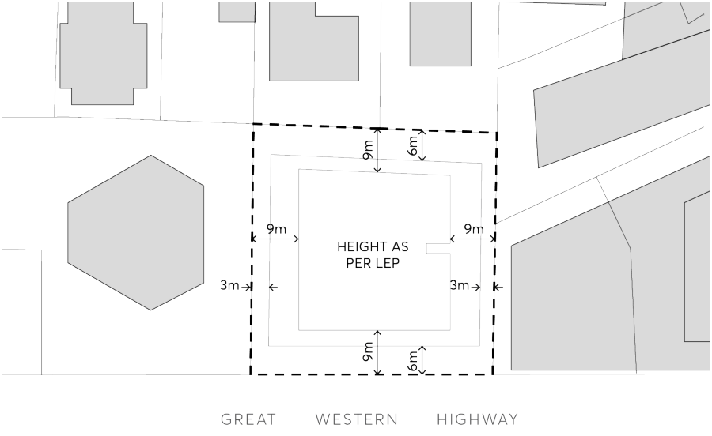
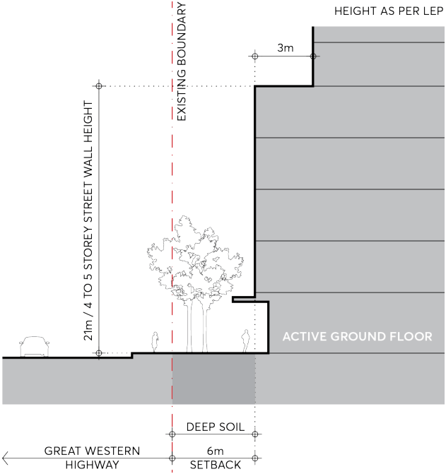

#### 9.10.18.2 BUILT FORM AND MASSING

Principles

P.01 To define built form and massing principles that achieve good urban design outcomes for the site context.

Set back buildings above the street wall and side and rear boundaries to allow daylight penetration, mitigate wind impacts and enable views to the sky in streets and public places.

Design street walls to create streets that are legible, comfortable, safe, functional and attractive.

8-14 GREAT WESTERN HIGHWAY

Design towers to be elegantly proportioned and maximise its slenderness of form.

Design Controls

Maximum Building Height C.01 The building will present a commercial podium of 4 to 5 storeys to Great Western Highway with residential tower setback above.

Building alignment and setbacks C.02 The building is to be aligned parallel with the Great Western Highway. C.03 Street setbacks and street wall heights are to comply with Figure 9.10.18.2 and Figure 9.10.18.3, whereby development is to have a 6 metre setback at ground, and a 3 metre upper level setback for tower above.

C.04 The building (podium) setback is to have a 6 metre setback to the existing boundary with the Great Western Highway, 3 metre from the eastern boundary, 6 metre to the northern boundary and a 3 metre setback to the western boundary.

C.05 The basement is to be located wholly within the build footprint, with the exception of the western boundary and a portion of the northern boundary as shown in Figure 9.10.18.2. A nil setback is permitted at these locations for basement levels that generally marry with the ground floor level of the development on 18 – 20 Great Western Highway.

C.06 The 6 metre front setback is to be measured from the existing boundary in accordance with Figure 9.10.18.3. The front setback is to ensure adequate deep-soil planting, and where possible, the retention of existing trees. In the event of any future widening of Great Western Highway is required, the setting of the building is not required to change.

C.07 The residential tower above commercial podium is to be setback 9 metre from all existing site boundaries.

> [Picture on page 344: a picture, saved as a picture (images/part-09-parramatta-city-centre-page-344-25.gif, 150 dpi).]

8-14 GREAT WESTERN HIGHWAY

Figure 9.10.18.2 – Building alignment and setbacks

> [Picture on page 345: a picture, saved as a picture (images/part-09-parramatta-city-centre-page-345-3.gif, 150 dpi).]

Figure 9.10.18.3 – Street Setbacks to Great Western Highway

C.08 Future development must provide for a minimum building separation above street wall height of 18 metres, where separation distances must be apportioned equally between adjacent sites.
