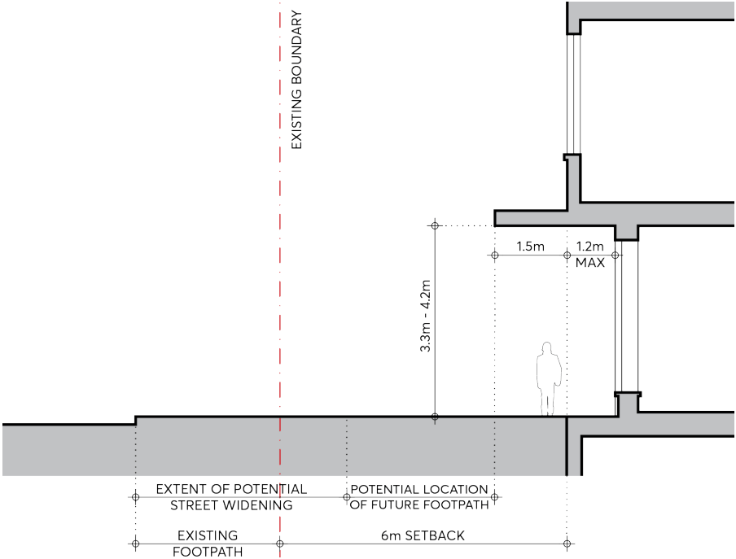

#### 9.10.18.3 STREET WALL DESIGN AND GROUND FLOOR

C.01 The street walls must:

a) Be modulated vertically in increments that relates to a fine grain subdivision and negotiates any stepping in the ground floor level.

b) Be of predominantly masonry character with no lightweight panel construction or curtain walling.

c) Be articulated with depth, relief, and shadow on the street façade. A minimum relief of 150mm between the masonry finish and glazing face must be achieved.

d) Utilise legible architectural elements and types - doors, windows, loggias, reveals, pilasters, sills, plinths, frame and infill, etc. - not necessarily expressed in a literal traditional manner.

e) Include semi-recessed awnings for pedestrian shelter, in accordance with Figure 9.10.18.5.

8-14 GREAT WESTERN HIGHWAY

> [Picture on page 346: a picture, saved as a picture (images/part-09-parramatta-city-centre-page-346-2.gif, 150 dpi).]

Figure 9.10.18.4 – Ground Floor Interface Zone

C.02 The active ground floor frontage must be considered in detail and the following must be incorporated in its design, as per Figure 9.10.18.4:

a) Active uses must fully occupy the ground floor frontage and not taken up by services.

b) A nominal 500mm interface zone at the frontage must be set aside to create interest and variety in the streetscape, to be used for setbacks for entries, opening of windows, seating ledges, benches, and general articulation.

c) The façade must have a high level of expressed detail and tactile material quality.

d) The articulation of the façade must include a well resolved meeting with the ground that also takes account of any slope. A horizontal plinth, integrated in the design, must be incorporated at the base of glazing to the natural ground level or footpath.

e) Design solutions need to maintain and reflect the levels of the existing footpath, incorporating a fine grain response that allows the ground floor tenancies to step with the sloping public domain.

8-14 GREAT WESTERN HIGHWAY
