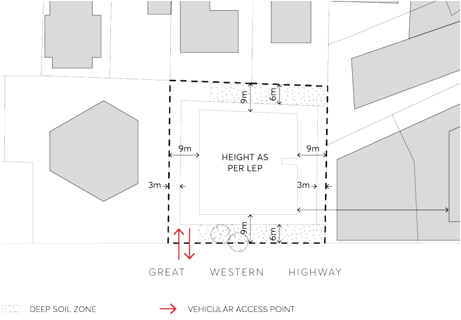
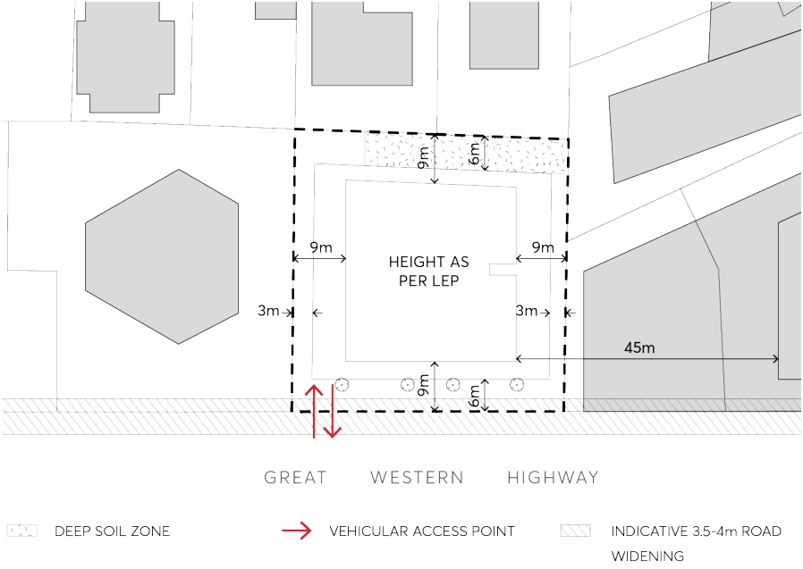

#### 9.10.18.4 ACCESS, PARKING AND SERVICING

Access control

C.01 Vehicular ingress and egress into the site must be provided near the site’s western boundary so that the access point does not impact on the operation of the Great Western Highway and Church Street intersection (Figure 9.10.18.5 and Figure 9.10.18.6).

C.02 The driveway from the Great Western Highway must be a minimum of 12m wide and comply with Council’s engineering standards.

C.03 All vehicles, including service vehicles, must enter and exit the site in a forward direction. C.04 All areas for car parking, loading, deliveries and servicing shall be located within the boundaries of the site. A swept path analysis must demonstrate that the largest vehicle likely to access the site can safely and efficiently manoeuvre in these areas.

> [Picture on page 347: a picture, saved as a picture (images/part-09-parramatta-city-centre-page-347-13.gif, 150 dpi).]

Figure 9.10.18.5 – Location of proposed vehicular access along the western site boundary and landscaping impact

8-14 GREAT WESTERN HIGHWAY

> [Picture on page 348: a picture, saved as a picture (images/part-09-parramatta-city-centre-page-348-2.gif, 150 dpi).]

Figure 9.10.18.6 – Indicative extent of road widening on Great Western Highway and landscaping impact
