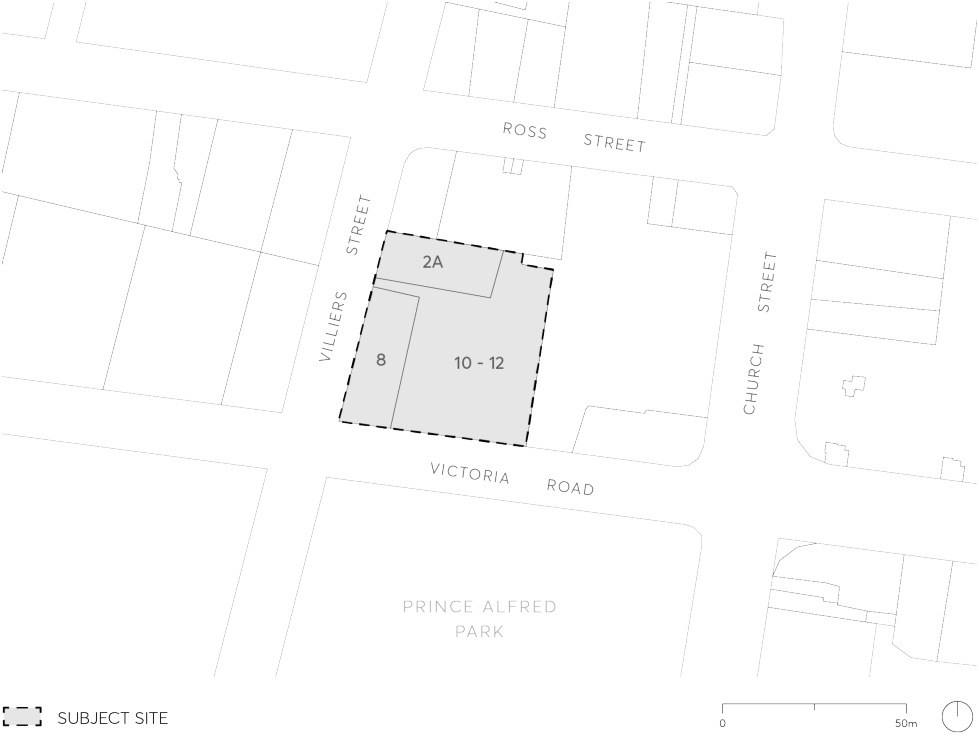

#### 9.10.19 8-12 VICTORIA ROAD AND 2A VILLIERS STREET

This Section applies to land at 8 – 12 Victoria Road and 2A Villiers Street, Parramatta, as shown in Figure 9.10.19.

> [Picture on page 350: a picture, saved as a picture (images/part-09-parramatta-city-centre-page-350-5.gif, 150 dpi).]

Figure 9.10.19 – Land Application map
