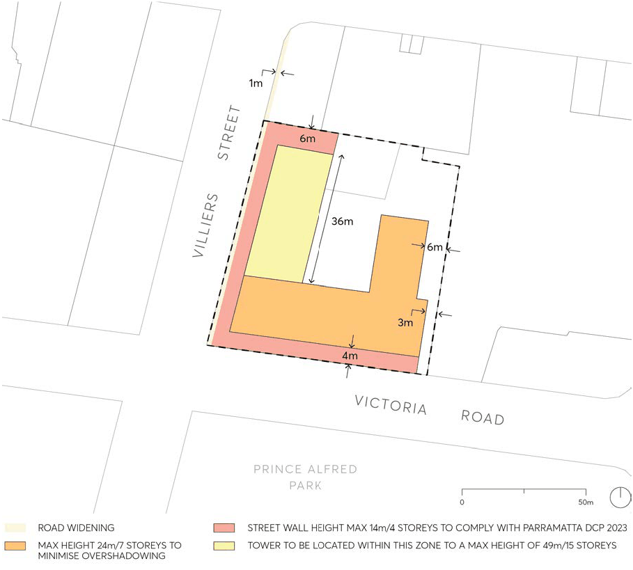
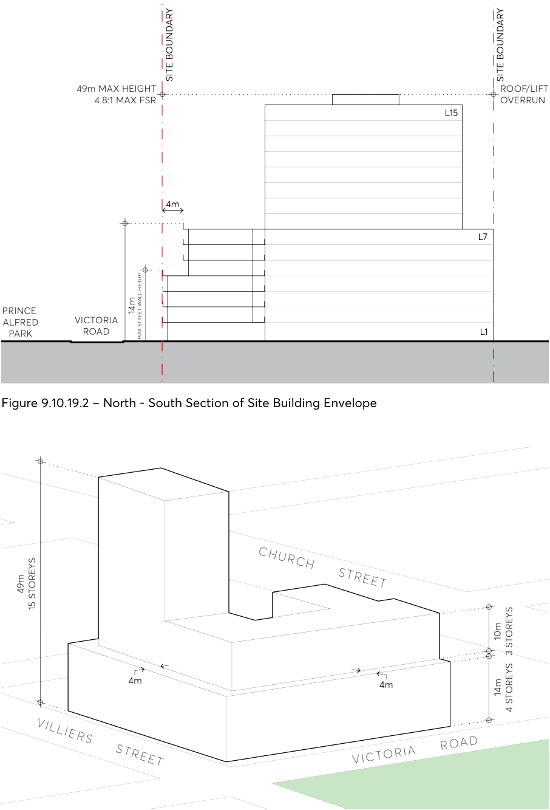

#### 9.10.19.3 TRAFFIC AND TRANSPORT

Site Objectives

O.01 To minimise pedestrian and vehicle conflict by limiting vehicle crossings in the public domain. O.02 To provide space to widen Villiers Street to accommodate increased traffic and pedestrian volumes as a result of additional development on the site.

Controls

C.01 All vehicular access must only be provided along Villiers Street and be located as far as possible from Victoria Road.

C.02 A minimum 1m boundary setback is to be provided on Villiers Street, as shown in Figure 9.10.19.1.

8-12 VICTORIA ROAD AND 2A VILLIERS STREET

> [Picture on page 353: a picture, saved as a picture (images/part-09-parramatta-city-centre-page-353-2.gif, 150 dpi).]

Figure 9.10.19.1 – Built Form Design Controls – Heights and Setbacks

8-12 VICTORIA ROAD AND 2A VILLIERS STREET

> [Picture on page 354: a picture, saved as a picture (images/part-09-parramatta-city-centre-page-354-2.gif, 150 dpi).]

Figure 9.10.19.2 – North - South Section of Site Building Envelope

Figure 9.10.19.3 – Indicative Built Form

470 CHURCH STREET, PARRAMATTA
