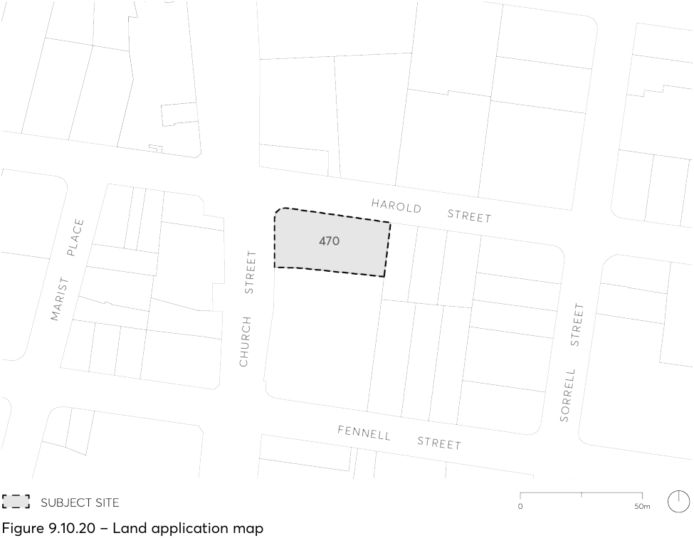

#### 9.10.20 470 CHURCH STREET, PARRAMATTA

This Section applies to land at 470 Church Street, Parramatta legally known as Lot 1 DP 785930 within the Parramatta City Centre – Deferred Area A as illustrated in Figure 9.10.20 below.

> [Picture on page 355: a picture, saved as a picture (images/part-09-parramatta-city-centre-page-355-5.gif, 150 dpi).]

Figure 9.10.20 – Land application map

This Section establishes site specific principles, objectives and controls to be interpreted during preparation and assessment of Development Applications for the site and is to be read in conjunction with Part 9 including Section 9.5.11 – Church Street North Special Area.
