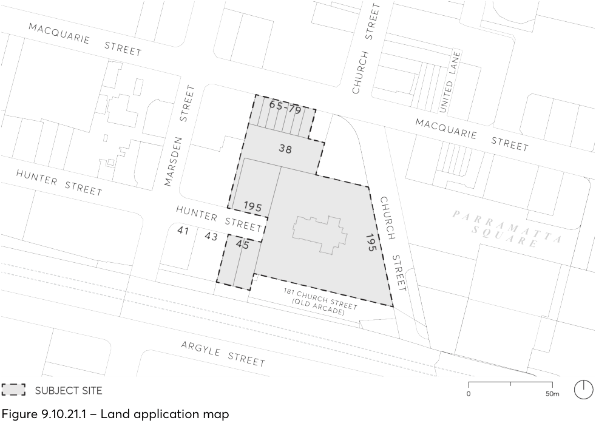
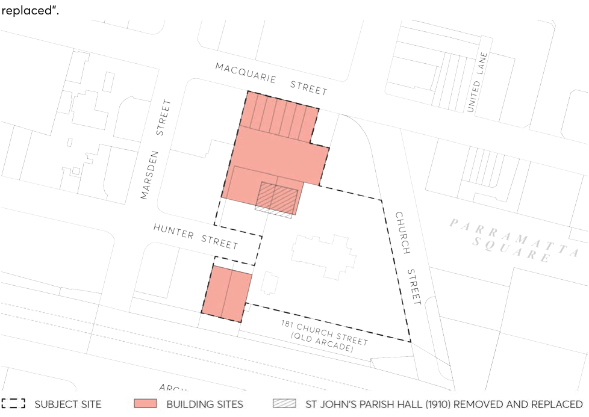
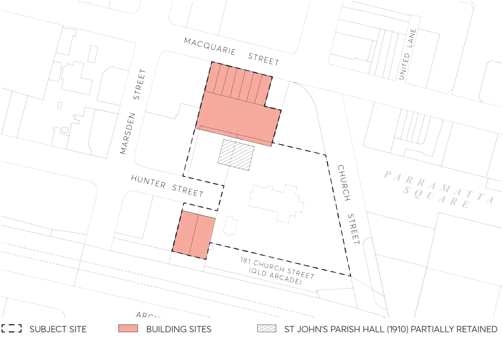

#### 9.10.21 65-79 MACQUARIE STREET, 38 HUNTER STREET, 195 CHURCH STREET AND

## 45 HUNTER STREET, PARRAMATTA (ST JOHN'S ANGLICAN CATHEDRAL)

This Section applies to 65-79 Macquarie Street (Lot E-K, DP15108), 38 Hunter Street (Lot M, DP15108), 195 Church Street (Lot 1-2, DP1110057) and 45 Hunter Street (Lot 1-2, DP575473), Parramatta as shown in Figure 9.10.21.1.

> [Picture on page 359: a picture, saved as a picture (images/part-09-parramatta-city-centre-page-359-8.gif, 150 dpi).]

Figure 9.10.21.1 – Land application map

This Section must be read in conjunction with other Sections of Parramatta DCP 2023 and Parramatta LEP 2023. If there is any inconsistency between this Section and other Sections of this DCP, this Section prevails.

This Section establishes objectives and controls to be interpreted during the preparation and assessment of Design Competitions and Development Applications (DAs) and supports the objectives of the relevant provisions in Parramatta LEP 2023.

SITE SPECIFIC CONTROLS 65-79 MACQUARIE STREET, 38 HUNTER STREET, 195 CHURCH STREET AND 45 HUNTER

STREET, PARRAMATTA (ST JOHN'S ANGLICAN CATHEDRAL)

Options for Development and Planning Pathway

The structure of Section 9.10.21 reflects the two re-development options for the subject site.  The options include:

Option A – for the redevelopment of the St John’s Church site for a new commercial building, new residential building and associated public domain works including expansion of the open space area to incorporate part of Hunter Street located on the western side of the Cathedral and removal of the St Johns Parish Hall building and replacement with new Parish facilities in the podium of the new commercial building and hereafter referred to as “Option A - St Johns Parish Hall removed and replaced”.

> [Picture on page 360: a picture, saved as a picture (images/part-09-parramatta-city-centre-page-360-12.gif, 150 dpi).]

Figure 9.10.21.2 – St John’s Parish Hall under Option A

Option B – for the redevelopment of the St John’s Church site for a new commercial building, new residential building and associated public domain works that includes the retention of the original part of the St Johns Parish Hall building and hereafter referred to as “Option B - St Johns Parish Hall partially retained”.

SITE SPECIFIC CONTROLS 65-79 MACQUARIE STREET, 38 HUNTER STREET, 195 CHURCH STREET AND 45 HUNTER

STREET, PARRAMATTA (ST JOHN'S ANGLICAN CATHEDRAL)

> [Picture on page 361: a picture, saved as a picture (images/part-09-parramatta-city-centre-page-361-3.gif, 150 dpi).]

Figure 9.10.21.3 – St John’s Parish Hall under Option B

Council’s Design Excellence Process requires a successful Architectural Design Competition Process to be undertaken before a Development Application can be lodged with Council. To enable a Design Competition process to deliver Design Excellence, the preferred planning pathway is a staged Development Application process comprising of the following three key steps:

STEP 1: Stage 1 Development Application for the proponent’s building envelopes, proposed removal and replacement or partial retention of the St John’s Parish Church Hall, public domain design and vehicle access and basement design. Supporting the assessment, the following documents must be submitted:

i) Updated Reference Design

ii) Conservation Management Plan

iii) Structural Report (assessing impacts of underground car parking on heritage items).

iv) Acoustic Report (assessing noise and vibration impacts from underground car parking on heritage items).

v) Interpretation Strategy (finalised Interpretation Plan will be lodged at Stage 2).

vi) Concept Landscape Plan.

vii) Arborist Report

viii) Heritage Impact Statement.

ix) Archaeological Test Excavation Report

OPTION A - ST JOHN'S PARISH HALL REMOVED AND REPLACED

STEP 2: Design Excellence Competition for a single design scenario based on approval of the Stage 1 DA.

STEP 3: Stage 2 Detailed Development Application based on winning Design Competition entry.

Where a Stage 1 Development Application determined that the St Johns Parish Hall should be removed and replaced, the DCP controls for “Option A - St Johns Parish Hall removed and replaced” and “Controls that apply to Option A and Option B  ” would be used to inform a Design Brief for the Design Competition and to assess a Stage 2 Development Application.

Conversely, where a Stage 1 Development Application determined that St Johns Parish Hall should be partially retained, the DCP controls for “Option B - St Johns Parish Hall partially retained” and “Controls that apply to Option A and Option B  ” would be used to inform a Design Brief for the Design Competition and to assess a Stage 2 Development Application.

The preferred planning pathway outlined above is considered the most appropriate pathway, providing certainty regarding the proposed form of development to occur on the site. As the primary objective of a Design Excellence Competition is to deliver the highest standard of architectural, urban and landscape design, understanding the heritage significance of the St John’s Parish Church Hall prior to undertaking the Design Competition is considered best practice. Further, the above process requiring a Stage 1 Development Application would remove the requirement for competitors to submit two design scenarios for consideration.

Before lodging a Development Application, including a Stage 1 Development Application, early consultation with Council is encouraged to formulate an agreed public domain design brief and public domain design, as well as an Interpretation Strategy.

### OPTION A - ST JOHN'S PARISH HALL REMOVED AND REPLACED
