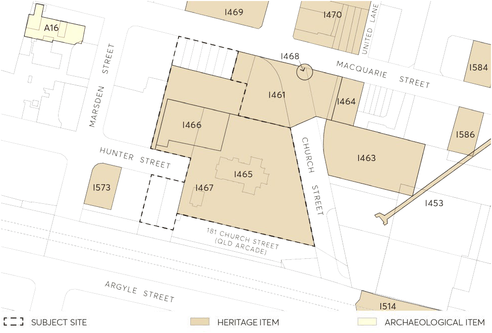

#### 9.10.21.3.1 HERITAGE LISTINGS

State heritage listing

• The subject site contains a State heritage item known as St John’s Anglican Cathedral (SHR ID 01805)

OPTION A - ST JOHN'S PARISH HALL REMOVED AND REPLACED

Local heritage listing

• St John’s Anglican Cathedral (item no. I465)

• St John’s Parish Hall (item no.I466)

• Warden’s Cottage (Verger’s Cottage) (item no.I467)

• Bicentennial Square and adjoining buildings (item no.I461)

• St John’s Building at 38 Hunter Street (included in the Bicentennial Square heritage listing) The subject site is in the vicinity of several state and locally listed heritage items, including:

• Centenary Square and adjoining buildings (item no.1461).

• Murray’s Building (and potential archaeological site) (item no.I464)

• Centennial Memorial Clock (item no.I468)

• Parramatta Town Hall (and potential archaeological site) (item no.I463)

• Shop (and potential archaeological site) (item no.I469)

• Two-storey residence, No. 41 Hunter Street (item no.I573)

The Parramatta LEP 2023 sets out the controls for development within the vicinity of heritage items.

> [Picture on page 364: a picture, saved as a picture (images/part-09-parramatta-city-centre-page-364-16.gif, 150 dpi).]

Figure 9.10.21.4 – State and local heritage items in the vicinity of St John’s Anglican Cathedral, Parramatta

OPTION A - ST JOHN'S PARISH HALL REMOVED AND REPLACED

General Objectives

O.01 Ensure that new development of the land owned by the Anglican Church is congruent with the heritage values of the Cathedral complex and appropriate in the context of the heritage items located within the vicinity of the site.

O.02 Ensure that the Cathedral complex retains its preeminent status in the City Centre. New development does not reduce the importance of the Cathedral complex in its immediate context, or the landmark quality of the Cathedral.

O.03 New development retains the relationships between the Cathedral complex and the historic buildings of Centenary Square as well as broader relationships within the City Centre.

O.04 Provide an appropriate setting for St John’s Anglican Cathedral, the former Warden’s Cottage (Verger’s Cottage), and St John’s Building on the site of any new development. This includes the retention of existing significant trees, an enhancement of the existing setting by the removal of at-grade car parking, and the ongoing incorporation of the land around the Cathedral complex into the public domain of Centenary Square.

O.05 Ensure new development responds appropriately to its historic context, including the historic street pattern.
