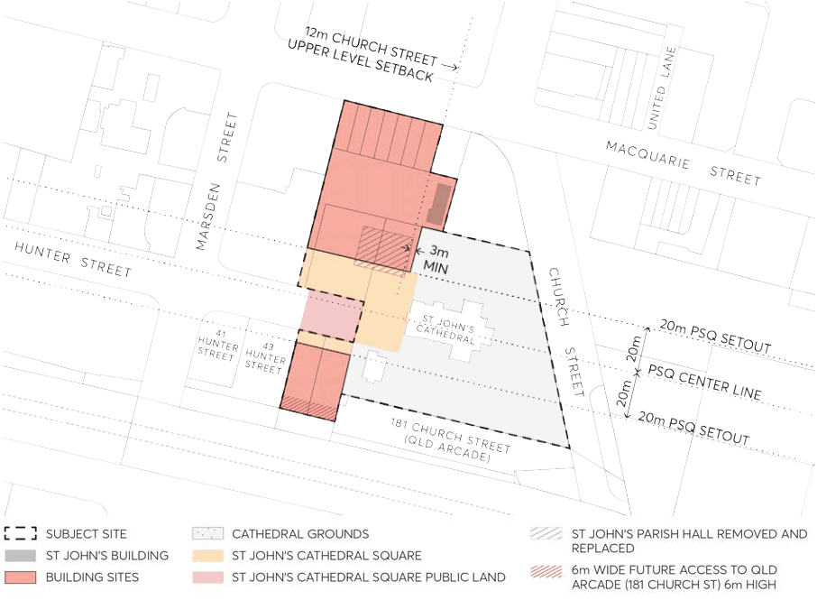

#### 9.10.21.4 PUBLIC DOMAIN

This Section of this DCP must be read in conjunction with the Parramatta Public Domain Guidelines 2017 and Section 9.4 – Public Domain of Parramatta DCP 2023.

The controls in Section 9.4 – Public Domain consolidate and update the public domain controls for the City Centre and, where there is an inconsistency between the public domain controls and objectives in this Section and other Parts of this DCP, this Section prevails.

Before lodging a Development Application early consultation with Council is encouraged to formulate an agreed design brief and public domain design. Design Submission Requirements are to be prepared in accordance the Parramatta Public Domain Guidelines 2017.

Objectives

O.01 Provide open spaces that are designed in relation to and which provide for a liturgical, parish and functional needs of St John’s Anglican Cathedral.

O.02 Provide open spaces that are publicly accessible and are complementary to the existing Parramatta Square and Centenary Square.

O.03 Contribute to connectivity and legibility within the City Centre including reinforcement of the historic pattern of development in the City Centre and ensuring that development is integrated with Parramatta’s urban structure.

O.04 Provide activation of publicly accessible spaces through church use and a diverse mix of others uses.

O.05 Provide a comfortable microclimate within the open spaces. O.06 Provide safe, at-grade vehicle access across pedestrian areas to the existing and proposed buildings.

O.07 Engage with Council regarding the open space design on the Western side of St John’s Anglican Cathedral prior to lodgement of the Development Application.

OPTION A - ST JOHN'S PARISH HALL REMOVED AND REPLACED

Controls

C.01 Council approval of an agreed detailed design brief and public domain design must be achieved before submission of a Development Application. The Applicant is to liaise with Council at 50% and 90% completion of the public domain design prior to lodgement of the Development Application.

C.02 The set-out of public domain and new built form at ground level shall be consistent with Figure 9.10.21.5. The new St John’s public domain shall be framed by new buildings set back 20 metres from the centreline of St John’s Anglican Cathedral and Parramatta Square.

> [Picture on page 371: a picture, saved as a picture (images/part-09-parramatta-city-centre-page-371-10.gif, 150 dpi).]

Figure 9.10.21.5 – Public domain set-out plan for Option A

C.03 Pedestrian access through the open space between Church Street and Hunter Street shall be open to the public 24/7, where possible, whilst providing for the requirements of St John’s Anglican Cathedral.

C.04 Tree planting shall be provided within the public domain that is appropriate to its role, respectful of sight lines including from Hunter Street facing St John’s Anglican Cathedral and at a scale that is appropriate to a setting for the St John’s Anglican Cathedral. Trees shall be planted at natural (pre new development maximum) ground level, not in raised planters. The size of trees shall be maximized, within the considerations otherwise outlined in this control.

C.05 A minimum soil depth of 1 metre (excluding structural, drainage and mulch layers) above any basement structure shall be provided for all trees, in contiguous planting pits. Minimum soil

OPTION A - ST JOHN'S PARISH HALL REMOVED AND REPLACED

volumes for trees on podiums over basements are to be provided according to the Apartment Design Guide.

C.06 Spaces for public seating shall be provided in a range of locations and to suit different users. C.07 Designs shall demonstrate the ability to accommodate a range of uses and activities including servicing requirements in the new public domain, including Parish of Parramatta events such as weddings and funerals and public events.
