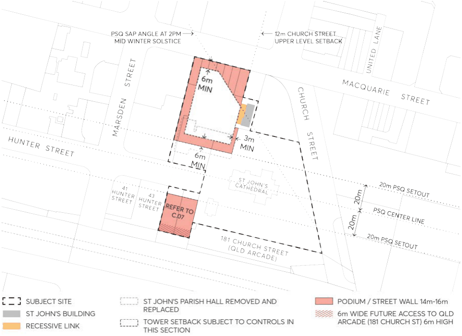

#### 9.10.21.5 BUILT FORM

This Section of this DCP must be read in conjunction with:

• Section 9.3 – Built Form

• Clause 7.3 Floor space ratio, Clause 7.7 Sun access, Clause 7.23 End of journey facilities, and Clause

7.10 Active frontages in Parramatta LEP 2023.

Where there is an inconsistency between the built form controls and objectives in this Section and other Sections of this DCP, this Section prevails.

Objectives

O.01 Ensure built form outcomes respond to the heritage significant of the site. O.02 Ensure built form outcomes that respond to the human scale around St John’s Anglican Cathedral, the associated public domain, other heritage items, existing buildings and any proposed street walls.

O.03 Ensure that street walls of new buildings frame the public domain through appropriate design, scale, and materiality to reflect the primacy of St John’s Anglican Cathedral within the overall site.

O.04 Respond to view corridors including those towards St John’s Anglican Cathedral along Church Street, Parramatta Square and Hunter Street.

O.05 Provide appropriate solar access to the public domain compliant with Parramatta LEP 2023. O.06 The built form is to provide for flexible and efficient commercial floorplates, whilst satisfying the heritage objectives of this DCP.

O.07 Provide appropriate building separation to neighbouring sites. O.08 Provide weather and wind protection to the open spaces. O.09 Ensure architectural responses make a high-quality contribution to the setting and urban design of the area consistent with Council’s design excellence policies.

O.10 Ensure built form outcomes respond to any adjacent buildings or likely future envelopes on neighbouring sites to enable informed consideration of suitable setbacks, built form, access and public domain outcomes as well as amenity impacts.

O.11 Provide a tall, slender tower on the Northern development site by requiring a splayed edge on the north-eastern Macquarie Street/Centenary Square corner of the tower to reduce the mass

OPTION A - ST JOHN'S PARISH HALL REMOVED AND REPLACED

and presence of the tower on the civic spaces and open up views across the podium to the street and sky.

Controls

C.01 Development Applications for new buildings within the St John’s Anglican Cathedral complex site must comply with the controls in Section 9.3 – Built Form unless adjusted by the controls below.

C.02 Street wall or podium interfaces of new development must comply with the following:

a) Street wall heights to the public domain areas in front of St John’s Anglican Cathedral should be in the range of 14-16m in height. The exact height of street walls is to be underpinned by detailed heritage, urban design, and architectural analysis.

b) DCP controls in Section 9.3 – Built Form must be applied to determine the outcomes for the Macquarie Street of the podium at the Northern development site, including analysis requirements found in Section 9.4.4 – The Street Wall.

c) Resolution of the eastern podium interface at the Northern development site is subject to Section 9.10.21.3 – Heritage of this DCP.

C.03 The southern and western setback of the Northern development site tower must be a minimum of 6 metres from the podium edge.

C.04 The eastern setback of the Northern development site tower must not encroach the Church Street upper-level setback line in Parramatta LEP 2023.

C.05 The eastern setback of the Northern development site tower must ensure compliance with the solar access requirement for Parramatta Square set out in Clause 7.7 Sun access of Parramatta LEP 2023.

C.06 The design of basement entry and exit points including any ramps to access lower levels must be contained within the building envelope where possible. No dive structures are permitted within Council owned land and within the open space areas around the Cathedral.

C.07 If site amalgamation of 41, 43 and 45 Hunter Street can not be achieved, additional massing up to one (1) storey above the specified street wall may be considered for the Southern development site where amenity and heritage impacts can be satisfied and the additional storey is setback a minimum 6 metres from Hunter Street, and the eastern, southern and western setbacks are established through detailed urban design and architectural analysis taking into consideration potential development at 41-43 Hunter Street and the surrounding heritage context. Any upper-level addition above the specified street wall should apply construction methods and materiality which reinforce a lightweight and recessive appearance to the architecture above the street wall.

C.08 The height and design of the street wall/podium at the base of both the northern and southern development sites must respond to the varying interface conditions (street, squares, heritage, and open space). For the Northern development site, development above the podium shall not encroach the PSQ SAP Angle at 2pm mid-winter solstice line shown in Figure 9.10.21.6 to ensure a well-proportioned commercial tower that is tall and slender allowing views across the podium to the surrounding streets and sky from Centenary Square.

OPTION B - ST JOHN'S PARISH HALL PARTIALLY RETAINED

> [Picture on page 374: a picture, saved as a picture (images/part-09-parramatta-city-centre-page-374-2.gif, 150 dpi).]

Figure 9.10.21.6 – Built Form set-out plan for Option A

### OPTION B - ST JOHN'S PARISH HALL PARTIALLY RETAINED
