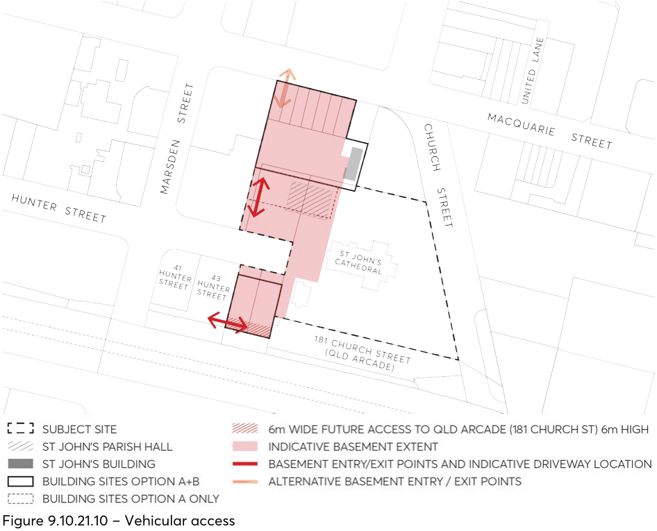

#### 9.10.21.10 VEHICLE ACCESS, PARKING AND SERVICING

This Section of this DCP must be read in conjunction with:

• Section 9.9 – Vehicular Access, Parking and Servicing

• Part 6 – Traffic and Transport

• Division 4 Car parking in Parramatta LEP 2023 Where there is an inconsistency between the vehicular access, parking and servicing controls and objectives in this Section of this DCP and other Parts of this DCP, this Section prevails.

Before lodging a Development Application, early consultation with Transport for NSW and Council is encouraged to formulate an agreed access point for ingress and egress to the subject site.

Objectives

O.01 Minimise the impact of basement facilities on heritage structures and minimise the size and quantity of vehicular access points and driveway crossovers on streetscape amenity, pedestrian safety and the quality of the public domain to be delivered on site.

CONTROLS THAT APPLY TO OPTION A AND OPTION B

O.02 Ensure vehicular access points, driveway crossovers and dive points to basements do not detract the heritage value of the St John’s Anglican Cathedral complex.

O.03 Minimise the vehicle and service crossings to reinforce a high-quality public domain along Macquarie Street, Hunter Street, and the broader St John’s Anglican Cathedral complex.

O.04 Minimise the impact of vehicular servicing and loading activities on the surrounding street network.

Controls

C.01 The preferred parking/service access for the St John’s Anglican Cathedral complex is to be designed in consultation with Transport for NSW to ensure the safe and efficient operation of the Parramatta Light Rail. Interface between new development and the Parramatta Light Rail Corridor is to be designed in consultation with Council and Transport for NSW to ensure safety for pedestrians, accessibility and visual amenity.

C.02 Where a vehicular driveway to the site is permitted from Macquarie Street, the driveway should be located nearest to the Western site boundary. The vehicular driveway should not interfere with traffic signals and high pedestrian activity occurring nearby in Church Street and Centenary Square. The vehicular driveway should be a minimum of 10 metres from the perpendicular of any intersection of any two streets.

C.03 In the case that a connected basement cannot be accommodated on the site, access for servicing, waste and loading vehicles for the Southern development is to be provided from the new Southern laneway to the rear of the properties. Vehicle access for residents is to be provided from Hunter Street.

C.04 A 6-metre-wide access shall be provided along the southern site boundary of the 45 Hunter Street property, with the intent of providing future alternative vehicular access to the Queensland Arcade site via Marsden Street

C.05 The access to be delivered along the southern site boundary can be clear to sky or within a building overhang / tunnel. The access should allow for a minimum height of 6 metres to ensure access for servicing, waste and loading vehicles.

C.06 In the case that vehicular access is required from Hunter Street to access either the northern or southern buildings, it should be located on that part of the site furthest from St John’s Anglican Cathedral and should not interfere with this heritage item.

C.07 Vehicular driveways located hard against the property boundary are acceptable, provided pedestrian sightlines are consistent with the relevant Australian Standard.

C.08 For any development with a residential component, ramping to a basement will need to comply with the 4.5 metre clearance height to accommodate for waste vehicles. Ramping to a basement that is solely used for residential vehicles (no waste vehicles) will need to comply with the minimum 2.1 metre clearance height.

C.09 Ramping to a basement will be subject to flooding requirements. C.10 Basement vehicular parking is to be provided on site to minimise the visual impact of car parking as viewed from the public domain and enhance pedestrian safety at ground level.

CONTROLS THAT APPLY TO OPTION A AND OPTION B

C.11 Vehicular parking should not be provided at ground level. If on grade vehicular access and temporary parking is required for weddings and funerals, it should only be for access to the Cathedral entrances and should have minimal visual impact.

C.12 In the case where the eastern end of Hunter Street is incorporated in the development site, the road width and cul-de-sac at the end of Hunter Street is to be designed to accommodate the largest vehicle that is expected to access this street (e.g. garbage truck or loading vehicle) and this is to be demonstrated using swept path plans and templates from Austroads Guidelines. Standard road surfaces and kerb and gutter is to be provided in accordance with Council’s standards and specifications.

C.13 Car parking rates provided on site must comply with the rates outlined in the Parramatta LEP 2023.

C.14 All vehicular servicing and loading activities shall be accommodated on-site.

> [Picture on page 388: a picture, saved as a picture (images/part-09-parramatta-city-centre-page-388-14.gif, 150 dpi).]

Figure 9.10.21.10 – Vehicular access
