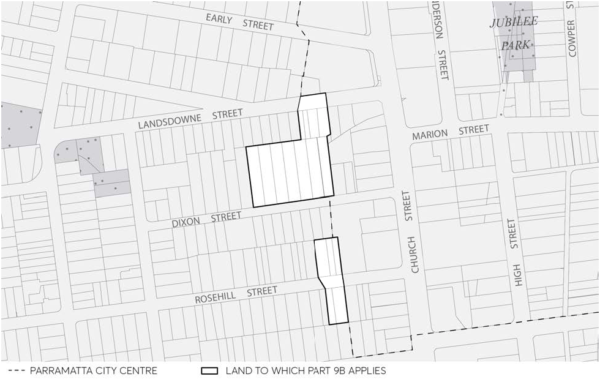
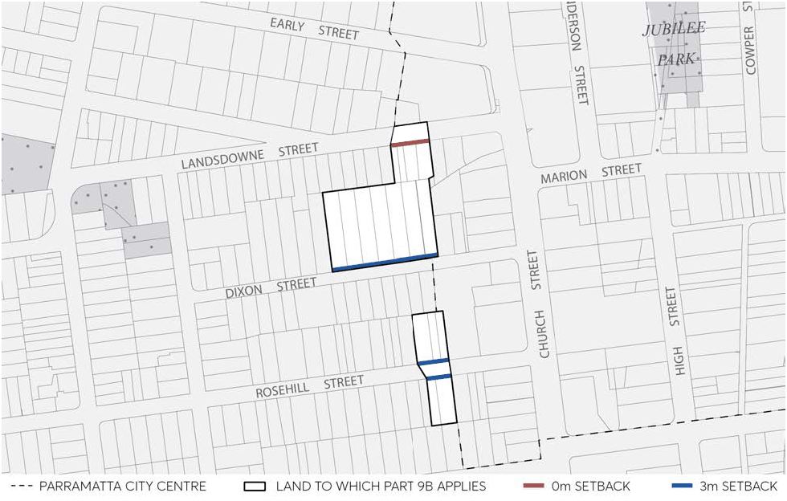
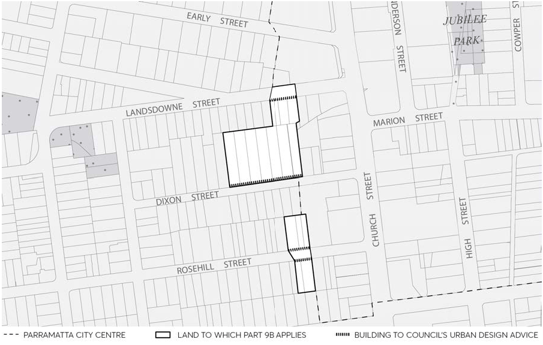
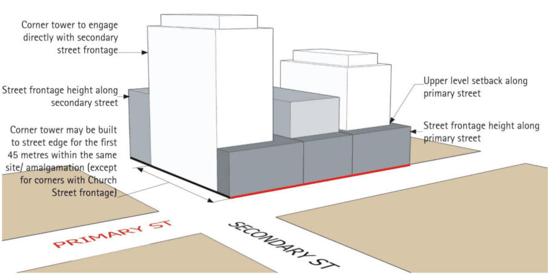
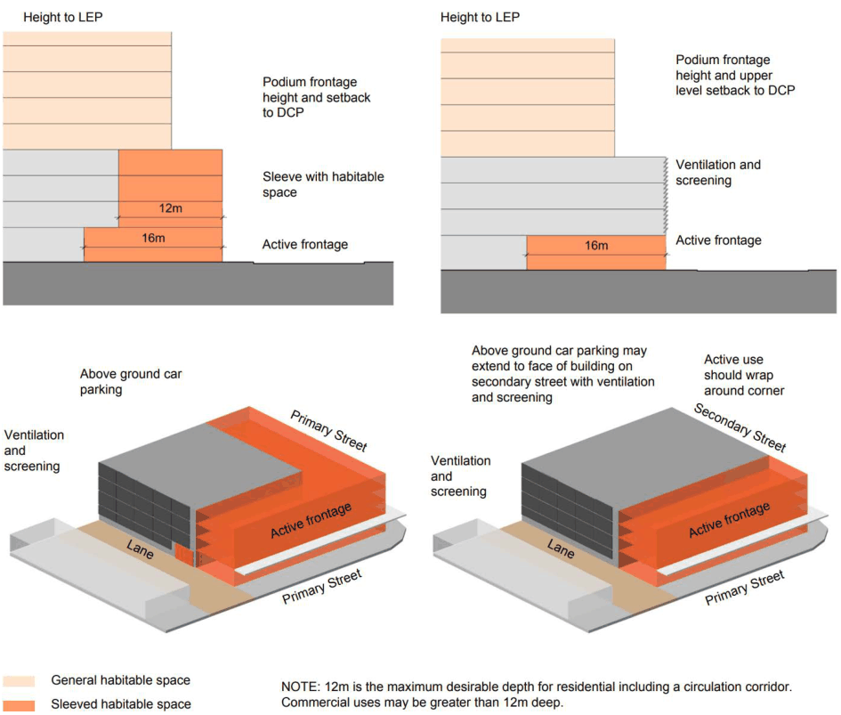
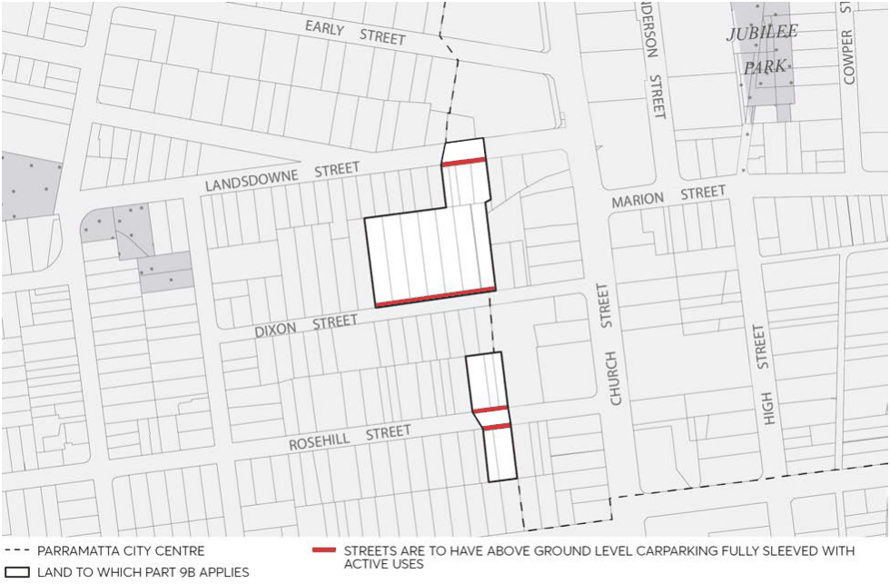

#### 9.10.21.12 ENVIRONMENTAL SUSTAINABILITY

This Section of this DCP must be read in conjunction with (but not limited to):

• Section 9.8 – Environmental Sustainability

• Clause 7.25 High performing buildings and Clause 7.24 Dual water systems of Parramatta LEP 2023

The controls in Section 9.10.21.12 respond to increasing demands on energy, water and sewerage infrastructure as well as in response to improve sustainable building technologies, and aim to deliver high performing buildings in the City Centre and limit environmental impacts from increased growth and the additional density in the St John’s Anglican Cathedral complex.

Where there is an inconsistency between the environmental sustainability objectives and the controls in this Section of this DCP and other Sections of this DCP, this Section prevails.

Objectives

O.01 Incorporate building services that reduces the demand for energy and water resources. O.02 Minimise the use of natural resources through resource recovery and waste avoidance measures.

O.03 Ensure that buildings are designed to inhibit wind funnelling and that the major public spaces are screened from winter winds and open to cooling summer breezes.

O.04 Ensure built form provides a comfortable pedestrian environment and public domain. O.05 Residential flat buildings are to minimise reliance on mechanical ventilation and reliance on artificial lighting by implementing passive design measures.

O.06 Use landscape design to modify summer and winter climatic conditions and improve amenity for people using the open space.

O.07 Maximise energy efficiency in building design, orientation, and siting.

Controls

C.01 Development Applications for new buildings within the St John's Anglican Cathedral complex site must comply with:

• Section 9.8 – Environmental Sustainability

• Clause 7.25 High performing buildings and Clause 7.24 Dual water systems of Parramatta LEP 2023

PARRAMATTA CITY CENTRE – AUTO ALLEY WEST

### PARRAMATTA CITY CENTRE – AUTO ALLEY (WEST) CONTENTS

| 9B.1 | BUILDING FORM......................................................................................................................................... 389 |  |
|---|---|---|
|  | 9B.1.1 | MINIMUM BUILDING STREET FRONTAGE ........................................................................... 389 |
|  | 9B.1.2 | BUILDING TO STREET ALIGNMENT AND STREET SETBACKS ....................................... 390 |
|  | 9B.1.3 | STREET AND RIVER FRORNTAGE HEIGHTS AND UPPER LEVEL SETBACKS ............. 391 |
|  | 9B.1.4 | BUILDING DEPTH AND BULK ................................................................................................... 393 |
|  | 9B.1.5 | BULIDING SEPARATION ............................................................................................................ 394 |
|  | 9B.1.6 | BUILDING FORM AND WIND MITIGATION ......................................................................... 394 |
|  | 9B.1.7 | BUILDING EXTERIORS................................................................................................................ 395 |
| 9B.2 | MIXED | USE BUILDINGS ............................................................................................................................ 397 |
| 9B.3 | PUBLIC DOMAIN AND PEDESTRIAN AMENITY ................................................................................. 398 |  |
|  | 9B.3.1 | ACTIVE FRONTAGES .................................................................................................................. 398 |
| 9B.4 | ACCESS AND PARKING ........................................................................................................................... 400 |  |
|  | 9B.4.1 | VEHICLE FOOTPATH CROSSINGS ........................................................................................ 400 |
|  | 9B.4.2 | PEDESTRIAN ACCESS AND MOBILITY .................................................................................. 401 |
|  | 9B.4.3 | VEHICULAR DRIVEWAYS AND MANOEUVRING AREAS ................................................. 402 |
|  | 9B.4.4 | ON-SITE PARKING ....................................................................................................................... 403 |
|  | 9B.4.5 | ABOVE GROUND CAR PARKING ............................................................................................ 405 |
|  | 9B.4.6 | LEASING OF EXISTING SURPLUS COMMERCIAL CAR PARKING SPACES ................406 |
| 9B.5 | ENVIRONMENTAL MANAGEMENT .......................................................................................................408 |  |
|  | 9B.5.1 | LANDSCAPE DESIGN..................................................................................................................408 |
|  | 9B.5.2 | PLANTING ON STRUCTURES ...................................................................................................409 |
|  | 9B.5.3 | GREEN ROOFS ............................................................................................................................. 410 |
|  | 9B.5.4 | ENERGY AND WATER EFFICIENT DESIGN ........................................................................... 411 |
|  | 9B.5.5 | RECYCLED WATER ...................................................................................................................... 411 |

9B - 387

PARRAMATTA CITY CENTRE – AUTO ALLEY WEST

### 9B PARRAMATTA CITY CENTRE – AUTO ALLEY WEST

The controls in this Part apply to land zoned E3 Productivity Support within the Parramatta City Centre as shown in Figure 9B.1.

The specific objectives and controls for this precinct detailed below are to be applied in conjunction with the general objectives and controls in Part 2, 3, 5, 6 and 7 of this DCP. Where there is any inconsistency with any other part of the DCP, the objectives and controls of this section will prevail.

The broad objectives for the Auto Alley (West Area) are: O.01 To support the commercial core with surrounding mixed use development that reinforces and complements the centre’s core employment role.

O.02 To ensure high-quality design of buildings. O.03 To provide for the conservation and interpretation of Parramatta’s heritage. O.04 To improve the natural environment.

> [Picture on page 393: a picture, saved as a picture (images/part-09-parramatta-city-centre-page-393-14.gif, 150 dpi).]

Figure 9B.1 – Land Application Map – Auto Alley (West)

9B - 388

PARRAMATTA CITY CENTRE – AUTO ALLEY WEST

BUILDING FORM

#### 9B.1 BUILDING FORM

The provisions in this Section are intended to encourage high-quality design. New development should contribute to an attractive public domain and produce a desirable setting for its intended uses.

Objectives

The following general objectives apply to this Section: O.01 To establish appropriate scale, dimensions, form and separation of buildings. O.02 Achieve active street frontages with good physical and visual connections between buildings and the street.

O.03 Define the public street so that it provides spaces that are legible, safe, comfortable, functional and attractive.

O.04 Ensure building depth, bulk and separation allows for view sharing and protects amenity, daylight penetration and privacy between adjoining developments.

O.05 Achieve an articulation and finish of building exteriors that contributes to a high-quality and sustainable urban environment.

#### 9B.1.1 MINIMUM BUILDING STREET FRONTAGE

Objectives

O.01 To ensure that visually, buildings have an appropriate overall horizontal proportion compared to their vertical proportions.

O.02 To ensure that vehicular access is reasonably spaced and separated along roads and lanes. O.03 To provide appropriate dimensions for the design of car parking levels.

Controls

C.01 Development parcels are required to have at least one street frontage of 20m or more. C.02 Exceptions to the minimum building street frontage will be considered:

• if Council is satisfied that due to the physical constraints of the site or adjoining sites it is not possible for the building to be erected with at least one street frontage of 20m or more, and

• the development meets the objectives of this clause.

9B - 389

PARRAMATTA CITY CENTRE – AUTO ALLEY WEST

BUILDING FORM

#### 9B.1.2 BUILDING TO STREET ALIGNMENT AND STREET SETBACKS

Street setbacks and building alignments establish the front building line and reinforce the spatial definition of streets. Consistent building lines within streets and blocks are desirable and generally buildings should be built to the street alignment to enhance pedestrian amenity and activity at street level. Setbacks should also respond to public spaces, the river foreshore, enhance heritage settings and may also provide for landscape areas and growing areas for street trees.

Objectives

O.01 To provide street edges which reinforce, improve or support the hierarchy and character of specific city streets and lanes.

O.02 To ensure there are consistent street frontages with buildings having common alignments. O.03 To present appropriate design responses to nearby development that complement the streetscape.

O.04 To create a clear transition between public and private space. O.05 To assist in achieving visual privacy to apartments from the street. O.06 To allow for street landscape character, where appropriate.

Controls

C.01 Comply with the street building alignment and front setbacks specified in Figure 9B.1.2.1. C.02 Building alignments and setbacks should also respond to important elements of the nearby context including public spaces and heritage buildings, monuments and landscape elements, in order to complement the streetscape. In some places, this may require greater building setbacks than those specified in Figure 9B.1.2.1.

C.03 Where the building alignment is set back from the street alignment, balconies are to be generally within the building envelope and may project up to 600mm into front building setbacks.

C.04 Minor projections into front building lines and setbacks for sun shading devices, entry awnings and cornices are permissible. (See also Section 9B.1.7 – Building Exteriors).

9B - 390

PARRAMATTA CITY CENTRE – AUTO ALLEY WEST

BUILDING FORM

> [Picture on page 396: a picture, saved as a picture (images/part-09-parramatta-city-centre-page-396-3.gif, 150 dpi).]

Figure 9B.1.2.1 – Building Alignment and Front Setbacks (to streets)

#### 9B.1.3 STREET AND RIVER FRORNTAGE HEIGHTS AND UPPER LEVEL SETBACKS

Street frontage heights refer to the height of the building that is built to the street alignment and therefore directly addresses the public street, lane or the river. The street section figures contained in this Section of this DCP specify the required street and river frontage heights and the required upper level setbacks above.

The street frontage height is the vertical distance measured at the centre of the street frontage from the average of the street levels at each end of the frontage to the parapet level of the frontage. The parapet level is the horizontal plane in which at least two thirds of the length of the top of the façade is situated.

Objectives

O.01 To strengthen the urban form of the City Centre Deferred Area with consistent street wall heights.

O.02 To achieve comfortable street and riverfront environments for pedestrians in terms of daylight, scale, sense of enclosure and wind mitigation as well as a healthy environment for street trees.

O.03 To enhance the distinctive character of streets within Parramatta City Centre Deferred Area.

9B - 391

PARRAMATTA CITY CENTRE – AUTO ALLEY WEST

BUILDING FORM

Controls

C.01 Buildings must comply with the relevant street and river frontage heights and upper level setbacks as shown in Figures 9B.1.1 and 9B.1.2. Podium heights must not exceed both the number of storeys and the height in metres.

C.02 The street frontage height that applies to a shared lane is the same as that of the closest street frontage height the lane connects to. In instances where the lane connects to two or more streets, the higher street frontage height applies (to a maximum of 26 metres).

C.03 Corner sites may be built with no upper level setback to the secondary street edge for the first 45 metres within the same site/amalgamation. This helps to articulate corners, generate feasible floor plates as well as allow corner towers to engage directly with the street and footpath. Refer to Figure 9B.1.6.

C.04 The following take precedence in determining the primary and secondary street frontages:

• Streets running E-W

• Streets running N-S

> [Picture on page 397: a picture, saved as a picture (images/part-09-parramatta-city-centre-page-397-17.gif, 150 dpi).]

Figure 9B.1.1 – Street / River Frontage Heights – Parramatta City Centre Deferred Area

9B - 392

PARRAMATTA CITY CENTRE – AUTO ALLEY WEST

BUILDING FORM

> [Picture on page 398: a picture, saved as a picture (images/part-09-parramatta-city-centre-page-398-3.gif, 150 dpi).]

Figure 9B.1.2 – Indicative Corner Condition with different Street Frontage Heights

#### 9B.1.4 BUILDING DEPTH AND BULK

Controlling building depth and bulk allows for good internal amenity, access to natural light and ventilation and mitigates potential adverse effects that tall and bulky buildings may have on the public domain.

Building depth is typically related to building use and the need for access to light and ventilation to building interiors and the comfort and amenity required for inhabitants.

Objectives

O.01 To promote the design and development of sustainable buildings. O.02 To achieve living and working environments with good internal amenity and minimise the need for artificial heating, cooling, and lighting.

O.03 To provide viable and useable commercial floor space. O.04 To achieve usable and pleasant streets and public domain at ground level by controlling the size of upper level of buildings.

O.05 To achieve a city skyline sympathetic to the topography and context. O.06 To allow for view sharing and view corridors. O.07 To reduce the apparent bulk and scale of buildings by breaking up expanses of building wall with modulation of form.

Controls

C.01 All points on an office floor should be no more than 12m from a source of daylight (e.g. window, atria, or light wells).

9B - 393

PARRAMATTA CITY CENTRE – AUTO ALLEY WEST

BUILDING FORM

#### 9B.1.5 BULIDING SEPARATION

Objectives

O.01 To ensure an appropriate level of amenity for building occupants in terms of daylight, outlook, view sharing, ventilation, wind mitigation, and privacy.

O.02 To achieve usable and pleasant streets, lanes, parks, and public spaces in terms of wind mitigation, daylight, and solar access.

Controls

C.01 Where permissible, side and rear boundaries are to be built to zero metres at lower levels of buildings.

C.02 Where a rear setback/courtyard is proposed at ground level, a minimum dimension of 6 metres must be provided. Ground level setbacks must have daylight and amenity. Deep soil zones/podium landscape should be co-located to the rear to create pockets of landscape/mature trees within the block.

C.03 Notwithstanding side setback controls, the podium should be built to the side boundaries (0 metres setback) where fronting the street.

C.04 If the specified setback distances cannot be achieved when an existing building is being refurbished or converted to another use, appropriate visual privacy levels are to be achieved through other means.

C.05 The building separation distances between buildings on the same site are not to be less than those required between buildings on adjoining sites, unless it can be demonstrated that reducing the separation distances provides adequate privacy and solar access to the buildings concerned.

#### 9B.1.6 BUILDING FORM AND WIND MITIGATION

Objectives

O.01 To ensure that building form enables the achievement of nominated wind standards to maintain safe and comfortable conditions in the City Centre deferred area streets and lanes.

Controls

C.01 To ensure public safety and comfort the following maximum wind criteria are to be met by new buildings:

i) 10 metres/second in retail streets

ii) 13 metres/second along major pedestrian streets, parks and public places

iii) 16 metres/second in all other streets

9B - 394

PARRAMATTA CITY CENTRE – AUTO ALLEY WEST

BUILDING FORM

C.01 Site design for tall buildings (towers) should:

i) Set tower buildings back from lower structures built at the street frontage.

ii) Protect pedestrians from strong wind downdrafts at the base of the tower.

iii) Ensure that tower buildings are well spaced from each other to allow breezes to penetrate City Centre Deferred Area.

iv) Consider the shape, location and height of buildings to satisfy wind criteria for public safety and comfort at ground level.

v) Ensure useability of open terraces and balconies.

#### 9B.1.7 BUILDING EXTERIORS

Parramatta’s cityscape and public domain is defined by its buildings, streets and public places. The maintenance and improvement of the public domain is dependent on a high-quality approach to the design of new development including the articulation and finish of building exteriors.

Objectives

To ensure that buildings: O.01 Contribute positively to the streetscape and public domain by means of high-quality architecture and selection of appropriate materials and finishes.

O.02 Provide richness of detail and architectural interest especially at visually prominent parts of buildings such as lower levels and roof tops.

O.03 Present appropriate design responses to nearby development that complement the streetscape.

O.04 Clearly define the adjoining streets, street corners and public spaces and avoid ambiguous external spaces with poor pedestrian amenity and security.

O.05 Maintain a pedestrian scale in the articulation and detailing of the lower levels of the building. O.06 Restrict the reflection of sunlight from buildings to surrounding areas and buildings.

Controls

C.01 Adjoining buildings (particularly heritage buildings) are to be considered in the design of new buildings in terms of:

• datum of main façade and roof elements,

• appropriate materials and finishes selection, and

• facade proportions including horizontal or vertical emphasis.

C.02 Balconies and terraces should be provided, particularly where buildings overlook parks and on low rise parts of buildings. Gardens on the top of setback areas of buildings are encouraged.

C.03 Articulate façades so that they address the street and add visual interest.

9B - 395

PARRAMATTA CITY CENTRE – AUTO ALLEY WEST

BUILDING FORM

C.04 External walls should be clad with high-quality and durable materials and finishes. C.05 Finishes with high maintenance costs, those susceptible to degradation or corrosion that result in unacceptable amenity impacts, such as reflective glass, are to be avoided.

C.06 To assist articulation and visual interest, avoid large expanses of any single material. C.07 Limit opaque or blank walls for ground floor uses to 30% of the building street frontage. C.08 Maximise glazing for ground floor retail uses, but break glazing into sections to avoid large expanses of glass.

C.09 A materials sample board and schedule is required to be submitted with applications for development over $1 million or for that part of any development built to the street edge.

C.10 Minor projections up to 450mm from building walls in accordance with those permitted by the Building Code of Australia may extend into the public space providing it does not fall within the definition of gross floor area and there is a public benefit, such as:

• expressed cornice lines that assist in enhancing the streetscape, and

• projections such as entry canopies that add visual interest and amenity.

C.11 The design of roof plant rooms and lift overruns is to be integrated into the overall architecture of the building.

C.12 New buildings and facades should not result in glare that causes discomfort or threatens safety of pedestrians or drivers.

C.13 Subject to the extent and nature of glazing and reflective materials used, a Reflectivity Report that analyses potential solar glare from the proposed development on pedestrians or motorists may be required.

9B - 396

PARRAMATTA CITY CENTRE – AUTO ALLEY WEST

MIXED USE BUILDINGS

#### 9B.2 MIXED USE BUILDINGS

Auto Alley (West) buildings provide for a variety of uses and activities that reinforce the character and function of the Auto Alley (West) and create activity and lively streets. In mixed use buildings, different uses are contained within the same building and are best located to a pattern and layout suitable to the mix of uses.

Objectives

O.01 To create active and lively streets with enhanced public safety by increasing activity in the public domain.

O.02 To minimise potential conflicts and achieve compatibility between different uses. O.03 To create legible and safe access and circulation in mixed use buildings. O.04 To ensure that buildings address the public domain and the street.

Controls

C.01 Specialised retail and business activity should be provided at ground level to support street activation.

C.02 Ground floor of all mixed-use buildings are to have a minimum floor to ceiling height of 3.6m in order to provide for flexibility of future use. Above ground level, minimum floor to ceiling heights are to be a minimum of 2.7 metres.

C.03 Provide security access controls to all entrances into private areas, including car parks and internal courtyards.

C.04 Front buildings onto major streets with active uses. C.05 Avoid the use of blank building walls at the ground level at street or lane frontages. C.06 Facilities for servicing the building, sub-stations, waste collection and the like are to be integrated as part of the building design to minimise the impact on active street frontages.

9B - 397

PARRAMATTA CITY CENTRE – AUTO ALLEY WEST

PUBLIC DOMAIN AND PEDESTRIAN AMENITY

#### 9B.3 PUBLIC DOMAIN AND PEDESTRIAN AMENITY

The public domain includes the publicly accessible shared spaces, including streets, lanes, squares and parks. The public domain is also affected by the private domain - the design quality of adjoining buildings, overshadowing, the design and location of building entrances, setbacks and signage.

The pedestrian network is a key aspect of the public domain. The pedestrian amenity provisions in this Section are intended to achieve a high-quality of urban design, pedestrian comfort and safety in the public spaces of the Auto Alley (West).

Council has adopted the Parramatta Public Domain Guidelines which are available on Council’s web site. These guidelines need to be referred to for new developments in the Auto Alley (West) and require the preparation for approval of an Alignments Plan and a Public Domain Plan.

Council’s tree mapping in its Parramatta Public Domain Guidelines has a Street Tree Plan, available on request, which should be consulted when preparing a public domain plan. Species selection for Auto Alley (West) developments should be appropriate for proposed building heights and Auto Alley (West) micro-climates to mitigate the urban heat island effect.

#### 9B.3.1 ACTIVE FRONTAGES

Active frontages provide a visual connection between the public domain and the interiors of buildings. This can be achieved by the design and level of building entries from streets, lanes and other public spaces, window displays, façade modulation and glazing and location of uses such as cafes, restaurants, reception areas and customer service counters at visible frontages to the public domain.

Active frontage uses are defined as one, or a combination of the following at street level:

• Entrance to specialised retail.

• Glazed entries to lobbies.

• Café or restaurant if accompanied by an entry from the street.

• Active office uses, such as reception, if visible from the street.

• Public building if accompanied by an entry.

Objectives

O.01 To promote pedestrian activity and safety in the public domain. O.02 To maximise active street and lane fronts in the Auto Alley (West). O.03 To define areas where active frontages are required.

Controls

Active Frontages

9B - 398

PARRAMATTA CITY CENTRE – AUTO ALLEY WEST

PUBLIC DOMAIN AND PEDESTRIAN AMENITY

C.01 Active frontages are required throughout the Auto Alley (West) for a minimum of 50% of each building front.

C.02 Active ground floor uses are to be at the same level as the footpath and be accessible directly from the street. (Refer to Council’s Parramatta Public Domain Guidelines and the requirement for an Alignments Plan).

C.03 Provide multiple entrances for large developments including an entrance on each street frontage.

C.04 Security grilles detract from an active street front, but where they are essential, must be fitted only internally within the shopfront and set back from the line of enclosure. Such grilles are to be fully retractable and at least 50% transparent in their closed state.

C.05 Extend active frontages above ground floor level with uses and building design, which provide transparency, and visual contact with the public domain.

9B - 399

PARRAMATTA CITY CENTRE – AUTO ALLEY WEST

ACCESS AND PARKING

#### 9B.4 ACCESS AND PARKING

#### 9B.4.1 VEHICLE FOOTPATH CROSSINGS

The design and location of vehicle access to developments should minimise both conflicts between pedestrians and vehicles on footpaths, particularly along pedestrian priority places and visual intrusion and disruption of streetscape continuity.

Objectives

O.01 To make vehicle access to buildings more compatible with pedestrian movements and the public domain.

O.02 To ensure vehicle entry points are integrated into building design and contribute to high-quality architecture and streetscapes.

Controls

Location of Vehicle Access C.01 One vehicle access point only (including the access for service vehicles and parking for non-residential uses within mixed use developments) will be generally permitted.

C.02 Where practicable, vehicle access is to be from lanes and minor streets rather than primary street fronts or streets with major pedestrian activity.

C.03 Where practicable, adjoining buildings are to share or amalgamate vehicle access points. Internal on-site signal equipment is to be used to allow shared access. Where appropriate, new buildings should provide vehicle access points so that they are capable of shared access at a later date.

C.04 Vehicle access may not be required or may be denied to some heritage buildings. Design of Vehicle Access C.05 Vehicle access ramps parallel to the street frontage will not be permitted. C.06 Doors to vehicle access points are to be fitted behind the building façade and to be of materials that integrate with the design of the building and contribute to a positive public domain.

C.07 Vehicle entries are to have high-quality finishes to walls and ceilings as well as high standard detailing. No service ducts or pipes are to be visible from the street.

Porte Cocheres C.08 Porte cocheres disrupt pedestrian movement and do not contribute to active street frontage. They may only be permitted in exceptional circumstances for hotels and major tourist venues subject to high-quality urban design, streetscape, heritage and pedestrian amenity considerations.

C.09 If justified, porte cocheres should preferably be internal to the building with one combined vehicle entry and exit point, or one entry and one exit point on two different street fronts of the development.

9B - 400

PARRAMATTA CITY CENTRE – AUTO ALLEY WEST

ACCESS AND PARKING

C.10 In exceptional circumstances for buildings with one street frontage only, an indented porte cochere with separate entry and exit points across the footpath may be permitted, as long as:

• it is constructed entirely at the footpath level,

• provides active street frontage uses in addition to any hotel entry or lobby at its perimeter,

• is of high-quality design and finish, and

• provides for safe and clear pedestrian movement along the street.

#### 9B.4.2 PEDESTRIAN ACCESS AND MOBILITY

Objectives

O.01 To ensure that all people who live, work, or visit the city are able to access and use all spaces, services and facilities through the creation of a barrier free environment in all public spaces, premises and associated spaces.

O.02 To provide a safe and easy access to buildings to enable better use and enjoyment by people regardless of age and physical condition, whilst also contributing to the vitality and vibrancy of the public domain.

Controls

C.01 Main building entry points should be clearly visible from primary street frontages and enhanced as appropriate with awnings, building signage or high-quality architectural features that improve clarity of building address and contribute to visitor and occupant amenity.

C.02 Access to public areas of buildings and dwellings should be direct and without unnecessary barriers. Avoid obstructions, which cause difficulties including:

• uneven and slippery surfaces;

• steep stairs and ramps;

• narrow doorways, paths and corridors; and

• devices such as door handles which require two hands to operate.

C.03 The design of facilities (including car parking requirements) for disabled persons must comply with the relevant Australian Standard (AS 1428.1 and AS1438.2, or as amended) and the Disability Discrimination Act 1992 (as amended).

C.04 The development must provide at least one main pedestrian entrance with convenient barrier free access in all developments to at least the ground floor.

C.05 The development must provide continuous paths of travel from all public roads and spaces as well as unimpeded internal access.

C.06 Pedestrian access ways, entry paths and lobbies must use durable materials commensurate with the standard of the adjoining public domain (street) with appropriate slip resistant materials, tactile surfaces and contrasting colours.

9B - 401

PARRAMATTA CITY CENTRE – AUTO ALLEY WEST

ACCESS AND PARKING

#### 9B.4.3 VEHICULAR DRIVEWAYS AND MANOEUVRING AREAS

Objectives

O.01 To minimise the impact of vehicle access points and driveway crossovers on streetscape amenity, pedestrian safety and the quality of the public domain by:

• designing vehicle access to required safety and traffic management standards,

• integrating vehicle access with site planning, streetscape requirements, traffic patterns, and

• minimising potential conflict with pedestrians.

O.02 To minimise the size and quantity of vehicle and service crossings to retain streetscape continuity and reinforce a high-quality public domain.

Controls

C.01 Driveways should be:

• Provided from lanes and secondary streets rather than the primary street, wherever practical.

• Located taking into account any services within the road reserve, such as power poles, drainage inlet pits and existing or proposed street trees.

• Located a minimum of 10 metres from the perpendicular of any intersection of any two roads.

• If adjacent to a residential development, setback a minimum of 1.5m from the relevant side property boundary.

C.02 Vehicle access is to be designed to:

• minimise the visual impact on the street, site layout and the building façade design, and

• if located off a primary street frontage, integrated into the building design.

C.03 All vehicles must be able to enter and leave the site in a forward direction without the need to make more than a three point turn.

C.04 Separate and clearly differentiate pedestrian and vehicle access. C.05 Locate vehicle access a minimum of 3 metres from pedestrian entrances. C.06 Minimise the size and quantity and visual intrusion of vehicle access points. C.07 Vehicular access may not ramp along boundary alignments edging the public domain, streets, lanes parks, water frontages and the like.

C.08 Design of driveway crossings must be in accordance with Council’s standard Vehicle Entrance Designs, with any works within the footpath and road reserve subject to a Section 138 Roads Act approval.

C.09 Driveway widths must comply with the relevant Australian Standards. C.10 Car space dimensions must comply with the relevant Australian Standards.

9B - 402

PARRAMATTA CITY CENTRE – AUTO ALLEY WEST

ACCESS AND PARKING

C.11 Driveway grades, vehicular ramp width/grades and passing bays and sight distance for driveways must be in accordance with the relevant Australian Standard, (AS 2890.1).

C.12 Vehicular ramps less than 20 metres long within developments and parking stations must have a maximum grade of 1 in 5 (20%). Ramp widths must be in accordance with AS 2890.

C.13 Access ways to underground parking should not be located adjacent to doors of the habitable rooms of any residential development.

C.14 For residential development, use semi-pervious materials for all uncovered parts of driveways/spaces to provide for some stormwater infiltration.

C.15 Vehicular access, egress and manoeuvring is to be provided in accordance with the NSW Fire Brigades Code of Practice – Building Construction – NSWFB Vehicle Requirements.

C.16 Generally, provision must be made for NSW Fire Brigade vehicles to enter and leave the site in a forward direction where:

• NSW Fire Brigade cannot park their vehicles within the road reserve due to the distance of hydrants from the building or restricted vehicular access to hydrants; or

• the site has an access driveway longer than 15m.

#### 9B.4.4 ON-SITE PARKING

On-site parking includes underground (basement), surface (at-grade) and above ground parking, including parking stations. Underground and semi-underground parking minimises the visual impact of car parks and is an efficient use of the site. Above ground parking may be appropriate for some sites, especially for sites constrained because of flood levels or archaeological conditions. However, above ground car parking will only be accepted if it is of a high design quality and meets the design controls specified in this Section. Car parking rates for the Parramatta City Centre Deferred Area are contained in Clause 7.17 Car Parking of Parramatta LEP 2023. These rates are maximums rates and are not to be exceeded.

9B.4.4.1 CAR PARKING RATES

Objectives

O.01 To facilitate an appropriate level of on-site parking provision in Auto Alley (West) to cater for a mix of development types.

O.02 To minimise the visual impact of on-site parking. O.03 To provide adequate space for parking and manoeuvring of vehicles (including service vehicles and bicycles).

O.04 To recognise the complementary use and benefit of public transport and non-motorised modes of transport such as bicycles and walking.

9B - 403

PARRAMATTA CITY CENTRE – AUTO ALLEY WEST

ACCESS AND PARKING

Controls

C.01 Where car parking is provided in basements, and semi-basements, development which will involve excavation shall incorporate the recommended site management procedures set out in the Parramatta Historical Archaeological Landscape Management Study.

C.02 Consolidate basement car parking areas under building footprints to maximise the area available for deep soil planting beneath forecourts and courtyards.

C.03 Maximise the efficiency of car park design with predominantly orthogonal geometry and related to circulation and car space sizes.

C.04 Design parking structures which minimise reliance on artificial lighting and car exhaust ventilation.

C.05 Provide 1-2% readily accessible parking spaces, designed and appropriately signed for use by people with disabilities.

C.06 Provide separate parking for motorcycles for an area equal to 1 car parking space, as a minimum, for every 50 car parking spaces provided, or part thereof. Motor cycle parking does not contribute to the number of parking spaces for the purpose of complying with the maximum number of parking spaces permitted.

C.07 On-site parking must meet the relevant Australian Standard (AS 2890.1 2004 – Parking facilities, or as amended).

C.08 Provide marked pedestrian pathways to car parking areas with clear lines of sight and safe lighting especially at night.

Bicycle Parking C.09 Make provision for secure bicycle parking in all public car parks and every building with onsite parking, in compliance with Part 6 – Traffic and Transport of this DCP.

C.10 Bicycle parking in public car parks will achieve safe, easy, and convenient access from the building to public streets.

C.11 For commercial and retail development providing employment for 20 persons or more, provide adequate change and shower facilities for cyclists. Facilities should be conveniently located close to bike storage areas.

Parking for commercial developments and mixed use developments C.12 The impact of any at-grade car parking must be minimised by:

• locating parking on the side or rear of the lot away from the street frontage;

• provision of fencing or landscaping to screen the view of cars from adjacent streets and buildings; and

• allowing for safe and direct access to building entry points.

C.13 Natural ventilation should be provided to underground parking areas where possible, with ventilation grilles and structures;

• integrated into the overall façade and landscape design of the development,

• not located on the primary street façade, and

9B - 404

PARRAMATTA CITY CENTRE – AUTO ALLEY WEST

ACCESS AND PARKING

• oriented away from windows of habitable rooms and private open spaces areas.

#### 9B.4.5 ABOVE GROUND CAR PARKING

Objectives

O.01 To provide car parking in an efficient and cost-effective manner. O.02 Ensure the manner in which the car parking is provided maintains and improves the amenity, aesthetic quality and liveability of the public domain.

O.03 Provide car parking in a manner that would make a reduction in the amount and rate of car parking provision possible as the city economy strengthens and alternative modes of transport are developed to serve the city.

O.04 Design car parking to be energy efficient, well lit, safe, and attractive.

Controls

C.01 The preferred location of car parking in the Auto Alley (West) is in basements. Above ground car parking may be appropriate for some sites, especially where there are constraints such as flood levels and/or archaeological conditions. Above ground car parking will only be permitted where the car parking:

• Is of high-quality design and will not have an adverse impact on the visual and acoustic amenity of neighbouring buildings and public domain.

• Is located behind other active uses including residential, retail and office when the frontage is to a primary street or public domain as indicated on Figure 9B.4.2. Where activation of above ground levels is required, the active use is to wrap around the corner of the building for a minimum of 15m. Refer to Figure 9B.4.3

• Is screened from the public domain, including all streets and lanes through the use of screening devices, architectural elements and landscaping that is integrated into the design of the building. Cars are not to be visible from the public domain. Car parking luminaires are not to be visible from the public domain. Refer to Figure 9B.4.3.

• Has an access that will not have an unacceptable impact on streetscape or the public domain in accordance with Figure 9B.4.1.

• Does not extend higher than the frontage and podium heights permitted on adjoining streets and in the case of different heights the lesser of the two.

• Is fully enclosed by a suitably designed wall or screen at ground level (on the frontages not required to be sleeved with active uses), with the exception of air supply vents, which should be a minimum of 2.3m above the ground at their lowest point, and designed to ensure the interior of the car park is not visible from the adjoining public domain.

• Allows for the creation of mid-block connections and laneways as indicated on Figure 9B.4.2.

9B - 405

PARRAMATTA CITY CENTRE – AUTO ALLEY WEST

ACCESS AND PARKING

• Is set back from the rear boundary of lots by a minimum of 6 metres to allow for natural ‘make up air supply’ to ensure efficient low energy operation.

• New access points to all parking (above and below ground) are to be limited in accordance Figure 9B.4.2. New access points will be permitted from existing lanes or new lanes, which may be created as part of the development.

• If located on a roof top, is not open to the sky or visible from other buildings.

• Has a minimum floor to ceiling height, clear of obstruction, of 2.7 metres above ground level and 3.3m on ground level.

C.02 Car parking areas:

• are to be well lit,

• are to avoid hidden and enclosed areas to allow for casual surveillance where practicable,

• where hidden and enclosed areas such as staircases and lift lobbies cannot be avoided,

• are to include mirrors or similar devices to aid surveillance,

• are to be well ventilated, and

• are to provide natural rather than mechanical ventilation where practicable.

C.03 To facilitate adaptation of car parking to other uses in the long term, consideration will be given to car parking remaining as part of the common property and not part of, or attached to, individual strata units.

#### 9B.4.6 LEASING OF EXISTING SURPLUS COMMERCIAL CAR PARKING SPACES

Objectives

O.01 To facilitate the efficient use of under-occupied car parking spaces within existing commercial buildings in the Auto Alley (West).

O.02 To appropriately regulate and manage the use of Auto Alley (West) parking spaces in a manner that responds to the changing demand for car parking over time.

O.03 To encourage greater use of under-utilised car parking so as to increase the availability of short term parking in other locations in the Auto Alley (West).

Controls

Parking spaces within an existing commercial building or commercial component of a mixed use building (but not residential parking) may, subject to development consent, be leased as parking spaces to persons or businesses who do not occupy that building, as provided in Clause 7.17 of Parramatta LEP 2023. Note: Commercial buildings may include activities such as retail premises, business premises, office premises, restaurants, and cafes. The following criteria must be satisfied:

9B - 406

PARRAMATTA CITY CENTRE – AUTO ALLEY WEST

ACCESS AND PARKING

C.01 The number of surplus spaces in the building must be specified, justified and shown on a site plan submitted with the Development Application. The number of surplus spaces represents the number of spaces above the maximum number required for the floorspace in the building based on the current car parking rates.

C.02 There is demand for take up of this car parking by other commercial enterprises within the Auto Alley (West).

C.03 The car parking layout and circulation routes, both pedestrian and vehicular are safe and suitable.

C.04 To promote the orderly and efficient use of surplus parking, spaces will only be permitted to be leased for long term parking (a minimum continuous period of one month). Any consent granted under this Section will apply for 2 years from the time the consent is issued. After that period, a new Development Application will be required.

> [Picture on page 412: a picture, saved as a picture (images/part-09-parramatta-city-centre-page-412-15.gif, 150 dpi).]

Figure 9B.4.2 – Frontage Treatments for Above Ground Car parking

9B - 407

PARRAMATTA CITY CENTRE – AUTO ALLEY WEST

ENVIRONMENTAL MANAGEMENT

> [Picture on page 413: a picture, saved as a picture (images/part-09-parramatta-city-centre-page-413-3.gif, 150 dpi).]

Figure 9B.4.3 – Above Ground Carparking Frontage Treatments

#### 9B.5 ENVIRONMENTAL MANAGEMENT

#### 9B.5.1 LANDSCAPE DESIGN

Objectives

O.01 To ensure landscaping is integrated into the design of development within the Auto Alley (West).

O.02 To encourage well designed landscaping that ameliorates heat bank effects in the Auto Alley (West).

Controls

C.01 Commercial and retail developments are to incorporate planting in accessible outdoor spaces such as courtyards, forecourts, terraces and roofs.

C.02 A landscape concept plan must be provided for all landscaped areas. The plan must outline how landscaped areas are to be maintained for the life of the development.

C.03 Street trees are to be provided in the footpath in accordance with the street tree mapping in Council’s Parramatta Public Domain Guidelines.

C.04 Landscaping of city buildings should consider the use of ‘green walls’ in appropriate locations.

9B - 408

PARRAMATTA CITY CENTRE – AUTO ALLEY WEST

ENVIRONMENTAL MANAGEMENT

C.05 Basement car parks should be contained predominantly within building footprints to allow for deep soil beneath forecourts and courtyards for canopy tree planting.

#### 9B.5.2 PLANTING ON STRUCTURES

Constraints on the location of car parking structures due to water table conditions may mean that landscaping might need to be provided over parking structures, on roof tops or on walls. The following controls apply in these conditions.

Objectives

O.01 To contribute to the landscape quality and amenity of buildings within the Auto Alley (West). O.02 To encourage the establishment and healthy growth of landscaping in urban areas within the Auto Alley (West).

Controls

C.01 Design for optimum conditions for plant growth by:

• providing soil depth, soil volume, and soil area appropriate to the size of the plants to be established,

• providing appropriate soil conditions including irrigation (where possible using recycled water) and suitable drainage.

C.02 Design planters to support the appropriate soil depth and plant selection by:

• ensuring planter proportions accommodate the largest volume of soil possible and soil depths to ensure tree growth, and

• providing square or rectangular planting areas rather than narrow linear areas.

C.03 Provide sufficient soil depth and area to allow for plant establishment and growth. The following minimum standards are recommended: Table 9B.5.2.1 – Minimum soil depth for plant establishment

| Plant type | Min soil depth | Min soil volume |
|---|---|---|
| Large trees (over 8m high) | 1.3m | 150m3 |
| Medium trees (2m to 8m high) | 1.0m | 35m3 |
| Small trees (up to 2m high) | 800mm | 9m3 |
| Shrubs and ground cover | 500mm | N/A |

9B - 409

PARRAMATTA CITY CENTRE – AUTO ALLEY WEST

ENVIRONMENTAL MANAGEMENT

#### 9B.5.3 GREEN ROOFS

A green roof or living roof is a roof of a building that is partially or completely covered with vegetation and a growing medium, planted over a waterproofing membrane. Container gardens on roofs, where plants are maintained in pots, are not considered to be green roofs.

Objectives

O.01 To promote the use of green roofs to assist with reduction of energy use, improve stormwater management, enhance environmental biodiversity and reduce urban heat island effects.

Controls

C.01 Buildings are encouraged to include a green roof component on the roof space.

9B - 410

PARRAMATTA CITY CENTRE – AUTO ALLEY WEST

ENVIRONMENTAL MANAGEMENT

#### 9B.5.4 ENERGY AND WATER EFFICIENT DESIGN

In addition to the objectives and principles in Section 5.4 – Environmental Performance the following objectives also apply to the Auto Alley (West).

O.01 Non-residential developments should be designed to meet a minimum rating of 5 Green Star Office Design.

O.02 Any building refurbishment with a value greater than $500,000 should result in a refurbished building with an estimate minimum 3.5 NABERS star rating.

#### 9B.5.5 RECYCLED WATER

New developments should be connected to a source of recycled or reuse water wherever possible. Recycled/reuse water means treating and using water, such as sewage, stormwater, industrial wastewater or greywater, for non-drinking purposes such as for industry, toilets, cooling towers and irrigation of gardens, lawns, parks, and crops.

Objectives

O.01 To increase the resilience of the City to interruptions in supply and during droughts by providing an alternative water supply to City buildings in the Auto Alley (West).

O.02 To defer the need to invest in new potable water supply infrastructure to supply future demand in the City.

O.03 To support the recycled water targets of the State Government’s ‘Metropolitan Water Plan’.

Controls

C.01 Dual reticulation (dual pipe) systems should be installed in new commercial, industrial and mixed use buildings, with the dual reticulation system being of sufficient size to supply all non-potable water uses of the building.

C.02 Use of building or precinct level water harvesting/treatment systems to reduce or eliminate non-potable water demand is encouraged.

9B - 411
