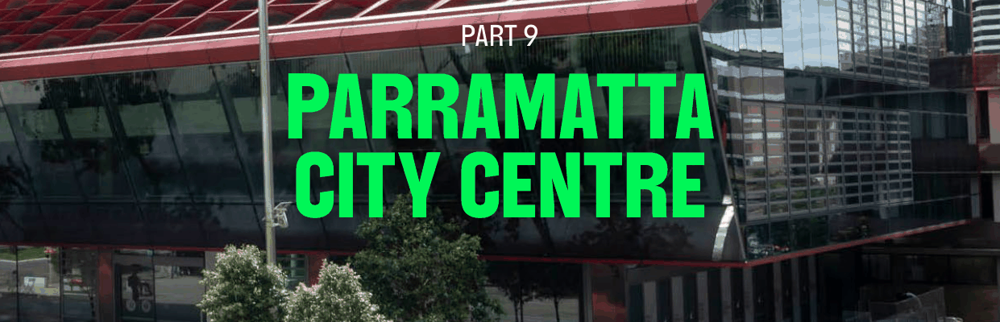

# Parramatta Development Control Plan 2023 - Part 9 Parramatta City Centre

> This chapter is split into 210 section file(s), one per numbered heading, in the order they appear in the PDF.

Source PDF: [dcp-part-9-parramatta-city-centre.pdf](dcp-part-9-parramatta-city-centre.pdf)

> [Picture on page 1: a picture, saved as a picture (images/part-09-parramatta-city-centre-page-1-1.gif, 150 dpi).]

## PART 9 PARRAMATTA

### CITY CENTRE

### CONTENTS

| 9 | PARRAMATTA CITY CENTRE ........................................................................................................... 1 |
|---|---|
| 9B | AUTO ALLEY (WEST) ..................................................................................................................... 387 |

| 9.1 | INTRODUCTION .................................................................................................................................. 1 9.1.1 APPLICATION ....................................................................................................................................... 1 9.1.2 GENERAL OBJECTIVES...................................................................................................................... 2 |
|---|---|
| 9.2 | DESIGN QUALITY ................................................................................................................................3 |
| 9.3 | BUILT FORM ........................................................................................................................................ 5 9.3.1 GUIDING PRINCIPLES ........................................................................................................................ 5 9.3.2 MINIMUM SITE FRONTAGE ............................................................................................................. 6 9.3.3 THE BUILDING ENVELOPE .............................................................................................................. 6 9.3.4 THE STREET WALL ............................................................................................................................ 16 9.3.5 THE GROUND FLOOR ...................................................................................................................... 18 9.3.6 ABOVE GROUND PARKING ............................................................................................................32 9.3.7 RESIDENTIAL APARTMENT DESIGN QUALITY ........................................................................ 33 9.3.8 WINTERGARDENS ............................................................................................................................ 34 9.3.9 DWELLING MIX AND FLEXIBLE HOUSING ............................................................................... 35 |
| 9.4 | PUBLIC DOMAIN .............................................................................................................................. 36 9.4.1 SOLAR ACCESS TO SIGNIFICANT PARKS AND SPACES ...................................................... 37 9.4.2 AWNINGS AND TREES ON STREETS .......................................................................................... 44 9.4.3 DESIGN OF AWNINGS .................................................................................................................... 49 9.4.4 PEDESTRIAN LANES, SHARED ZONES AND SERVICE LANES ............................................. 51 9.4.5 PEDESTRIAN OVERPASSES AND UNDERPASSES .................................................................. 54 9.4.6 VEHICLE FOOTPATH CROSSINGS .............................................................................................. 54 9.4.7 VIEWS ...................................................................................................................................................57 |
| 9.5 | SPECIAL AREAS ................................................................................................................................ 60 9.5.1 CITY RIVER ........................................................................................................................................... 61 9.5.2 CIVIC LINK .......................................................................................................................................... 69 9.5.3 GEORGE STREET .............................................................................................................................. 83 9.5.4 CHURCH STREET .............................................................................................................................. 87 9.5.5 MARION STREET ............................................................................................................................... 90 9.5.6 CAMPBELL STREET & GREAT WESTERN HIGHWAY ............................................................. 96 9.5.7 AUTO ALLEY ..................................................................................................................................... 102 9.5.8 STATION STREET WEST ................................................................................................................ 110 9.5.9 CREEK CORRIDORS ........................................................................................................................ 114 9.5.10 PARK EDGE HIGHLY SENSITIVE AREA ...................................................................................... 116 9.5.11 CHURCH STREET NORTH ............................................................................................................. 125 |
| 9.6 | HERITAGE .......................................................................................................................................... 138 9.6.1 GUIDING PRINCIPLES .................................................................................................................... 138 |

TOC - 1

|  | 9.6.2 | UNDERSTANDING THE PLACE ................................................................................................... 140 |
|---|---|---|
|  | 9.6.3 | HERITAGE RELATIONSHIPS ......................................................................................................... 141 |
|  | 9.6.4 | DEMOLITION .................................................................................................................................... 144 |
|  | 9.6.5 | AMALGAMATION OF LOTS .......................................................................................................... 145 |
|  | 9.6.6 | DEVELOPMENT TO BENEFIT A HERITAGE ITEM ................................................................... 146 |
|  | 9.6.7 | INTERPRETATION ............................................................................................................................ 148 |
| 9.7 | FLOOD RISK MANAGEMENT ...................................................................................................... 149 |  |
|  | 9.7.1 | ASSESSMENT AND MINIMISATION OF FLOOD HAZARDS, RISKS AND POTENTIAL FOR |
|  |  | HARM ................................................................................................................................................. 150 |
|  | 9.7.2 | LAND USE AND BUILDING LEVELS ............................................................................................ 153 |
|  | 9.7.3 | SENSITIVE AND CRITICAL USES ................................................................................................. 155 |
|  | 9.7.4 | FLOOD WARNING AND EMERGENCY RESPONSE PLANNING ......................................... 155 |
|  | 9.7.5 | DEVELOPMENT IN AND NEAR FLOODWAYS, RIPARIAN ZONES AND NATURALISED |
|  |  | CHANNELS ........................................................................................................................................ 158 |
|  | 9.7.6 | CONTROLS FOR FLOODWAYS................................................................................................... 158 |
|  | 9.7.7 | CONTROLS FOR PARRAMATTA RIVER BANK AND FORESHORES ................................. 160 |
|  | 9.7.8 | CAR PARK BASEMENTS IN FLOOD PRONE AREAS .............................................................. 161 |
| 9.8 | ENVIRONMENTAL SUSTAINABILITY ........................................................................................ 164 |  |
|  | 9.8.1 | HIGH PERFORMING BUILDINGS ................................................................................................. 164 |
|  | 9.8.2 | DUAL WATER SYSTEMS ............................................................................................................... 166 |
|  | 9.8.3 | ALL ELECTRIC BUILDINGS ........................................................................................................... 167 |
|  | 9.8.4 | ELECTRIC VEHICLE CHARGING INFRASTRUCTURE ............................................................168 |
|  | 9.8.5 | URBAN COOLING........................................................................................................................... 169 |
|  | 9.8.6 | SOLAR LIGHT REFLECTIVITY (GLARE) ...................................................................................... 176 |
|  | 9.8.7 | NATURAL REFRIGERANTS IN AIR CONDITIONING............................................................... 177 |
|  | 9.8.8 | BIRD FRIENDLY DESIGN ................................................................................................................ 178 |
|  | 9.8.9 | WIND MITIGATION .......................................................................................................................... 179 |
| 9.9 | VEHICULAR ACCESS, PARKING AND SERVICING ............................................................... 184 |  |
|  | 9.9.1 | VEHICLE DRIVEWAYS AND MANOEUVRING.......................................................................... 184 |
|  | 9.9.2 | ON SITE CAR PARKING ................................................................................................................. 185 |
|  | 9.9.3 | BICYCLE PARKING AND END OF JOURNEY FACILITIES.....................................................186 |
| 9.10 | SITE SPECIFIC CONTROLS ......................................................................................................... 184 |  |
|  | 9.10.1 | PARRAMATTA SQUARE ................................................................................................................. 191 |
|  | 9.10.2 | 57, 63 AND 83 CHURCH STREET ................................................................................................ 204 |
|  | 9.10.3 | 180 GEORGE STREET...................................................................................................................... 213 |
|  | 9.10.4 | 2-10 PHILLIP STREET ...................................................................................................................... 217 |
|  | 9.10.5 | 184-188 GEORGE STREET .............................................................................................................. 231 |
|  | 9.10.6 | 2-6 HASSALL STREET .................................................................................................................... 237 |
|  | 9.10.7 | 12A PARKES STREET ...................................................................................................................... 243 |

TOC - 2

9.10.8 14-20 PARKES STREET, HARRIS PARK ...................................................................................... 247

9.10.9 55 AIRD STREET ............................................................................................................................... 251

9.10.10 142-154 MACQUARIE STREET, 118 HARRIS STREET AND 135 GEORGE STREET .......... 256

9.10.11 33-34 MARION STREET ................................................................................................................. 275

9.10.12 2 O'CONNELL STREET, PARRAMATTA ..................................................................................... 278

9.10.13 12 HASSALL STREET ....................................................................................................................... 285

9.10.14 20 MACQUARIE STREET ............................................................................................................... 292

9.10.15 197 AND 207 CHURCH STREET AND 89 MARSDEN STREET ............................................. 303

9.10.16 18-40 ANDERSON STREET ............................................................................................................ 315

9.10.17 89-91 GEORGE STREET ................................................................................................................. 327

9.10.18 8-14 GREAT WESTERN HIGHWAY ............................................................................................. 337

9.10.19  8-12 VICTORIA ROAD AND 2A VILLIERS STREET .................................................................. 345

9.10.20 470 CHURCH STREET, PARRAMATTA ...................................................................................... 350

9.10.21 65-79 MACQUARIE STREET, 38 HUNTER STREET, 195 CHURCH STREET AND 45 HUNTER STREET, PARRAMATTA (ST JOHN'S ANGLICAN CATHEDRAL) ....................... 354

TOC - 3

INTRODUCTION

<!-- sections -->
## Sections

1. [9.1.1 APPLICATION](001-9-1-1-application.md)
2. [9.1.2 GENERAL OBJECTIVES](002-9-1-2-general-objectives.md)
3. [9.2 DESIGN QUALITY](003-9-2-design-quality.md)
4. [9.3.1 GUIDING PRINCIPLES](004-9-3-1-guiding-principles.md)
5. [9.3.2 MINIMUM SITE FRONTAGE](005-9-3-2-minimum-site-frontage.md)
6. [9.3.3 THE BUILDING ENVELOPE](006-9-3-3-the-building-envelope.md)
7. [9.3.3.1 STREET SETBACKS](007-9-3-3-1-street-setbacks.md)
8. [9.3.3.2 BUILDING SEPARATION](008-9-3-3-2-building-separation.md)
9. [9.3.3.3 TOWER SLENDERNESS](009-9-3-3-3-tower-slenderness.md)
10. [9.3.3.4 FLOOR HEIGHTS](010-9-3-3-4-floor-heights.md)
11. [9.3.4 THE STREET WALL](011-9-3-4-the-street-wall.md)
12. [9.3.5 THE GROUND FLOOR](012-9-3-5-the-ground-floor.md)
13. [9.3.5.1.1 ACTIVE GROUND FLOOR FRONTAGE](013-9-3-5-1-1-active-ground-floor-frontage.md)
14. [9.3.5.1.2 RESIDENTIAL GROUND FLOOR FRONTAGE](014-9-3-5-1-2-residential-ground-floor-frontage.md)
15. [9.3.5.2 FLOOD AFFECTED SITES](015-9-3-5-2-flood-affected-sites.md)
16. [9.3.5.2.1 ACTIVE GROUND FLOOR FRONTAGE](016-9-3-5-2-1-active-ground-floor-frontage.md)
17. [9.3.5.2.1 This area must:](017-9-3-5-2-1-this-area-must.md)
18. [9.3.5.2.2 RESIDENTIAL GROUND FLOOR FRONTAGE](018-9-3-5-2-2-residential-ground-floor-frontage.md)
19. [9.3.5.2.3 FLOODWATER MANAGEMENT DESIGN ELEMENTS](019-9-3-5-2-3-floodwater-management-design-elements.md)
20. [9.3.5.3 ARCADES](020-9-3-5-3-arcades.md)
21. [9.3.5.4 SERVICES AND UTILITIES](021-9-3-5-4-services-and-utilities.md)
22. [9.3.6 ABOVE GROUND PARKING](022-9-3-6-above-ground-parking.md)
23. [9.3.7 RESIDENTIAL APARTMENT DESIGN QUALITY](023-9-3-7-residential-apartment-design-quality.md)
24. [9.3.8 WINTERGARDENS](024-9-3-8-wintergardens.md)
25. [9.3.9 DWELLING MIX AND FLEXIBLE HOUSING](025-9-3-9-dwelling-mix-and-flexible-housing.md)
26. [9.4 PUBLIC DOMAIN](026-9-4-public-domain.md)
27. [9.4.1 SOLAR ACCESS TO SIGNIFICANT PARKS AND SPACES](027-9-4-1-solar-access-to-significant-parks-and.md)
28. [9.4.2 AWNINGS AND TREES ON STREETS](028-9-4-2-awnings-and-trees-on-streets.md)
29. [9.4.2.1 AWNINGS HAVE PRIORITY](029-9-4-2-1-awnings-have-priority.md)
30. [9.4.2.2 STREET TREES HAVE PRIORITY](030-9-4-2-2-street-trees-have-priority.md)
31. [9.4.2.3 SEMI-RECESSED AWNINGS](031-9-4-2-3-semi-recessed-awnings.md)
32. [9.4.3 DESIGN OF AWNINGS](032-9-4-3-design-of-awnings.md)
33. [9.4.3.1 AWNINGS ON STREETS](033-9-4-3-1-awnings-on-streets.md)
34. [9.4.3.2 AWNINGS ON LANES](034-9-4-3-2-awnings-on-lanes.md)
35. [9.4.4 PEDESTRIAN LANES, SHARED ZONES AND SERVICE LANES](035-9-4-4-pedestrian-lanes-shared-zones-and.md)
36. [9.4.5 PEDESTRIAN OVERPASSES AND UNDERPASSES](036-9-4-5-pedestrian-overpasses-and-underpasses.md)
37. [9.4.6 VEHICLE FOOTPATH CROSSINGS](037-9-4-6-vehicle-footpath-crossings.md)
38. [9.4.7 VIEWS](038-9-4-7-views.md)
39. [9.5 SPECIAL AREAS](039-9-5-special-areas.md)
40. [9.5.1 CITY RIVER](040-9-5-1-city-river.md)
41. [9.5.1.2 CITY EAST BLOCK](041-9-5-1-2-city-east-block.md)
42. [9.5.2 CIVIC LINK](042-9-5-2-civic-link.md)
43. [9.5.3 GEORGE STREET](043-9-5-3-george-street.md)
44. [9.5.4 CHURCH STREET](044-9-5-4-church-street.md)
45. [9.5.5 MARION STREET](045-9-5-5-marion-street.md)
46. [9.5.6 CAMPBELL STREET & GREAT WESTERN HIGHWAY](046-9-5-6-campbell-street-and-great-western.md)
47. [9.5.7 AUTO ALLEY](047-9-5-7-auto-alley.md)
48. [9.5.8 STATION STREET WEST](048-9-5-8-station-street-west.md)
49. [9.5.9 CREEK CORRIDORS](049-9-5-9-creek-corridors.md)
50. [9.5.10 PARK EDGE HIGHLY SENSITIVE AREA](050-9-5-10-park-edge-highly-sensitive-area.md)
51. [9.5.11 CHURCH STREET NORTH](051-9-5-11-church-street-north.md)
52. [9.6 HERITAGE](052-9-6-heritage.md)
53. [9.6.1 GUIDING PRINCIPLES](053-9-6-1-guiding-principles.md)
54. [9.6.2 UNDERSTANDING THE PLACE](054-9-6-2-understanding-the-place.md)
55. [9.6.3 HERITAGE RELATIONSHIPS](055-9-6-3-heritage-relationships.md)
56. [9.6.4 DEMOLITION](056-9-6-4-demolition.md)
57. [9.6.5 AMALGAMATION OF LOTS](057-9-6-5-amalgamation-of-lots.md)
58. [9.6.6 DEVELOPMENT TO BENEFIT A HERITAGE ITEM](058-9-6-6-development-to-benefit-a-heritage-item.md)
59. [9.6.7 INTERPRETATION](059-9-6-7-interpretation.md)
60. [9.7 FLOOD RISK MANAGEMENT](060-9-7-flood-risk-management.md)
61. [9.7.1 ASSESSMENT AND MINIMISATION OF FLOOD HAZARDS, RISKS AND](061-9-7-1-assessment-and-minimisation-of-flood.md)
62. [9.7.2 LAND USE AND BUILDING LEVELS](062-9-7-2-land-use-and-building-levels.md)
63. [9.7.3 SENSITIVE AND CRITICAL USES](063-9-7-3-sensitive-and-critical-uses.md)
64. [9.7.4 FLOOD WARNING AND EMERGENCY RESPONSE PLANNING](064-9-7-4-flood-warning-and-emergency-response.md)
65. [9.7.5 DEVELOPMENT IN AND NEAR FLOODWAYS, RIPARIAN ZONES AND](065-9-7-5-development-in-and-near-floodways.md)
66. [9.7.6 CONTROLS FOR FLOODWAYS](066-9-7-6-controls-for-floodways.md)
67. [9.7.7 CONTROLS FOR PARRAMATTA RIVER BANK AND FORESHORES](067-9-7-7-controls-for-parramatta-river-bank-and.md)
68. [9.7.8 CAR PARK BASEMENTS IN FLOOD PRONE AREAS](068-9-7-8-car-park-basements-in-flood-prone-areas.md)
69. [9.8 ENVIRONMENTAL SUSTAINABILITY](069-9-8-environmental-sustainability.md)
70. [9.8.1 HIGH PERFORMING BUILDINGS](070-9-8-1-high-performing-buildings.md)
71. [9.8.2 DUAL WATER SYSTEMS](071-9-8-2-dual-water-systems.md)
72. [9.8.3 ALL ELECTRIC BUILDINGS](072-9-8-3-all-electric-buildings.md)
73. [9.8.4 ELECTRIC VEHICLE CHARGING INFRASTRUCTURE](073-9-8-4-electric-vehicle-charging-infrastructure.md)
74. [9.8.5 URBAN COOLING](074-9-8-5-urban-cooling.md)
75. [9.8.5.1 ROOF SURFACES](075-9-8-5-1-roof-surfaces.md)
76. [9.8.5.2 FACADES](076-9-8-5-2-facades.md)
77. [9.8.5.2.1 TECHNICAL REQUIREMENTS - UHI FAÇADE SHADING](077-9-8-5-2-1-technical-requirements-uhi-fa-ade.md)
78. [9.8.5.3 HEATING AND COOLING SYSTEMS – HEAT REJECTION](078-9-8-5-3-heating-and-cooling-systems-heat.md)
79. [9.8.5.4 GREEN ROOFS OR WALLS](079-9-8-5-4-green-roofs-or-walls.md)
80. [9.8.6 SOLAR LIGHT REFLECTIVITY (GLARE)](080-9-8-6-solar-light-reflectivity-glare.md)
81. [9.8.7 NATURAL REFRIGERANTS IN AIR CONDITIONING](081-9-8-7-natural-refrigerants-in-air-conditioning.md)
82. [9.8.8 BIRD FRIENDLY DESIGN](082-9-8-8-bird-friendly-design.md)
83. [9.8.9 WIND MITIGATION](083-9-8-9-wind-mitigation.md)
84. [9.8.9.2 TECHNICAL REQUIREMENTS – WIND MITIGATION PERFORMANCE](084-9-8-9-2-technical-requirements-wind-mitigation.md)
85. [9.9.1 VEHICLE DRIVEWAYS AND MANOEUVRING](085-9-9-1-vehicle-driveways-and-manoeuvring.md)
86. [9.9.2 ON SITE CAR PARKING](086-9-9-2-on-site-car-parking.md)
87. [9.9.3 BICYCLE PARKING AND END OF JOURNEY FACILITIES](087-9-9-3-bicycle-parking-and-end-of-journey.md)
88. [9.9.3.2 BICYCLE PARKING](088-9-9-3-2-bicycle-parking.md)
89. [9.9.3.3 END OF JOURNEY FACILITIES](089-9-9-3-3-end-of-journey-facilities.md)
90. [9.10 SITE SPECIFIC CONTROLS](090-9-10-site-specific-controls.md)
91. [9.10.1 PARRAMATTA SQUARE](091-9-10-1-parramatta-square.md)
92. [9.10.1.1 DESIRED FUTURE CHARACTER](092-9-10-1-1-desired-future-character.md)
93. [9.10.1.2 SITE REQUIREMENTS](093-9-10-1-2-site-requirements.md)
94. [9.10.1.3 BUILDING FORM](094-9-10-1-3-building-form.md)
95. [9.10.1.4 SUSTAINABILITY](095-9-10-1-4-sustainability.md)
96. [9.10.1.5 ACCESS, PARKING AND SERVICES](096-9-10-1-5-access-parking-and-services.md)
97. [9.10.1.6 HERITAGE](097-9-10-1-6-heritage.md)
98. [9.10.1.7 PUBLIC ART](098-9-10-1-7-public-art.md)
99. [9.10.1.8 UTILITIES](099-9-10-1-8-utilities.md)
100. [9.10.2 57, 63 AND 83 CHURCH STREET](100-9-10-2-57-63-and-83-church-street.md)
101. [9.10.2.1 DESIRED FUTURE CHARACTER](101-9-10-2-1-desired-future-character.md)
102. [9.10.2.2 SITE OBJECTIVES](102-9-10-2-2-site-objectives.md)
103. [9.10.2.3 PUBLIC DOMAIN](103-9-10-2-3-public-domain.md)
104. [9.10.2.4 BUILDING FORM](104-9-10-2-4-building-form.md)
105. [9.10.2.5 SUSTAINABILITY, MICROCLIMATE & WATER](105-9-10-2-5-sustainability-microclimate-and-water.md)
106. [9.10.2.6 ACCESS, PARKING AND SERVICING](106-9-10-2-6-access-parking-and-servicing.md)
107. [9.10.3 180 GEORGE STREET](107-9-10-3-180-george-street.md)
108. [9.10.3.1 DESIRED FUTURE CHARACTER](108-9-10-3-1-desired-future-character.md)
109. [9.10.4 2-10 PHILLIP STREET](109-9-10-4-2-10-phillip-street.md)
110. [9.10.4.1 DESIRED FUTURE CHARACTER](110-9-10-4-1-desired-future-character.md)
111. [9.10.5 184-188 GEORGE STREET](111-9-10-5-184-188-george-street.md)
112. [9.10.5.1 DESIRED FUTURE CHARACTER](112-9-10-5-1-desired-future-character.md)
113. [9.10.6 2-6 HASSALL STREET, PARRAMATTA](113-9-10-6-2-6-hassall-street-parramatta.md)
114. [9.10.6.1 DESIRED FUTURE CHARACTER](114-9-10-6-1-desired-future-character.md)
115. [9.10.6.2 BUILDING FORM](115-9-10-6-2-building-form.md)
116. [9.10.7 12A PARKES STREET](116-9-10-7-12a-parkes-street.md)
117. [9.10.7.1 DESIRED FUTURE CHARACTER](117-9-10-7-1-desired-future-character.md)
118. [9.10.8 14-20 PARKES STREET, HARRIS PARK](118-9-10-8-14-20-parkes-street-harris-park.md)
119. [9.10.8.1 DESIRED FUTURE CHARACTER](119-9-10-8-1-desired-future-character.md)
120. [9.10.9 55 AIRD STREET](120-9-10-9-55-aird-street.md)
121. [9.10.9.1 BUILDING ENVELOPES](121-9-10-9-1-building-envelopes.md)
122. [9.10.9.2 STREET WALL DESIGN](122-9-10-9-2-street-wall-design.md)
123. [9.10.9.3 THE GROUND FLOOR](123-9-10-9-3-the-ground-floor.md)
124. [9.10.10 142-154 MACQUARIE STREET, 118 HARRIS STREET AND 135 GEORGE STREET](124-9-10-10-142-154-macquarie-street-118-harris.md)
125. [9.10.10.1 PRIVATE DOMAIN](125-9-10-10-1-private-domain.md)
126. [9.10.10.2 BUILDING FORM](126-9-10-10-2-building-form.md)
127. [9.10.10.3 ACCESS, PARKING AND SERVICING](127-9-10-10-3-access-parking-and-servicing.md)
128. [9.10.10.4 SUSTAINABILITY, MICROCLIMATE AND WATER](128-9-10-10-4-sustainability-microclimate-and-water.md)
129. [9.10.10.5 FLOOD RISK MANAGEMENT](129-9-10-10-5-flood-risk-management.md)
130. [9.10.11 33-34 MARION STREET](130-9-10-11-33-34-marion-street.md)
131. [9.10.11.1 BUILT FORM OBJECTIVES](131-9-10-11-1-built-form-objectives.md)
132. [9.10.12 2 O’CONNELL STREET, PARRAMATTA](132-9-10-12-2-o-connell-street-parramatta.md)
133. [9.10.12.1 BUILDING ENVELOPES](133-9-10-12-1-building-envelopes.md)
134. [9.10.12.2 STREET WALL DESIGN](134-9-10-12-2-street-wall-design.md)
135. [9.10.12.3 THE GROUND FLOOR](135-9-10-12-3-the-ground-floor.md)
136. [9.10.12.4 HERITAGE](136-9-10-12-4-heritage.md)
137. [9.10.12.5 MATERIALS](137-9-10-12-5-materials.md)
138. [9.10.13 12 HASSALL STREET](138-9-10-13-12-hassall-street.md)
139. [9.10.13.1 DESIRED FUTURE CHARACTER](139-9-10-13-1-desired-future-character.md)
140. [9.10.13.2 BUILDING FORM](140-9-10-13-2-building-form.md)
141. [9.10.13.3 MIXED USES](141-9-10-13-3-mixed-uses.md)
142. [9.10.13.4 PUBLIC DOMAIN AND LANDSCAPING](142-9-10-13-4-public-domain-and-landscaping.md)
143. [9.10.13.5 CAR PARKING AND ACCESS](143-9-10-13-5-car-parking-and-access.md)
144. [9.10.14 20 MACQUARIE STREET](144-9-10-14-20-macquarie-street.md)
145. [9.10.14.1 DESIRED FUTURE CHARACTER](145-9-10-14-1-desired-future-character.md)
146. [9.10.14.2 BUILT FORM, DESIGN AND MASSING](146-9-10-14-2-built-form-design-and-massing.md)
147. [9.10.14.3 LAND USES](147-9-10-14-3-land-uses.md)
148. [9.10.14.4 TRAFFIC AND TRANSPORT](148-9-10-14-4-traffic-and-transport.md)
149. [9.10.14.5 DESIRED FUTURE CHARACTER](149-9-10-14-5-desired-future-character.md)
150. [9.10.14.6 BUILT FORM, DESIGN AND MASSING](150-9-10-14-6-built-form-design-and-massing.md)
151. [9.10.14.7 LAND USES](151-9-10-14-7-land-uses.md)
152. [9.10.14.8 TRAFFIC AND TRANSPORT](152-9-10-14-8-traffic-and-transport.md)
153. [9.10.15 197 AND 207 CHURCH STREET AND 89 MARSDEN STREET](153-9-10-15-197-and-207-church-street-and-89-marsden.md)
154. [9.10.15.1 DESIRED FUTURE CHARACTER](154-9-10-15-1-desired-future-character.md)
155. [9.10.15.2 BUILT FORM](155-9-10-15-2-built-form.md)
156. [9.10.15.3 PUBLIC DOMAIN](156-9-10-15-3-public-domain.md)
157. [9.10.15.4 TRAFFIC AND TRANSPORT](157-9-10-15-4-traffic-and-transport.md)
158. [9.10.15.5 HERITAGE](158-9-10-15-5-heritage.md)
159. [9.10.15.6 STREET WALL DESIGN](159-9-10-15-6-street-wall-design.md)
160. [9.10.15.7 GROUND FLOOR](160-9-10-15-7-ground-floor.md)
161. [9.10.15.8 FLOOD MANAGEMENT](161-9-10-15-8-flood-management.md)
162. [9.10.16 18-40 ANDERSON STREET](162-9-10-16-18-40-anderson-street.md)
163. [9.10.16.1 DESIRED FUTURE CHARACTER](163-9-10-16-1-desired-future-character.md)
164. [9.10.17 89-91 GEORGE STREET](164-9-10-17-89-91-george-street.md)
165. [9.10.17.1 DESIRED FUTURE CHARACTER](165-9-10-17-1-desired-future-character.md)
166. [9.10.17.2 HERITAGE](166-9-10-17-2-heritage.md)
167. [9.10.17.3 BUILT FORM](167-9-10-17-3-built-form.md)
168. [9.10.17.4 SUSTAINABILITY](168-9-10-17-4-sustainability.md)
169. [9.10.18 8-14 GREAT WESTERN HIGHWAY](169-9-10-18-8-14-great-western-highway.md)
170. [9.10.18.1 DESIRED FUTURE CHARACTER](170-9-10-18-1-desired-future-character.md)
171. [9.10.18.2 BUILT FORM AND MASSING](171-9-10-18-2-built-form-and-massing.md)
172. [9.10.18.3 STREET WALL DESIGN AND GROUND FLOOR](172-9-10-18-3-street-wall-design-and-ground-floor.md)
173. [9.10.18.4 ACCESS, PARKING AND SERVICING](173-9-10-18-4-access-parking-and-servicing.md)
174. [9.10.18.5 HERITAGE](174-9-10-18-5-heritage.md)
175. [9.10.18.6 LANDSCAPING](175-9-10-18-6-landscaping.md)
176. [9.10.19 8-12 VICTORIA ROAD AND 2A VILLIERS STREET](176-9-10-19-8-12-victoria-road-and-2a-villiers.md)
177. [9.10.19.1 DESIRED FUTURE CHARACTER](177-9-10-19-1-desired-future-character.md)
178. [9.10.19.2 BUILDING FORM AND MASSING](178-9-10-19-2-building-form-and-massing.md)
179. [9.10.19.3 TRAFFIC AND TRANSPORT](179-9-10-19-3-traffic-and-transport.md)
180. [9.10.20 470 CHURCH STREET, PARRAMATTA](180-9-10-20-470-church-street-parramatta.md)
181. [9.10.20.1 DESIRED FUTURE CHARACTER](181-9-10-20-1-desired-future-character.md)
182. [9.10.20.2 BUILT FORM, DESIGN AND MASSING](182-9-10-20-2-built-form-design-and-massing.md)
183. [9.10.20.3 LAND USES](183-9-10-20-3-land-uses.md)
184. [9.10.20.4 TRAFFIC AND TRANSPORT](184-9-10-20-4-traffic-and-transport.md)
185. [45 HUNTER STREET, PARRAMATTA (ST JOHN'S ANGLICAN CATHEDRAL)](185-45-hunter-street-parramatta-st-john-s.md)
186. [9.10.21.2 DESIRED FUTURE CHARACTER](186-9-10-21-2-desired-future-character.md)
187. [9.10.21.3 HERITAGE](187-9-10-21-3-heritage.md)
188. [9.10.21.3.1 HERITAGE LISTINGS](188-9-10-21-3-1-heritage-listings.md)
189. [9.10.21.3.2 UNDERSTANDING THE PLACE](189-9-10-21-3-2-understanding-the-place.md)
190. [9.10.21.3.3 HERITAGE RELATIONSHIPS](190-9-10-21-3-3-heritage-relationships.md)
191. [9.10.21.3.4 ARCHIVAL RECORDING](191-9-10-21-3-4-archival-recording.md)
192. [9.10.21.3.5 AMALGAMATION OF LOTS AND LANDSCAPE SETTING](192-9-10-21-3-5-amalgamation-of-lots-and-landscape.md)
193. [9.10.21.3.6 DEVELOPMENT TO BENEFIT A HERITAGE ITEM](193-9-10-21-3-6-development-to-benefit-a-heritage-item.md)
194. [9.10.21.3.7 INTERPRETATION](194-9-10-21-3-7-interpretation.md)
195. [9.10.21.4 PUBLIC DOMAIN](195-9-10-21-4-public-domain.md)
196. [9.10.21.5 BUILT FORM](196-9-10-21-5-built-form.md)
197. [9.10.21.6 DESIRED FUTURE CHARACTER](197-9-10-21-6-desired-future-character.md)
198. [9.10.21.7 HERITAGE](198-9-10-21-7-heritage.md)
199. [9.10.21.7.1 HERITAGE LISTINGS](199-9-10-21-7-1-heritage-listings.md)
200. [9.10.21.7.2 UNDERSTANDING THE PLACE](200-9-10-21-7-2-understanding-the-place.md)
201. [9.10.21.7.3 HERITAGE RELATIONSHIPS](201-9-10-21-7-3-heritage-relationships.md)
202. [9.10.21.7.4 ARCHIVAL RECORDING](202-9-10-21-7-4-archival-recording.md)
203. [9.10.21.7.5 AMALGAMATION OF LOTS AND LANDSCAPE SETTING](203-9-10-21-7-5-amalgamation-of-lots-and-landscape.md)
204. [9.10.21.7.6 DEVELOPMENT TO BENEFIT A HERITAGE ITEM](204-9-10-21-7-6-development-to-benefit-a-heritage-item.md)
205. [9.10.21.7.7 INTERPRETATION](205-9-10-21-7-7-interpretation.md)
206. [9.10.21.8 PUBLIC DOMAIN](206-9-10-21-8-public-domain.md)
207. [9.10.21.9 BUILT FORM](207-9-10-21-9-built-form.md)
208. [9.10.21.10 VEHICLE ACCESS, PARKING AND SERVICING](208-9-10-21-10-vehicle-access-parking-and-servicing.md)
209. [9.10.21.11 FLOOD RISK AND RAINWATER MANAGEMENT](209-9-10-21-11-flood-risk-and-rainwater-management.md)
210. [9.10.21.12 ENVIRONMENTAL SUSTAINABILITY](210-9-10-21-12-environmental-sustainability.md)
