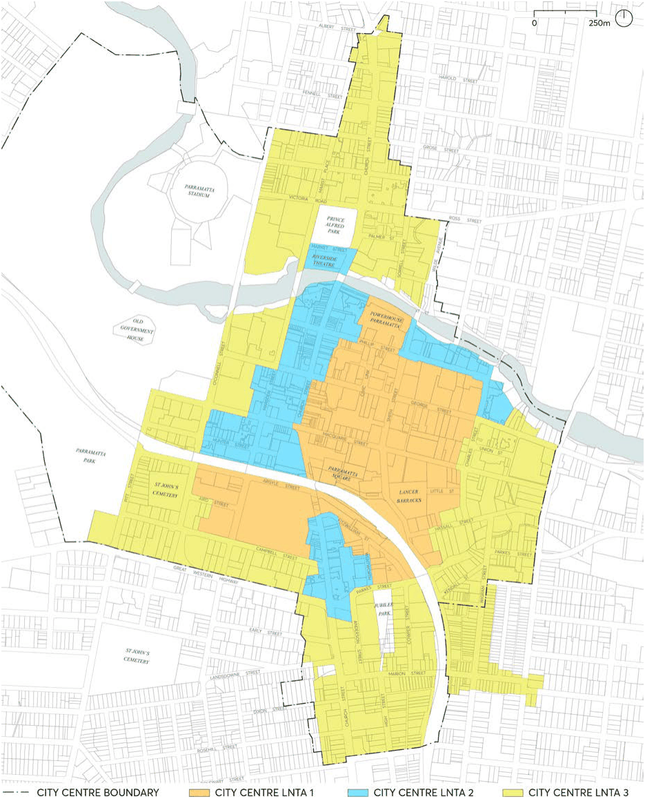

### 10.2 LATE NIGHT TRADING AREAS

This Section describes the Late Night Trading Areas (LNTAs). The LNTAs located within the City of Parramatta are identified on the late night trading area map at Figure 10.2.1. LNTA’s include:

• City Centre LNTA 1

• City Centre LNTA 2

• City Centre LNTA 3

> [Picture on page 8: a picture, saved as a picture (images/part-10-late-night-trading-page-8-8.gif, 150 dpi).]

Figure 10.2.1 – Late Night Trading Areas Map

LATE NIGHT TRADING AREAS
