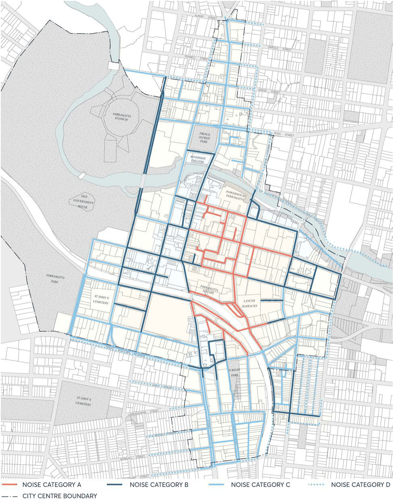

#### 10.4.2 NOISE CATEGORIES AND LEVELS WITHIN LNTAS

This Section describes the External Noise Category (NC) Cumulative Levels that apply in the Parramatta City Centre and immediate surrounds as shown in Figure 10.4.2. The Noise Categories have been established based on:

• Existing Entertainment Noise levels in benchmark areas;

• Historical measurement data across Sydney, including Parramatta; and

• An analysis of noise ingress through typical window façade construction for different receiver types.

Objectives

O.01. Provide criteria that considers cumulative impacts of activity in the public realm. O.02. Provide an appropriate framework for the assessment of entertainment noise levels in the Parramatta City Centre and immediate surrounds to provide certainty for emitters and receivers.

O.03. Protect the amenity of existing and potential future sensitive receivers.

ACOUSTIC CONTROLS

Controls

C.01 Entertainment Noise should not exceed the External Noise Category Cumulative Levels in Table

10.4.2 for the respective Noise Categories as shown in Figure 10.4.2.

C.02 External Noise Category Cumulative Levels apply:

a) on all days.

b) to the frontage or boundary of lots.

c) to all floors to the maximum LEP building heights.

C.03 A 5dB reduction from external cumulative noise levels will be applied to determine the permitted noise contribution for an individual noise generating development.

Table 10.4.2. – External Noise Category (NC) Cumulative Levels, Leq(15minute)

| Noise Category | Period1 |  | Overall, dBA | Octave band, dB |  |  |
|---|---|---|---|---|---|---|
|  |  |  |  | 31.5 Hz | 63 Hz | 125 Hz |
| NC-A | 1 - Day/Evening 2 - Night 3 - Late night | 7am – 10pm 10pm – Midnight Midnight – 7am | 70 70 65 | 73 73 63 | 73 73 63 | 68 68 61 |
| NC-B | 1 - Day/Evening 2 - Night 3 - Late night | 7am – 10pm 10pm – Midnight Midnight – 7am | 65 60 55 | 65 60 55 | 65 60 55 | 61 56 53 |
| NC-C | 1 - Day/Evening 2 - Night 3 - Late Night | 7am – 10pm 10pm – Midnight Midnight – 7am | 58 53 48 | 60 55 50 | 60 55 50 | 58 53 48 |
| NC-D | 1 - Day/Evening 2 - Night 3 - Late Night | 7am – 10pm 10pm – Midnight Midnight – 7am | 55 50 45 | 57 52 47 | 57 52 47 | 55 50 45 |

Notes:

1\. Time periods are defined in the Glossary of Terms. Time periods apply on all days.

2\. Noise levels are ‘free field’, i.e. not façade corrected.

ACOUSTIC CONTROLS

> [Picture on page 19: a picture, saved as a picture (images/part-10-late-night-trading-page-19-2.gif, 150 dpi).]

Figure 10.4.2 – Noise Category Levels in the City Centre and immediate surrounds

ACOUSTIC CONTROLS
