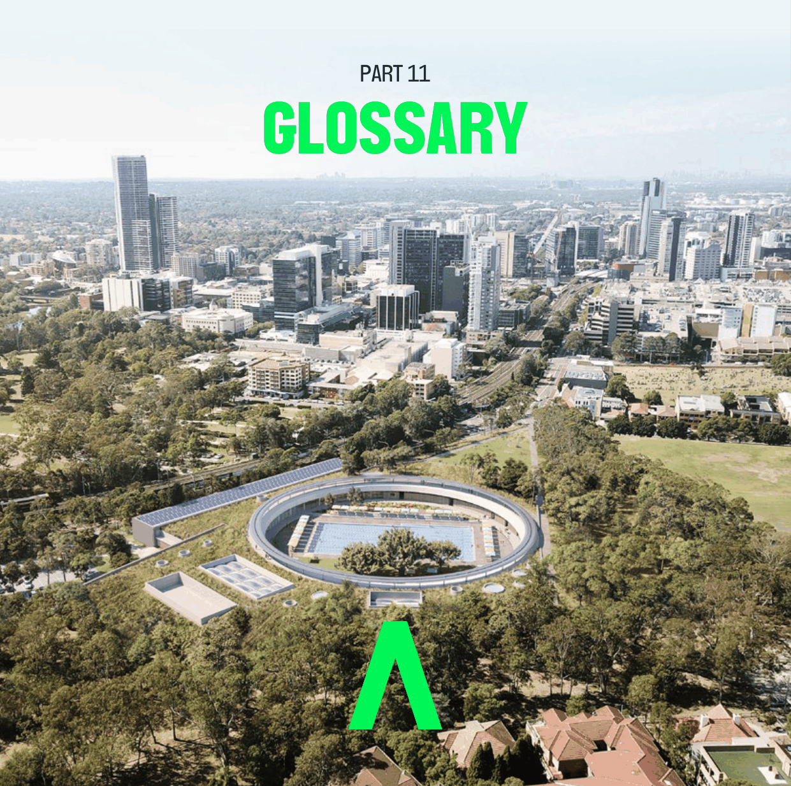

# Parramatta Development Control Plan 2023 - Part 11 Glossary

Source PDF: [dcp-part-11-glossary.pdf](dcp-part-11-glossary.pdf)

> [Picture on page 1: a picture, saved as a picture (images/part-11-glossary-page-1-1.gif, 150 dpi).]

## PART 11 GLOSSARY

| TERM | DESCRIPTION |
|---|---|
| Adequate Warning | is where the following is provided: |
| Systems, Signage | • an audible and visual alarm system which alerts occupants to the need |
| and Exits | to evacuate, sufficiently prior to likely inundation to allow for the safe evacuation of pedestrians and vehicles; • signage to identify the appropriate procedure and route to evacuate; and • exits which are located such that pedestrians evacuating any location during any flood do not have to travel through deeper water to reach a place of refuge above the 100 year flood away from the enclosed car parking. |
| Adverse flood | Flooding that adversely affects human safety, environmental |
| impact | impact/damage or the value or use of land, whether public or privately owned. Adverse flooding may result from a change in: • peak discharge • run-off volume • impervious area • rate of run-off, ie the travel time of stormwater run-off through the catchment |
| At-grade | Any form of parking provided either on the ground level of a building or at ground level outside a building. |
| Average Recurrence | The long term average number of years between of the occurrence of a flood |
| Interval (ARI) | as big as or larger than the selected event. |
| Balcony | Includes any porch, patio, covered deck or verandah, but does not include any deck area which is not provided with a roof. |
| Biodiversity | The different plants, animals and microorganisms, the genes they contain, and the ecosystems of which they are a part. The concept of biodiversity emphasises the inter-relatedness of the biological world, and encompasses the terrestrial, marine, and aquatic environments. |
| Building | A web-based planning tool for the assessment of the potential performance |
| Sustainability Index | of new residential development in terms of its efficiency in energy and water |
| (BASIX) | use. It enables the production of a rating for a project on the sustainability index and where the required targets are met, the issuing of a BASIX certificate which must be submitted with development applications and complying development certificates. BASIX is implemented under State Environmental Planning Policy (Building Sustainability Index: BASIX) 2004. |
| Building envelope | The three dimensional space within which a building can be built. |
| Building line or | The horizontal distance between the property boundary or other stated |
| setback (has the | boundary (measured at 90 degrees from the boundary) and: |
| same meaning as in | • a building wall, or |
| the Parramatta LEP | • the outside face of any balcony, deck or the like, or |
| 2023) | • the supporting posts of a carport or verandah roof, whichever distance is the shortest. |

| TERM | DESCRIPTION |
|---|---|
| Catchment | The entire area of land drained by a river and its tributaries bounded by a defined ridge line. |
| Children’s service | As defined in the Children’s Services Regulation 2004. |
| Children’s Services | Meaning Children’s Services Regulation 2004. |
| Regulation |  |
| Communal open | An area on the site set aside for the purposes of providing deep soil zones, |
| space | passive and active recreation areas and landscaping but does not include private open space. |
| Context | The broader setting of a place, the extent of which is influenced by the scale of development and the nature of surrounding land uses and patterns. |
| Concessional | Definition in Table 5.1.1.1 – Land Use Category Definitions in Section 5.1.1 – |
| development | Water Management. |
| Cultural trees | Trees that can be indigenous, native or exotic and are important for cultural reasons. |
| dBA | Decibels of the “A-scale”- a set frequency weighted scale of noise which allows for lack of sensitivity to the ear to sound at very high and very low frequencies. |
| Deep soil zone | A specified area of the development site, not covered by an impervious surface, that allows water on the site to infiltrate naturally to the groundwater and allows for the future provision of mature vegetation. |
| Design floor level | Meaning the minimum floor level that applies to the development. If the development is concessional, this level is determined based on what land use category would apply if it was not categorised as Concessional Development. The floor level standards specified for the relevant land use category (excluding Concessional Development) in the low flood risk precinct are to be applied. |
| Eco-industrial | Where local businesses work together and with their community to reduce |
| development | waste and pollution whilst increasing resource efficiencies and sharing. |
| Effective warning | The time available after receiving advice of an impending flood and before |
| time | the flood waters prevent appropriate flood response actions being undertaken. The effective warning time is typically used to move farm equipment, move stock, raise furniture, evacuate people and transport their possessions. |
| End of pipe | Stormwater quality controls that are designed to treat pollutants at the point of discharge rather than at source. |
| Façade | The major portion of the building that addresses the principal street frontage on the site upon which the building is located. |
| Fascia sign | A sign attached to the fascia or return of an awning. |
| Flood | A relatively high stream flow which overtops the natural or artificial banks in any part of a stream, river, estuary, lake or dam, and/or local over land flooding associated with major drainage as defined by the Floodplain Development Manual (FDM) before entering the water course. NOTE: Consistent with the FDM, this Policy does not apply in circumstances |

| TERM | DESCRIPTION of local drainage inundation as defined in the FDM and determined by Council. Local drainage problems can generally be minimised by the adoption of urban building controls requiring a minimum difference between finished floor and ground levels. |
|---|---|
| Flood compatible | Meaning a combination of measures incorporated in the design and/or |
| building | construction and alteration of individual buildings or structures subject to |
| components | flooding, and the use of flood compatible materials for the reduction or elimination of flood damage. |
| Flood compatible | Include those materials used in building which are resistant to damage when |
| materials | inundated. |
| Flood education, | • Flood education seeks to provide information to raise awareness of the |
| awareness and | flood problem so as to enable individuals to understand how to manage |
| readiness | themselves and their property in response to flood warnings and in a flood event. It invokes a state of flood readiness. • Flood awareness is an appreciation of the likely effects of flooding and knowledge of the relevant flood warning, response and evacuation procedures. • Flood readiness is an ability to react within the effective warning time. |
| Flood evacuation | Meaning the strategy for the evacuation of areas within effective warning |
| strategy | time during periods of flood as specified within Council’s Floodplain Risk Management Plan, the relevant State Emergency Services (SES) Flood Plan, by advice received from the SES or as determined in the assessment of individual proposals. |
| Flood risk | The potential danger to personal safety and potential damage to property resulting from flooding. The degree of risk varies with circumstances across the full range floods. Flood risk in the Floodplain Management Manual is divided into 3 types, existing, future and continuing risks. They are described below. • Existing flood risk is the risk a community is exposed to as a result of its location on the floodplain. • Future flood risk is the risk the community is exposed to as a result of new development on the floodplain. • Continuing flood risk is the risk a community is exposed to after floodplain management measures have been implemented. |
| Flood risk | The catchment wide flood study prepared under the direction of the NSW |
| management plan | Government Development Manual (2005) or previous versions, for the |
| or study | sustainable management of the floodplain including the management of existing flood risk, future flood risk and continuing flood risk. |
| Flood storage areas | Those parts of the floodplain that are important for the temporary storage of floodwaters during the passage of a flood. The extent and behaviour of flood storage areas may change with flood severity, and loss of flood storage can increase the severity of flood impacts by reducing the natural flood attenuation. |

| TERM | DESCRIPTION |
|---|---|
| Flood prone land | Being synonymous with ‘flood liable land’ and ‘floodplain’ is the area of land which is subject to inundation by floods up to and including an extreme flood such as a probable maximum flood (PMF). |
| Floodway areas | Those areas of the floodplain where a significant discharge of water occurs during floods. They are often aligned with naturally defined channels. Floodways are areas that, even if only partially blocked, would cause a significant redistribution of flood flow, or significant increase in flood levels. |
| Flush wall sign | A sign which is attached to the wall of a building (other than the transom of a doorway or display window) and not projecting more than 300mm from the wall. |
| Freeboard | A factor of safety expressed as the height above the flood used to determine the design floor level or ground level. Freeboard provides a factor of safety to compensate for uncertainties in the estimation of flood levels across the floodplain, such as wave action, localised hydraulic behaviour and impacts that are specific event related, such as levee and embankment settlement, and other effects such as “greenhouse” and climate change. |
| Frontage | A boundary of a lot which abuts a road. |
| Gentrification | The redevelopment of existing housing stock with new housing forms, thus improving property values, but often displacing low-income residents and small businesses. |
| Gross floor area | The sum of the floor area of each floor of a building measured from the |
| (has the same | internal face of external walls, or from the internal face of walls separating |
| meaning as in the | the building from any other building, measured at a height of 1.4 metres |
| Parramatta LEP 2023) | above the floor, and includes: • the area of a mezzanine, and • habitable rooms in a basement or an attic, and • any shop, auditorium, cinema, and the like, in a basement or attic, but excludes: • any area for common vertical circulation, such as lifts and stairs, and • any basement: • storage, and • vehicular access, loading areas, garbage and services, and • plant rooms, lift towers and other areas used exclusively for mechanical services or ducting, and • car parking to meet any requirements of the consent authority (including access to that car parking), and • any space used for the loading or unloading of goods (including access to it), and • terraces and balconies with outer walls less than 1.4 metres high, and • voids above a floor at the level of a storey or storey above. |
| Ground level | The existing level of a site at any point. |
| (existing) (has the |  |
| same meaning as in |  |

| TERM | DESCRIPTION |
|---|---|
| the Parramatta LEP |  |
| 2023) |  |
| Ground level | For any point on a site, the ground surface after completion of any |
| (finished) (has the | earthworks (excluding any excavation for a basement, footings or the like) for |
| same meaning as in | which consent has been granted or that is exempt development. |
| the Parramatta LEP |  |
| 2023) |  |
| Ground level (mean) | For any site on which a building is situated or proposed, one half of the sum |
| (has the same | of the highest and lowest levels at ground level (finished) of the outer surface |
| meaning as in the | of the external walls of the building. |
| Parramatta LEP 2023) |  |
| Groundwater | All water that occurs below the land surface in aquifers. |
| Habitable floor area | in a residential situation: • a living or working area, such as a lounge room, dining room, rumpus room, kitchen, bedroom or workroom; • in an industrial or commercial situation • an area used for offices or to store valuable possessions • susceptible to flood damage in the event of a flood. |
| Habitable room | Any room used for normal domestic activities other than a bathroom, toilet, pantry, walk-in wardrobe, corridor, lobby, photographic darkroom, clothes drying room, and other spaces of a specialised nature occupied neither frequently nor for extended periods |
| Hazard | Source of potential harm or a situation with a potential to cause loss. In relation to this manual, the hazard is flooding which has the potential to cause harm or loss to the community. |
| Height of building | The vertical distance between ground level (existing) at any point to the |
| (or building height) | highest point of the building, including plant and lift overruns, but excluding |
| (has the same | communication devices, antennae, satellite dishes, masts, flagpoles, |
| meaning as in the | chimneys, flues and the like. |
| Parramatta LEP 2023) |  |
| High pollution risk | Development sites that are considered to have a potential to impact on the receiving water quality. The following sites have been determined as being ‘high pollution risk’. • fast food, drive in or take away restaurants with an uncovered floor area greater than 100sqm • shopping centres on allotments greater than 1,000m2 • service stations • car wash bays • industrial developments or industrial units • developments with uncovered car parking for more than 12 cars • medium density residential developments (units/villas/town houses) having an impermeable surface area greater than 1,000m2 (not including roof area) |

| TERM | DESCRIPTION |
|---|---|
| Illuminated Sign | A sign which is internally or externally lit by artificial lighting whether that lighting is integral or separate from the sign, including signs that have flashing or sequenced lighting, spotlighting, directional, projected or laser lighting. |
| Impervious surface | Surfaces which do not allow rainwater to penetrate into the underlying soil. |
| Indigenous species | A plant or animal species that occurs at a place within its historically known natural range and that forms part of the natural biological diversity of a place. |
| Indoor | Indoor unencumbered play space as defined in Clause 30 of the Children’s |
| unencumbered | Services Regulation 2004. |
| space |  |
| Isolated site | A site that has limitations on its future potential development because of its size and shape, proximity to other development and its ability to be consolidated with other properties for development purposes. |
| Landscaped area | A part of a site used for growing plants, grasses and trees, but does not |
| (has the same | include any building, structure or hard paved area. |
| meaning as in the | To measure landscaped open space: |
| Parramatta LEP 2023) | • impervious surfaces such as driveways, paved areas, roofed areas, carparking and stormwater structures, decks and the like and any area with a width or length of less than 2m are excluded • the water surface of swimming pools is included • landscaping is to be at ground level • the minimum soil depth of land that can be included as landscaped open space is 1m. |
| Legibility | The extent to which people can understand the layout of a place and find their way, including cues from three dimensional forms and patterns in the landscape. |
| Local drainage | Smaller scale problems in urban areas. They are outside the definition of major drainage in this glossary. |
| Local overland | Inundation by local runoff rather than overbank discharge from a stream, |
| flooding | river, estuary, lake or dam. |
| Mainstream | Inundation of normally dry land occurring when water overflows the natural |
| flooding | or artificial banks of a stream, river, estuary, lake or dam. |
| Major drainage | Council has discretion in determining whether urban drainage problems are associated with major or local drainage. Major drainage involves: • the floodplains of original watercourses (which may now be piped, channelised or diverted), or sloping areas where overland flows develop along alternative paths once system capacity is exceeded; and/or • water depths generally in excess of 0.3 metres (in the major system design storm as defined in the current version of Australian Rainfall and Runoff). These conditions may result in danger to personal safety and property damage to both premises and vehicles; and/or |

| TERM | DESCRIPTION • major overland flowpaths through developed areas outside of defined drainage reserves; and/or • the potential to affect a number of buildings along the major flow path. |
|---|---|
| Multi dwelling | Multi dwelling housing (has the same meaning as in the Parramatta LEP 2023) |
| housing (has the |  |
| same meaning as in |  |
| the Parramatta LEP |  |
| 2023) |  |
| Native | Indigenous to Australia but not necessarily to the area. |
| Natural Channel | Maintain the hydraulic conveyance requirements of engineered or affected |
| Design (NCD) | channels while improving environmental values. NCD combines the disciplines of hydraulic engineering, fluvial geomorphology, in-stream and riparian ecology and community requirements. NCD involves the creation of channels with attributes of natural channels, including a meandering plan, pool and riffle zones, use of natural materials and riparian/floodplain vegetation. |
| Natural functions | Functions associated with water movement such as water flow distribution, volume and quality. |
| Natural ground level | Means the ground level of a site before any site works have been undertaken to alter the naturally occurring height and/or contours of the land. |
| Outdoor | Outdoor unencumbered play spaces as defined in clause 30 of the Children’s |
| unencumbered | Services Regulation 2004. |
| space |  |
| Parramatta LEP 2023 | Parramatta Local Environmental Plan 2023. |
| Private open space | The portion of private land which serves as an extension of the dwelling to provide space for relaxation, dining, entertainment and recreation. |
| Probable Maximum | The largest flood that could conceivably occur at a particular location. |
| Flood (PMF) |  |
| Public domain | Comprises the shared urban area and spaces, the structures that relate to those spaces and the infrastructure that supports and serves them (e.g. railway corridors, streetscapes, public car parks, parks and reserves, waterways and river systems). |
| Reliable access | Reliable access during a flood means the ability for people to safely evacuate an area subject to imminent flooding, having regard to the depth and velocity of flood waters, the suitability of the evacuation route, and without a need to travel through areas where water depths increase. |
| Risk | Meaning the chance of something happening that will have an impact. It is measured in terms of consequences and probability (likelihood). In the context of this plan, it is the likelihood of consequences arising from the interaction of floods, communities and the environment. |
| Robust | Refers to the durability of buildings and structures. |
| Site Emergency | A management plan prepared in consultation with the State Emergency |
| Response Flood | Services (SES) and approved by Council which demonstrates the means to |

| TERM | DESCRIPTION |
|---|---|
| Plan | minimise the likelihood of flood damage, including demonstrated ability to move goods above flood level within the likely available flood warning time and a requirement for flood drills for larger commercial/industrial premises. This could be in the form of an individual Flood Plan. |
| Site Stormwater | A plan identifying the potential impacts associated with stormwater run-off |
| Management Plan | for a proposed development and providing a range of management |
| (SSMP) | strategies and appropriate measures for water quantity, water quality, water re-use and environmental concerns. SSMP needs to be developed in accordance with Council’s Design and Development Guidelines and may form part of the development’s overall Environmental Management Plan. |
| Spatial | The relationship of space. |
| Streetscape | The composition of elements in a street which create the urban form and includes elements such as building forms and styles, landscaping, street furniture, pavements etc. |
| Storey (has the | A storey is a space within a building that is situated between one floor level |
| same meaning as | and the floor level next above, or if there is no floor above, the ceiling or roof |
| the Parramatta LEP | above, but does not include: |
| 2023) | • space that contains only a lift shaft, stairway or meter room, or • a mezzanine, or • an attic. |
| Stormwater | Run-off from land during and after rain. Stormwater removes accumulated material including litter, soil, nutrient, pathogens, chemicals, pesticides, oils and grease. |
| Subfloor space | The space between the underside of a suspended floor and the ground. |
| Terrace Housing | Multi dwelling housing where all dwellings face and generally follow the alignment of one or more public roads. |
| The City | The area defined as the Parramatta Local Government Area |
| Top Hamper Sign | A sign attached to the transom of a doorway or display window of a building. |
| Under Awning Sign | A sign located below or otherwise supported from the underside of an awning. |
| Wall height | The vertical distance between the top of the eaves at the wall line (excluding dormer windows), parapet or flat roof (not including a chimney), whichever is the highest, and the natural ground level immediately below that point. |
| Waterway (has the | The whole or any part of a watercourse, wetland, waterbody (artificial) or |
| same meaning as in | waterbody (natural). These individual terms are defined in the Parramatta LEP |
| the Parramatta LEP | 2023. |
| 2023) |  |
| Water Sensitive | WSUD offers an alternative to the traditional conveyance approach to |
| Urban Design | stormwater management. WSUD is a philosophy which aims to mitigate |
| (WSUD) | environmental impacts particularly on water quantity, water quality and receiving waterways, conventionally associated with urbanisation. Thus WSUD incorporates holistic management measures that take into account |

| TERM | DESCRIPTION urban planning and design, social and environmental amenity of the urban landscape and stormwater management which are integrated with stormwater conveyance by reducing peak flows, protection of natural systems and water quality, stormwater reuse and water conserving landscaping. |
|---|---|
