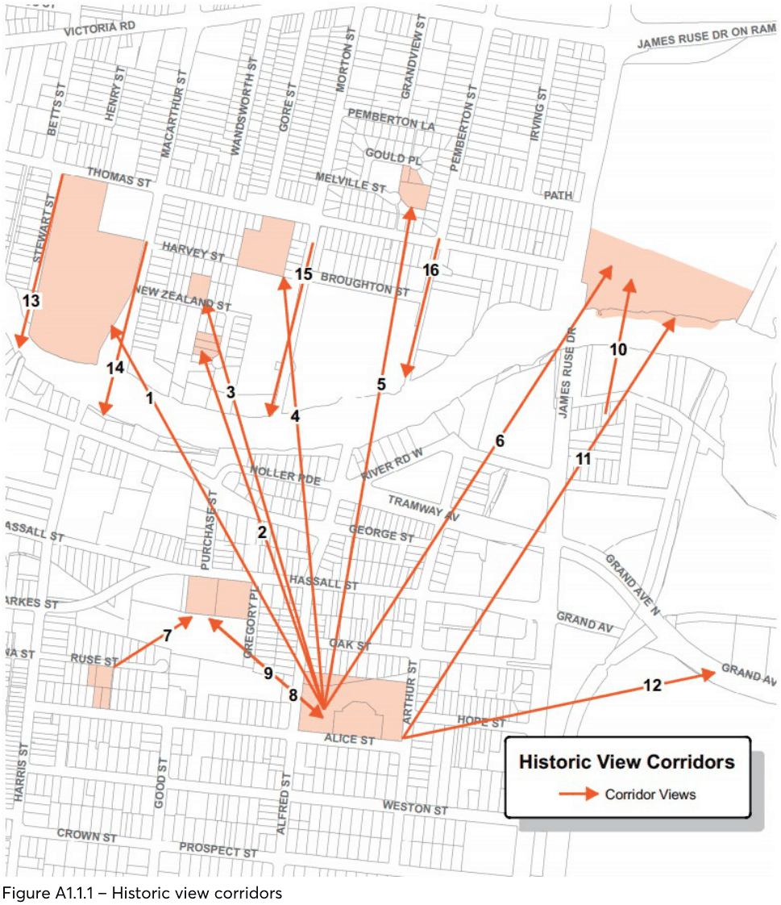
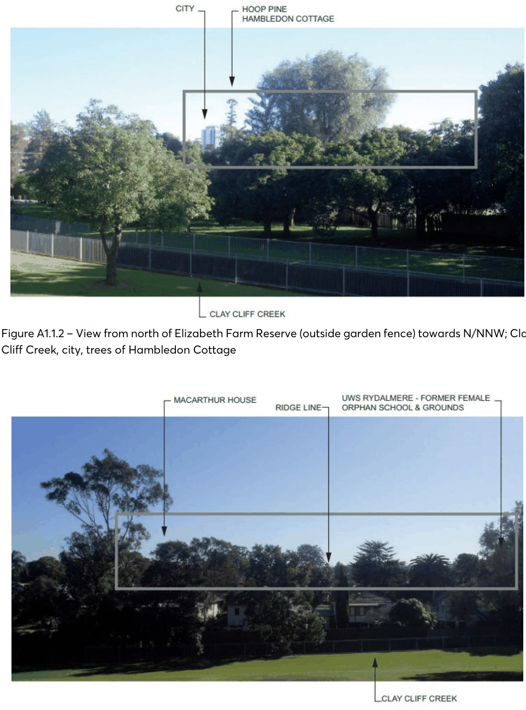
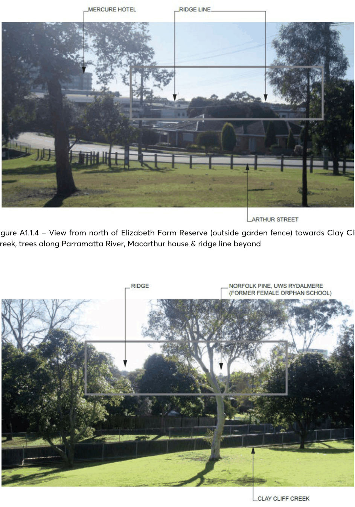
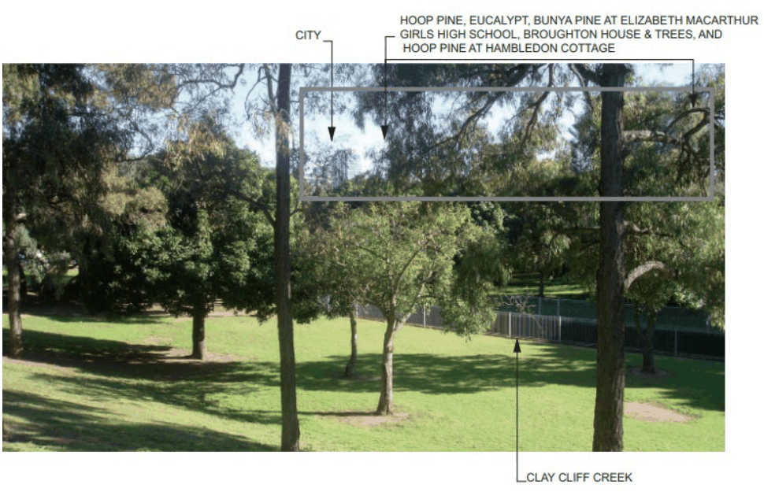

#### A1.1 HARRIS PARK

> [Picture on page 3: a picture, saved as a picture (images/part-12-appendices-page-3-3.gif, 150 dpi).]

Figure A1.1.1 – Historic view corridors

Table A1.1.1 – Historic view corridors

| View Number | Description | Significance |
|---|---|---|
| No. 1-5, 11 and 12 on views map | Views from Elizabeth Farm and Harris Park colonial precinct north to the ridgeline of hills, river basin (area bounded by Victoria Road, James Ruse Drive, Prospect and Harris Streets) to trees along river, former Newlands, trees of former Rangihou, Wavertree, Macarthur Girls High School, marked by tall tree plantings, including bunya and hoop pines, visible above surrounding suburban development. | Broadest panorama views in Parramatta, of hills to the north allowing appreciation, river valley landscape setting, the siting and interrelationships between key colonial farms and remnant early houses (marked by historic tall tree plantings of Elizabeth Farm, Newlands, Wavertree, Macarthur House, Rangihou). Also modern views of key historic farm plantings from major roads. |
| No. 6 and 10 on views map | Views of the former Female Orphan School/ UWS Rydalmere from southwest, from James Ruse Drive, Elizabeth Farm and Experiment Farm. | Views to a key heritage item, the former Female Orphan School, retention of historical visual connections to Elizabeth Farm and Experiment Farm. |
| No. 7 on views map | View from Experiment Farm northeast to trees of Hambledon Cottage. | Demonstrates interrelationship between two key colonial cottages. |
| No. 8 on views map | Views from Hambledon Cottage to trees of Elizabeth Farm. | Demonstrates interrelationship between master and servant, the Macarthur family and governess. |
| No. 9 on views map | Views from Elizabeth Farm to trees of Hambledon Cottage. |  |
| No. 13-16 on views map | Views from riverbank ridge defined by Thomas Street, North Parramatta, looking south down Stewart, Macarthur, Morton and Pemberton Streets to tall tree plantings of Hambledon Cottage, Experiment Farm, Elizabeth Farm and ridgeline of Harris Park colonial precinct. | Retain modern views of landmark tree plantings from the riverbank edge. |

> [Picture on page 5: a picture, saved as a picture (images/part-12-appendices-page-5-1.gif, 150 dpi).]

Figure A1.1.2 – View from north of Elizabeth Farm Reserve (outside garden fence) towards N/NNW; Clay Cliff Creek, city, trees of Hambledon Cottage

Figure A1.1.3 –  View from north of Elizabeth Farm Reserve (outside garden fence) towards Clay Cliff Creek, trees along Parramatta River, Macarthur House & ridge line beyond

> [Picture on page 6: a picture, saved as a picture (images/part-12-appendices-page-6-1.gif, 150 dpi).]

Figure A1.1.4 – View from north of Elizabeth Farm Reserve (outside garden fence) towards Clay Cliff Creek, trees along Parramatta River, Macarthur house & ridge line beyond

Figure A1.1.5 – View from north of Elizabeth Farm Reserve (outside garden fence) towards Clay Cliff Creek, trees along Parramatta River, Macarthur House & ridge line beyond

> [Picture on page 7: a picture, saved as a picture (images/part-12-appendices-page-7-1.gif, 150 dpi).]

Figure A1.1.6 – View from north of Elizabeth Farm Reserve (outside garden fence) towards Clay Cliff Creek, city, trees of Hambledon Cottage, trees of Elizabeth Macarthur Girls High School (former grounds of Newlands), & trees of Brougton House (former Newlands)
