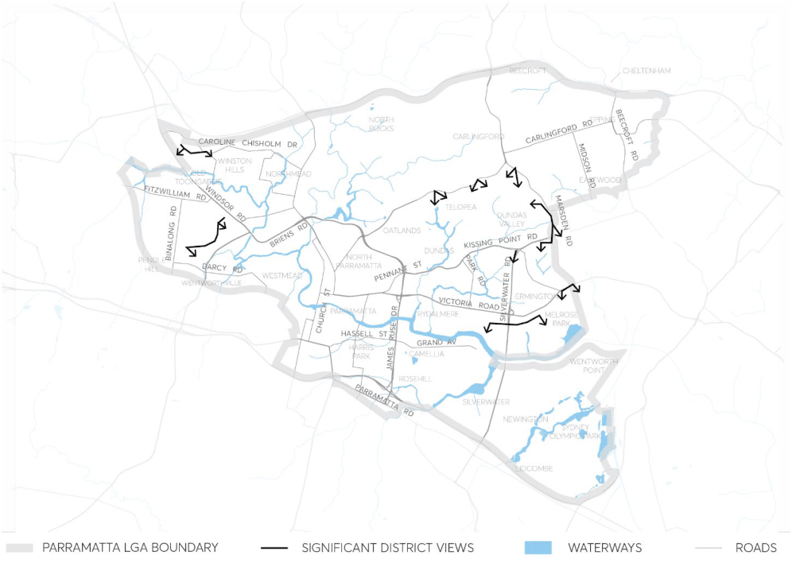
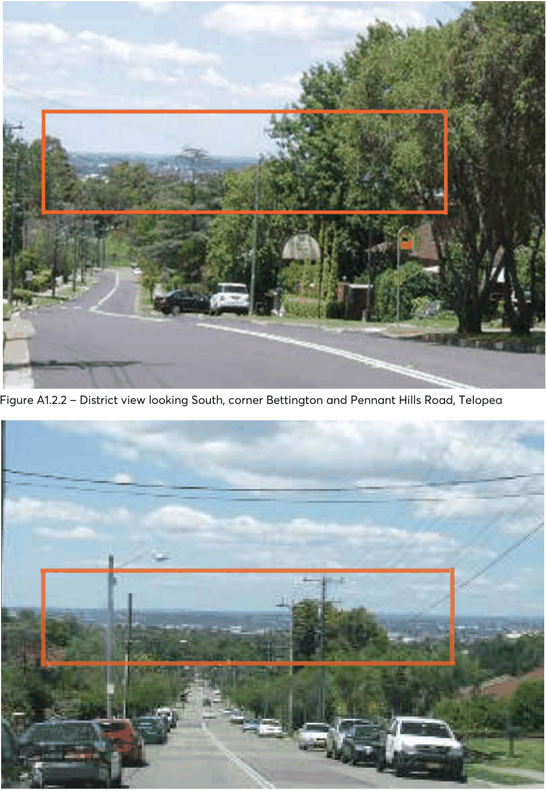
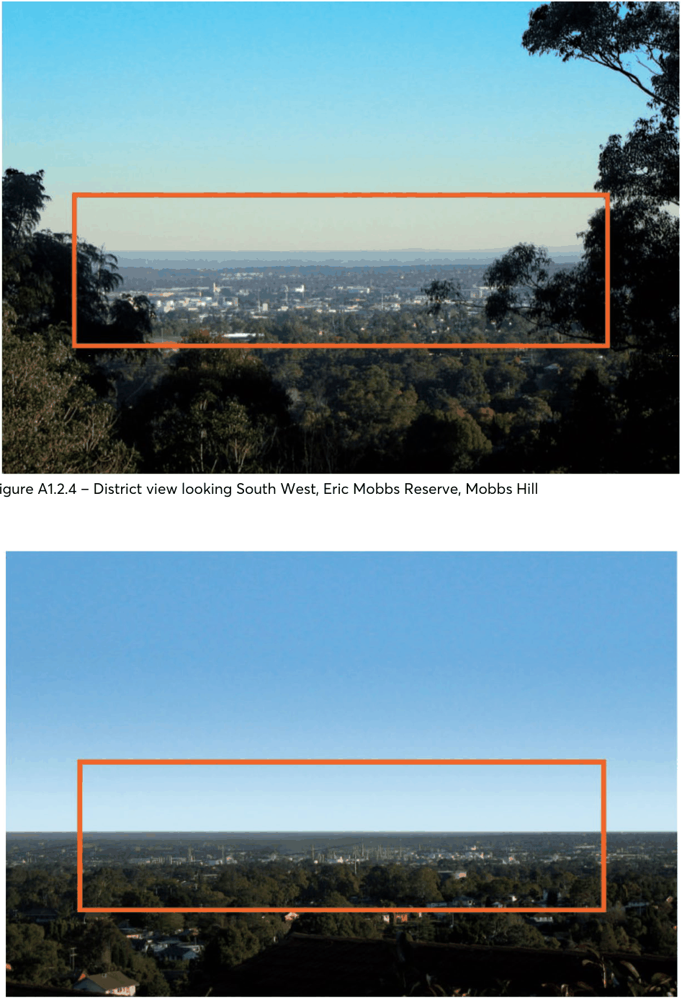
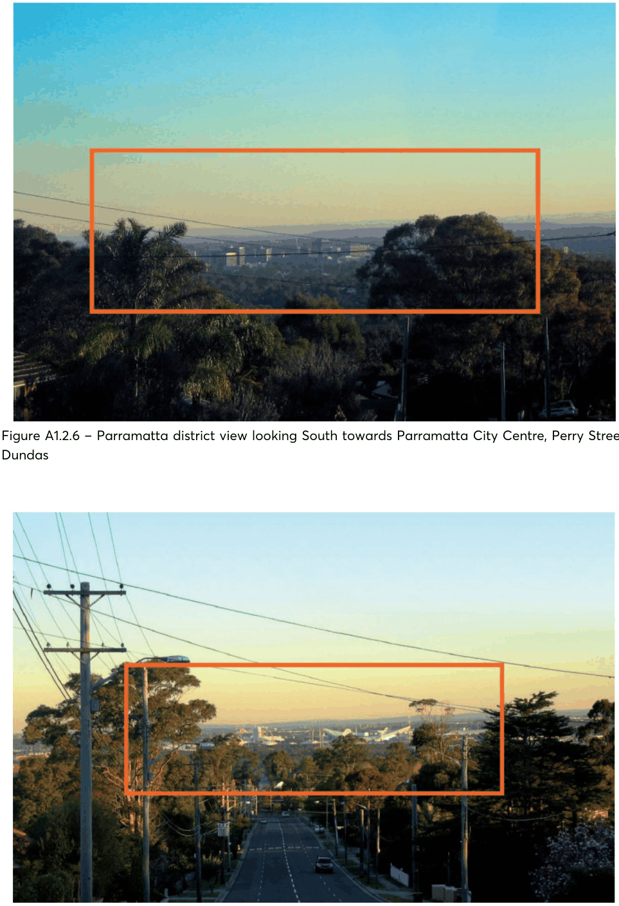
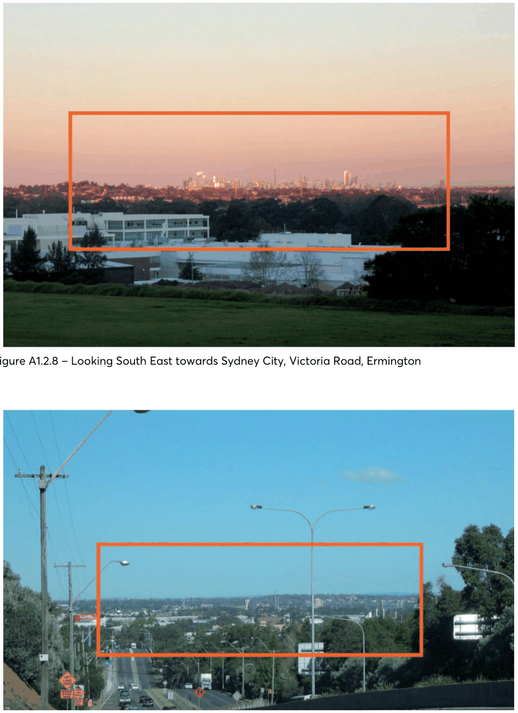
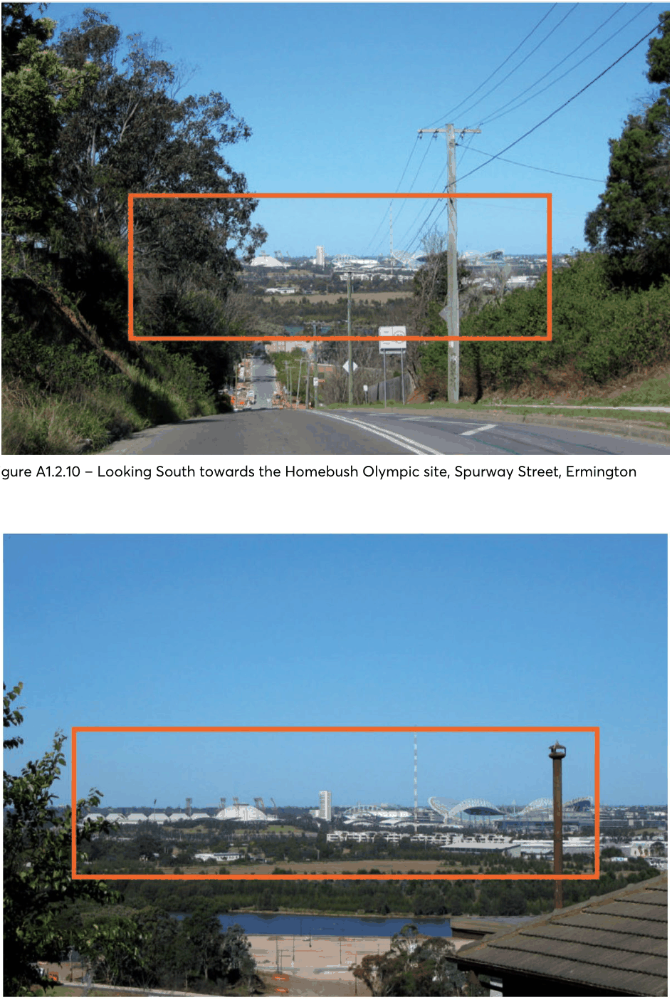
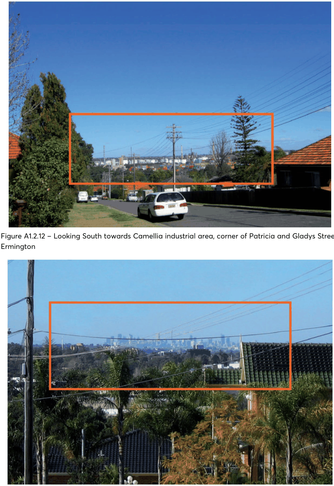
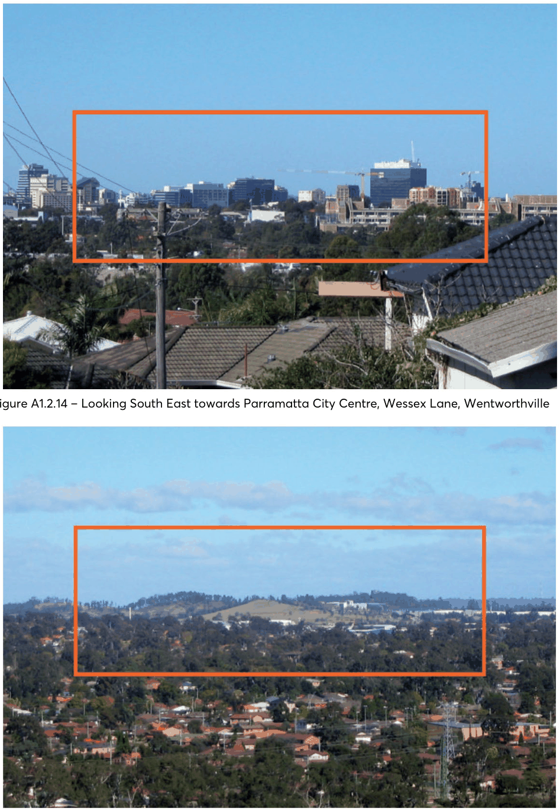
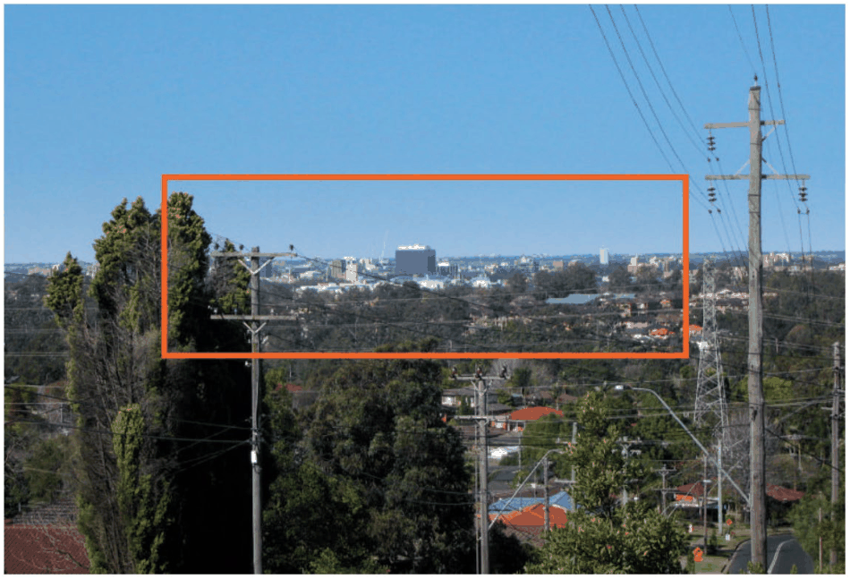

#### A1.2 OTHER SUBURBS

> [Picture on page 8: a picture, saved as a picture (images/part-12-appendices-page-8-2.gif, 150 dpi).]

Figure A1.2.1 – Views and vistas

> [Picture on page 9: a picture, saved as a picture (images/part-12-appendices-page-9-1.gif, 150 dpi).]

Figure A1.2.2 – District view looking South, corner Bettington and Pennant Hills Road, Telopea

Figure A1.2.3 – Panoramic view of Camellia and Rydalmere looking South, corner Adderton and Pennant Hills Road, Telopea

> [Picture on page 10: a picture, saved as a picture (images/part-12-appendices-page-10-1.gif, 150 dpi).]

Figure A1.2.4 – District view looking South West, Eric Mobbs Reserve, Mobbs Hill

Figure A1.2.5 – Looking South West towards Camellia industrial area, Perry Street, Dundas

> [Picture on page 11: a picture, saved as a picture (images/part-12-appendices-page-11-1.gif, 150 dpi).]

Figure A1.2.6 – Parramatta district view looking South towards Parramatta City Centre, Perry Street, Dundas

Figure A1.2.7 – Looking South towards the Homebush Olympic Centre, Marsden Road, Dundas

> [Picture on page 12: a picture, saved as a picture (images/part-12-appendices-page-12-1.gif, 150 dpi).]

Figure A1.2.8 – Looking South East towards Sydney City, Victoria Road, Ermington

Figure A1.2.9 – Looking South towards the Homebush Olympic site, Silverwater Road, Ermington

> [Picture on page 13: a picture, saved as a picture (images/part-12-appendices-page-13-1.gif, 150 dpi).]

Figure A1.2.10 – Looking South towards the Homebush Olympic site, Spurway Street, Ermington

Figure A1.2.11 – Looking South towards the Homebush Olympic site, Coffey Street, Ermington

> [Picture on page 14: a picture, saved as a picture (images/part-12-appendices-page-14-1.gif, 150 dpi).]

Figure A1.2.12 – Looking South towards Camellia industrial area, corner of Patricia and Gladys Street, Ermington

Figure A1.2.13 – Looking South East towards Sydney City, Constitution Road Wentworthville

> [Picture on page 15: a picture, saved as a picture (images/part-12-appendices-page-15-1.gif, 150 dpi).]

Figure A1.2.14 – Looking South East towards Parramatta City Centre, Wessex Lane, Wentworthville

Figure A1.2.15 – Looking South West towards Prospect Hill, Buckleys Road, Winston Hills

> [Picture on page 16: a picture, saved as a picture (images/part-12-appendices-page-16-1.gif, 150 dpi).]

Figure A1.2.16 – Looking South East towards Parramatta City Centre, Buckleys Road, Winston Hills

### APPENDIX 2 WASTE MANAGEMENT
